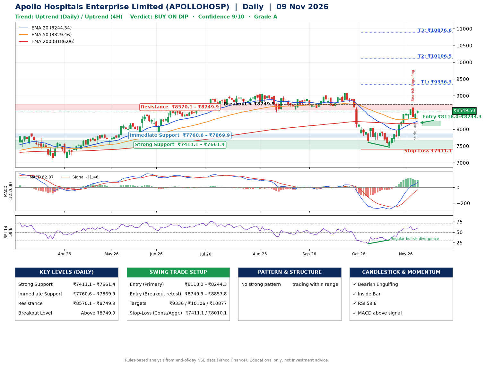

📌 **Apollo Hospitals Enterprise Limited (APOLLOHOSP) – Multi-Timeframe Technical Analysis (Daily + 4H Combined)**
_Data up to 09 Nov 2026 · Close ₹8549.50_

**📍 Daily Timeframe Trend**
- Trend: **Uptrend** (price above rising EMAs)
- Recent swing highs: ₹9024.0, ₹9070.5, ₹8100.0 · swing lows: ₹8672.5, ₹7607.5, ₹7465.0
- EMAs: EMA20 ₹8244.3, EMA50 ₹8329.5, EMA200 ₹8186.1; mixed / crossing; price above EMA20, EMA50, EMA200
- MACD 62.87 above signal -31.46 (above zero); histogram falling
- RSI(14) 59.6; Regular bullish divergence

**📍 4-Hour Timeframe Trend**
- Structure: **Uptrend** (higher highs and higher lows)
- Pullback/support area: recent 4H swing lows ₹7719.0, ₹8255.5; EMA20 ₹8319.8
- EMA20/50: bullish stack (EMA20 > EMA50); price above EMA20, EMA50
- MACD 139.11 above signal 130.73 (above zero); histogram rising
- RSI(14) 64.8; Hidden bullish divergence

**📍 Pattern Detection (Both Timeframes)**
- No strong pattern detected. Trading within range.

**📍 Candlestick Patterns (last 3 daily candles)**
- **Bearish Engulfing** – 05 Nov: sellers fully reversed the prior green candle
- **Inside Bar** – 06 Nov: compression inside the prior range ₹8252.0–₹8696.0

**📍 Price Action Key Levels (Daily Structure)**

| Zone | Price Level (₹) | Context |
|------|-----------------|---------|
| Strong Support | ₹7411.1 – ₹7661.4 | Cluster of earlier swing lows (demand) |
| Immediate Support | ₹7760.6 – ₹7869.9 | Nearest swing-low / wick area |
| Resistance | ₹8570.1 – ₹8749.9 | Nearest swing-high supply |
| Breakout Level | Above ₹8749.9 | Swing continuation trigger (52-week high ₹9070.5) |

**📍 Swing Trade Setup**

🟢 **Entry Zone**
- Primary: ₹8118.0 – ₹8244.3 (daily support / EMA20 area; enter on a bullish 4H candle)
- Alternate: ₹8749.9 – ₹8857.8 (breakout retest)

🎯 **Profit Targets**
- T1: ₹9336.3
- T2: ₹10106.5
- T3: ₹10876.6

🛑 **Stop-Loss**
- Conservative: below daily swing low (₹7411.1)
- Aggressive: below 4H structure (₹8010.1)
- Risk per share ≈ ₹770.1; reward:risk to T1 ≈ 1.5

**📌 Strategy Notes**
- Higher timeframe: daily trend is uptrend; only take longs while price holds above ₹7411.1.
- Entry timing: wait for a bullish 4H candle (engulfing/hammer) inside ₹8118.0 – ₹8244.3 rather than buying mid-range.
- EMA stacking: mixed / crossing; price above EMA20, EMA50, EMA200.
- Breakout rule: a daily close above ₹8749.9 with volume above its 20-day average (≈548,043) opens T2/T3.
- Momentum: RSI 60 – room to run; Regular bullish divergence.
- Exit discipline: move the stop to entry once T1 is hit; book partial profits at each target.

**STEP 2 — Marked Up Chart**

**✅ Trade Validation Checklist**
- Trend + momentum aligned: Yes · Price at entry zone: No
- Stop defined (₹7411.1) · Reward:risk ≥ 1.5 to T1: No

## 📌 Final Verdict

Recommendation: **🟡 BUY ON DIP**

Confidence: **9/10**

Trade Quality: **A**

Reason:
• Daily uptrend (price above rising EMAs)

Next Action:
• Wait for a pullback to ₹8118.0–₹8244.3

_Rules-based analysis from end-of-day data. Educational only, not investment advice. Never place orders without your own confirmation._