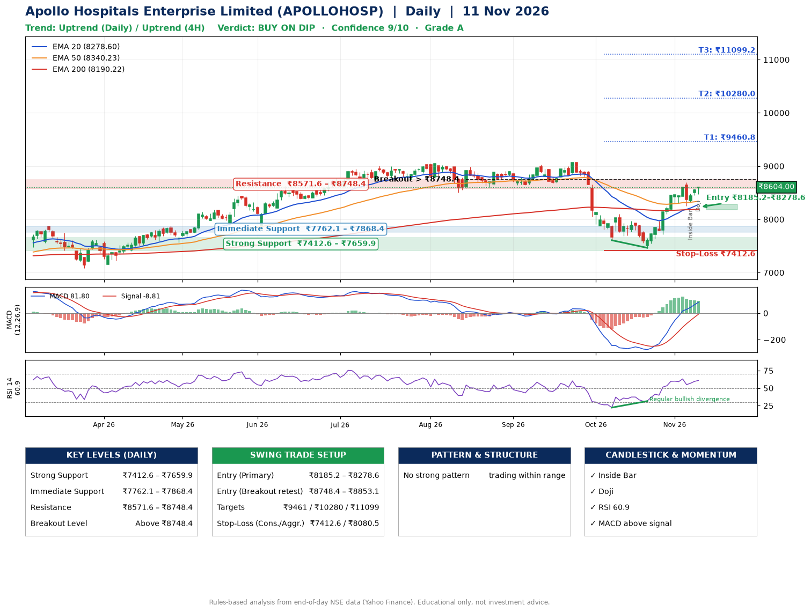

📌 **Apollo Hospitals Enterprise Limited (APOLLOHOSP) – Multi-Timeframe Technical Analysis (Daily + 4H Combined)**
_Data up to 11 Nov 2026 · Close ₹8604.00_

**📍 Daily Timeframe Trend**
- Trend: **Uptrend** (price above rising EMAs)
- Recent swing highs: ₹9024.0, ₹9070.5, ₹8100.0 · swing lows: ₹8672.5, ₹7607.5, ₹7465.0
- EMAs: EMA20 ₹8278.6, EMA50 ₹8340.2, EMA200 ₹8190.2; mixed / crossing; price above EMA20, EMA50, EMA200
- MACD 81.80 above signal -8.81 (above zero); histogram falling
- RSI(14) 60.9; Regular bullish divergence

**📍 4-Hour Timeframe Trend**
- Structure: **Uptrend** (higher highs and higher lows)
- Pullback/support area: recent 4H swing lows ₹7719.0, ₹8255.5; EMA20 ₹8361.6
- EMA20/50: bullish stack (EMA20 > EMA50); price above EMA20, EMA50
- MACD 139.63 above signal 133.19 (above zero); histogram rising
- RSI(14) 65.2; Hidden bullish divergence

**📍 Pattern Detection (Both Timeframes)**
- No strong pattern detected. Trading within range.

**📍 Candlestick Patterns (last 3 daily candles)**
- **Inside Bar** – 06 Nov: compression inside the prior range ₹8252.0–₹8696.0
- **Doji** – 11 Nov: indecision; wait for the next candle to confirm direction

**📍 Price Action Key Levels (Daily Structure)**

| Zone | Price Level (₹) | Context |
|------|-----------------|---------|
| Strong Support | ₹7412.6 – ₹7659.9 | Cluster of earlier swing lows (demand) |
| Immediate Support | ₹7762.1 – ₹7868.4 | Nearest swing-low / wick area |
| Resistance | ₹8571.6 – ₹8748.4 | Nearest swing-high supply |
| Breakout Level | Above ₹8748.4 | Swing continuation trigger (52-week high ₹9070.5) |

**📍 Swing Trade Setup**

🟢 **Entry Zone**
- Primary: ₹8185.2 – ₹8278.6 (daily support / EMA20 area; enter on a bullish 4H candle)
- Alternate: ₹8748.4 – ₹8853.1 (breakout retest)

🎯 **Profit Targets**
- T1: ₹9460.8
- T2: ₹10280.0
- T3: ₹11099.2

🛑 **Stop-Loss**
- Conservative: below daily swing low (₹7412.6)
- Aggressive: below 4H structure (₹8080.5)
- Risk per share ≈ ₹819.2; reward:risk to T1 ≈ 1.5

**📌 Strategy Notes**
- Higher timeframe: daily trend is uptrend; only take longs while price holds above ₹7412.6.
- Entry timing: wait for a bullish 4H candle (engulfing/hammer) inside ₹8185.2 – ₹8278.6 rather than buying mid-range.
- EMA stacking: mixed / crossing; price above EMA20, EMA50, EMA200.
- Breakout rule: a daily close above ₹8748.4 with volume above its 20-day average (≈519,870) opens T2/T3.
- Momentum: RSI 61 – room to run; Regular bullish divergence.
- Exit discipline: move the stop to entry once T1 is hit; book partial profits at each target.

**STEP 2 — Marked Up Chart**

**✅ Trade Validation Checklist**
- Trend + momentum aligned: Yes · Price at entry zone: No
- Stop defined (₹7412.6) · Reward:risk ≥ 1.5 to T1: Yes

## 📌 Final Verdict

Recommendation: **🟡 BUY ON DIP**

Confidence: **9/10**

Trade Quality: **A**

Reason:
• Daily uptrend (price above rising EMAs)

Next Action:
• Wait for a pullback to ₹8185.2–₹8278.6

_Rules-based analysis from end-of-day data. Educational only, not investment advice. Never place orders without your own confirmation._