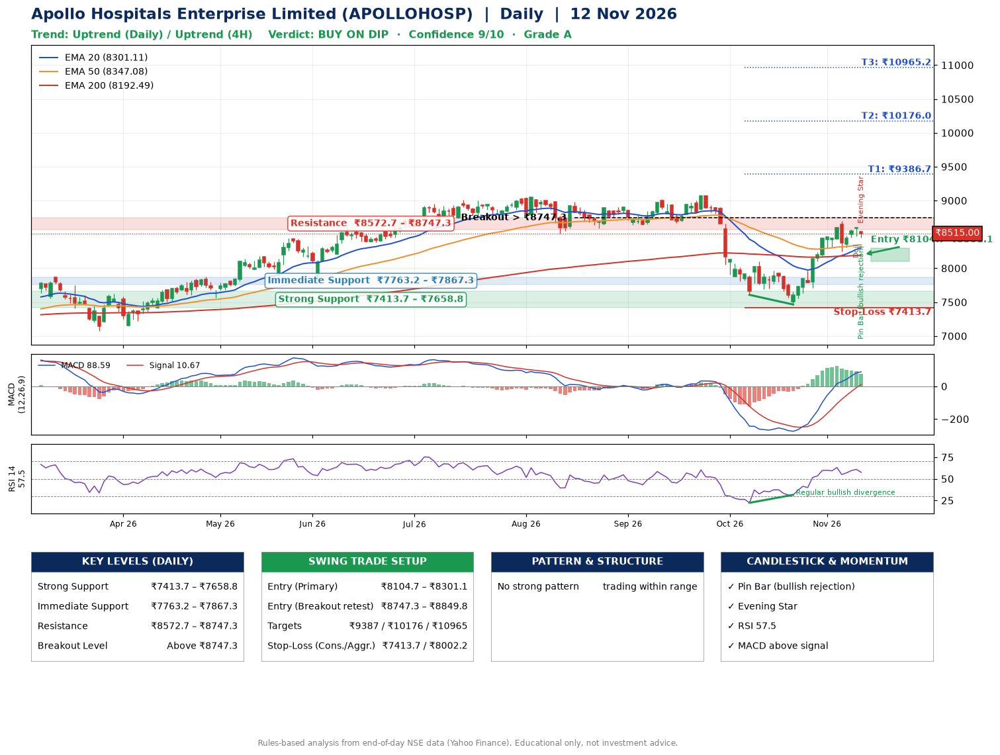

📌 **Apollo Hospitals Enterprise Limited (APOLLOHOSP) – Multi-Timeframe Technical Analysis (Daily + 4H Combined)**
_Data up to 12 Nov 2026 · Close ₹8515.00_

**📍 Daily Timeframe Trend**
- Trend: **Uptrend** (price above rising EMAs)
- Recent swing highs: ₹9024.0, ₹9070.5, ₹8100.0 · swing lows: ₹8672.5, ₹7607.5, ₹7465.0
- EMAs: EMA20 ₹8301.1, EMA50 ₹8347.1, EMA200 ₹8192.5; mixed / crossing; price above EMA20, EMA50, EMA200
- MACD 88.59 above signal 10.67 (above zero); histogram falling
- RSI(14) 57.5; Regular bullish divergence

**📍 4-Hour Timeframe Trend**
- Structure: **Uptrend** (higher highs and higher lows)
- Pullback/support area: recent 4H swing lows ₹7719.0, ₹8255.5; EMA20 ₹8388.1
- EMA20/50: bullish stack (EMA20 > EMA50); price above EMA20, EMA50
- MACD 127.81 below signal 132.11 (above zero), fresh bearish crossover; histogram falling
- RSI(14) 59.6; Hidden bullish divergence

**📍 Pattern Detection (Both Timeframes)**
- No strong pattern detected. Trading within range.

**📍 Candlestick Patterns (last 3 daily candles)**
- **Doji** – 11 Nov: indecision; wait for the next candle to confirm direction
- **Pin Bar (bullish rejection)** – 12 Nov: long lower wick shows dip-buying near ₹8454.5
- **Evening Star** – 12 Nov: three-candle bearish reversal

**📍 Price Action Key Levels (Daily Structure)**

| Zone | Price Level (₹) | Context |
|------|-----------------|---------|
| Strong Support | ₹7413.7 – ₹7658.8 | Cluster of earlier swing lows (demand) |
| Immediate Support | ₹7763.2 – ₹7867.3 | Nearest swing-low / wick area |
| Resistance | ₹8572.7 – ₹8747.3 | Nearest swing-high supply |
| Breakout Level | Above ₹8747.3 | Swing continuation trigger (52-week high ₹9070.5) |

**📍 Swing Trade Setup**

🟢 **Entry Zone**
- Primary: ₹8104.7 – ₹8301.1 (daily support / EMA20 area; enter on a bullish 4H candle)
- Alternate: ₹8747.3 – ₹8849.8 (breakout retest)

🎯 **Profit Targets**
- T1: ₹9386.7
- T2: ₹10176.0
- T3: ₹10965.2

🛑 **Stop-Loss**
- Conservative: below daily swing low (₹7413.7)
- Aggressive: below 4H structure (₹8002.2)
- Risk per share ≈ ₹789.2; reward:risk to T1 ≈ 1.5
- Time to T1: about 40 trading days (it rose this much within 60 trading days 16% of the time in the last 2 years)
- Time to T2: it never rose this much within 60 trading days in the price history

**📌 Strategy Notes**
- Higher timeframe: daily trend is uptrend; only take longs while price holds above ₹7413.7.
- Entry timing: wait for a bullish 4H candle (engulfing/hammer) inside ₹8104.7 – ₹8301.1 rather than buying mid-range.
- EMA stacking: mixed / crossing; price above EMA20, EMA50, EMA200.
- Breakout rule: a daily close above ₹8747.3 with volume above its 20-day average (≈513,651) opens T2/T3.
- Momentum: RSI 58 – room to run; Regular bullish divergence.
- Exit discipline: move the stop to entry once T1 is hit; book partial profits at each target.

**STEP 2 — Marked Up Chart**

**✅ Trade Validation Checklist**
- Trend + momentum aligned: Yes · Price at entry zone: No
- Stop defined (₹7413.7) · Reward:risk ≥ 1.5 to T1: No

## 📌 Final Verdict

Recommendation: **🟡 BUY ON DIP**

Confidence: **9/10**

Trade Quality: **A**

Reason:
• Daily uptrend (price above rising EMAs)

Next Action:
• Wait for a pullback to ₹8104.7–₹8301.1, or a breakout above ₹8747.3

_Rules-based analysis from end-of-day data. Educational only, not investment advice. Never place orders without your own confirmation._