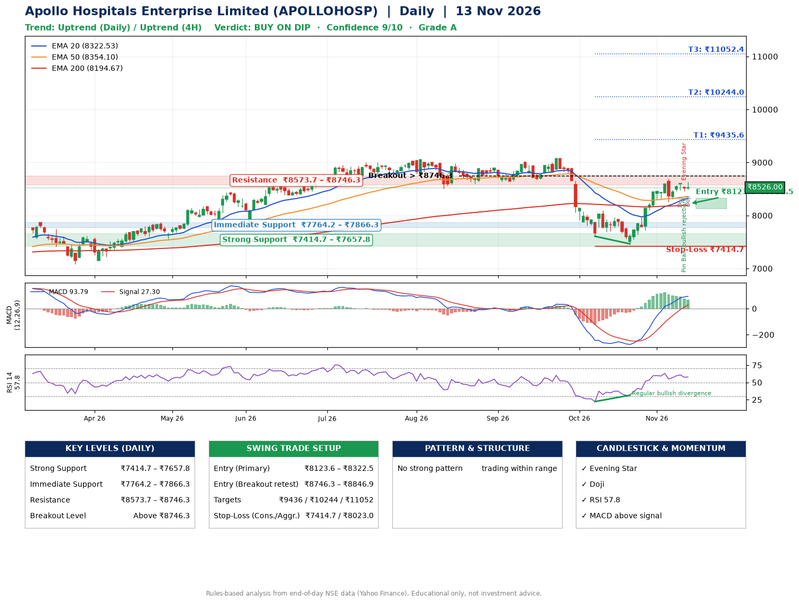

📌 **Apollo Hospitals Enterprise Limited (APOLLOHOSP) – Multi-Timeframe Technical Analysis (Daily + 4H Combined)**
_Data up to 13 Nov 2026 · Close ₹8526.00_

**📍 Daily Timeframe Trend**
- Trend: **Uptrend** (price above rising EMAs)
- Recent swing highs: ₹9070.5, ₹8100.0, ₹8696.0 · swing lows: ₹8672.5, ₹7607.5, ₹7465.0
- EMAs: EMA20 ₹8322.5, EMA50 ₹8354.1, EMA200 ₹8194.7; mixed / crossing; price above EMA20, EMA50, EMA200
- MACD 93.79 above signal 27.30 (above zero); histogram falling
- RSI(14) 57.8; Regular bullish divergence

**📍 4-Hour Timeframe Trend**
- Structure: **Uptrend** (higher highs and higher lows)
- Pullback/support area: recent 4H swing lows ₹8255.5, ₹8455.0; EMA20 ₹8414.2
- EMA20/50: bullish stack (EMA20 > EMA50); price above EMA20, EMA50
- MACD 118.77 below signal 128.17 (above zero), fresh bearish crossover; histogram falling
- RSI(14) 59.7; no divergence

**📍 Pattern Detection (Both Timeframes)**
- No strong pattern detected. Trading within range.

**📍 Candlestick Patterns (last 3 daily candles)**
- **Doji** – 11 Nov: indecision; wait for the next candle to confirm direction
- **Pin Bar (bullish rejection)** – 12 Nov: long lower wick shows dip-buying near ₹8454.5
- **Evening Star** – 12 Nov: three-candle bearish reversal
- **Doji** – 13 Nov: indecision; wait for the next candle to confirm direction

**📍 Price Action Key Levels (Daily Structure)**

| Zone | Price Level (₹) | Context |
|------|-----------------|---------|
| Strong Support | ₹7414.7 – ₹7657.8 | Cluster of earlier swing lows (demand) |
| Immediate Support | ₹7764.2 – ₹7866.3 | Nearest swing-low / wick area |
| Resistance | ₹8573.7 – ₹8746.3 | Nearest swing-high supply |
| Breakout Level | Above ₹8746.3 | Swing continuation trigger (52-week high ₹9070.5) |

**📍 Swing Trade Setup**

🟢 **Entry Zone**
- Primary: ₹8123.6 – ₹8322.5 (daily support / EMA20 area; enter on a bullish 4H candle)
- Alternate: ₹8746.3 – ₹8846.9 (breakout retest)

🎯 **Profit Targets**
- T1: ₹9435.6
- T2: ₹10244.0
- T3: ₹11052.4

🛑 **Stop-Loss**
- Conservative: below daily swing low (₹7414.7)
- Aggressive: below 4H structure (₹8023.0)
- Risk per share ≈ ₹808.4; reward:risk to T1 ≈ 1.5
- Time to T1: about 42 trading days (it rose this much within 60 trading days 15% of the time in the last 2 years)
- Time to T2: it never rose this much within 60 trading days in the price history

**📌 Strategy Notes**
- Higher timeframe: daily trend is uptrend; only take longs while price holds above ₹7414.7.
- Entry timing: wait for a bullish 4H candle (engulfing/hammer) inside ₹8123.6 – ₹8322.5 rather than buying mid-range.
- EMA stacking: mixed / crossing; price above EMA20, EMA50, EMA200.
- Breakout rule: a daily close above ₹8746.3 with volume above its 20-day average (≈514,116) opens T2/T3.
- Momentum: RSI 58 – room to run; Regular bullish divergence.
- Exit discipline: move the stop to entry once T1 is hit; book partial profits at each target.

**STEP 2 — Marked Up Chart**

**✅ Trade Validation Checklist**
- Trend + momentum aligned: Yes · Price at entry zone: No
- Stop defined (₹7414.7) · Reward:risk ≥ 1.5 to T1: No

## 📌 Final Verdict

Recommendation: **🟡 BUY ON DIP**

Confidence: **9/10**

Trade Quality: **A**

Reason:
• Daily uptrend (price above rising EMAs)

Next Action:
• Wait for a pullback to ₹8123.6–₹8322.5, or a breakout above ₹8746.3

_Rules-based analysis from end-of-day data. Educational only, not investment advice. Never place orders without your own confirmation._