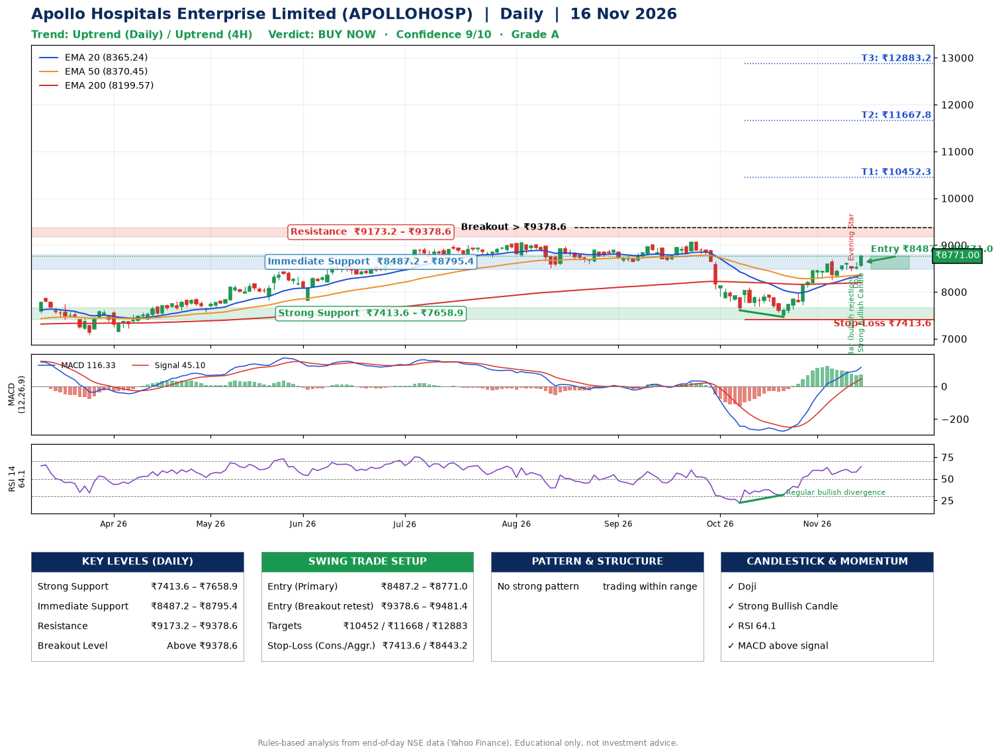

📌 **Apollo Hospitals Enterprise Limited (APOLLOHOSP) – Multi-Timeframe Technical Analysis (Daily + 4H Combined)**
_Data up to 16 Nov 2026 · Close ₹8771.00_

**📍 Daily Timeframe Trend**
- Trend: **Uptrend** (price above rising EMAs)
- Recent swing highs: ₹9070.5, ₹8100.0, ₹8696.0 · swing lows: ₹8672.5, ₹7607.5, ₹7465.0
- EMAs: EMA20 ₹8365.2, EMA50 ₹8370.4, EMA200 ₹8199.6; mixed / crossing; price above EMA20, EMA50, EMA200
- MACD 116.33 above signal 45.10 (above zero); histogram rising
- RSI(14) 64.1; Regular bullish divergence

**📍 4-Hour Timeframe Trend**
- Structure: **Uptrend** (higher highs and higher lows)
- Pullback/support area: recent 4H swing lows ₹8255.5, ₹8455.0; EMA20 ₹8525.1
- EMA20/50: bullish stack (EMA20 > EMA50); price above EMA20, EMA50
- MACD 145.91 above signal 136.44 (above zero), fresh bullish crossover; histogram falling
- RSI(14) 63.9; no divergence

**📍 Pattern Detection (Both Timeframes)**
- No strong pattern detected. Trading within range.

**📍 Candlestick Patterns (last 3 daily candles)**
- **Pin Bar (bullish rejection)** – 12 Nov: long lower wick shows dip-buying near ₹8454.5
- **Evening Star** – 12 Nov: three-candle bearish reversal
- **Doji** – 13 Nov: indecision; wait for the next candle to confirm direction
- **Strong Bullish Candle** – 16 Nov: wide-range green candle, buyers in control

**📍 Price Action Key Levels (Daily Structure)**

| Zone | Price Level (₹) | Context |
|------|-----------------|---------|
| Strong Support | ₹7413.6 – ₹7658.9 | Cluster of earlier swing lows (demand) |
| Immediate Support | ₹8487.2 – ₹8795.4 | Nearest swing-low / wick area |
| Resistance | ₹9173.2 – ₹9378.6 | Nearest swing-high supply |
| Breakout Level | Above ₹9378.6 | Swing continuation trigger (52-week high ₹9070.5) |

**📍 Swing Trade Setup**

🟢 **Entry Zone**
- Primary: ₹8487.2 – ₹8771.0 (daily support / EMA20 area; enter on a bullish 4H candle)
- Alternate: ₹9378.6 – ₹9481.4 (breakout retest)

🎯 **Profit Targets**
- T1: ₹10452.3
- T2: ₹11667.8
- T3: ₹12883.2

🛑 **Stop-Loss**
- Conservative: below daily swing low (₹7413.6)
- Aggressive: below 4H structure (₹8443.2)
- Risk per share ≈ ₹1215.5; reward:risk to T1 ≈ 1.5
- Time to T1: about 59 trading days (it rose this much within 60 trading days 0% of the time in the last 2 years)
- Time to T2: it never rose this much within 60 trading days in the price history

**📌 Strategy Notes**
- Higher timeframe: daily trend is uptrend; only take longs while price holds above ₹7413.6.
- Entry timing: wait for a bullish 4H candle (engulfing/hammer) inside ₹8487.2 – ₹8771.0 rather than buying mid-range.
- EMA stacking: mixed / crossing; price above EMA20, EMA50, EMA200.
- Breakout rule: a daily close above ₹9378.6 with volume above its 20-day average (≈522,415) opens T2/T3.
- Momentum: RSI 64 – room to run; Regular bullish divergence.
- Exit discipline: move the stop to entry once T1 is hit; book partial profits at each target.

**STEP 2 — Marked Up Chart**

**✅ Trade Validation Checklist**
- Trend + momentum aligned: Yes · Price at entry zone: Yes
- Stop defined (₹7413.6) · Reward:risk ≥ 1.5 to T1: No

## 📌 Final Verdict

Recommendation: **🟢 BUY NOW**

Confidence: **9/10**

Trade Quality: **A**

Reason:
• Daily uptrend (price above rising EMAs)

Next Action:
• Buy now within the entry zone, with the stop-loss in place

_Rules-based analysis from end-of-day data. Educational only, not investment advice. Never place orders without your own confirmation._