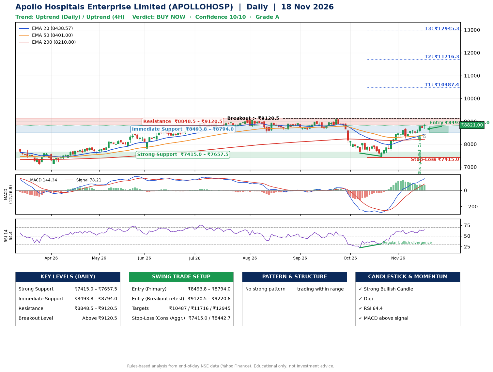

📌 **Apollo Hospitals Enterprise Limited (APOLLOHOSP) – Multi-Timeframe Technical Analysis (Daily + 4H Combined)**
_Data up to 18 Nov 2026 · Close ₹8821.00_

**📍 Daily Timeframe Trend**
- Trend: **Uptrend** (price above rising EMAs)
- Recent swing highs: ₹9070.5, ₹8100.0, ₹8696.0 · swing lows: ₹8672.5, ₹7607.5, ₹7465.0
- EMAs: EMA20 ₹8438.6, EMA50 ₹8401.0, EMA200 ₹8210.8; bullish stack (EMA20 > EMA50 > EMA200); price above EMA20, EMA50, EMA200
- MACD 144.34 above signal 78.21 (above zero); histogram falling
- RSI(14) 64.4; Regular bullish divergence

**📍 4-Hour Timeframe Trend**
- Structure: **Uptrend** (higher highs and higher lows)
- Pullback/support area: recent 4H swing lows ₹8255.5, ₹8455.0; EMA20 ₹8570.6
- EMA20/50: bullish stack (EMA20 > EMA50); price above EMA20, EMA50
- MACD 148.44 above signal 140.05 (above zero); histogram rising
- RSI(14) 68.0; no divergence

**📍 Pattern Detection (Both Timeframes)**
- No strong pattern detected. Trading within range.

**📍 Candlestick Patterns (last 3 daily candles)**
- **Strong Bullish Candle** – 16 Nov: wide-range green candle, buyers in control
- **Doji** – 18 Nov: indecision; wait for the next candle to confirm direction

**📍 Price Action Key Levels (Daily Structure)**

| Zone | Price Level (₹) | Context |
|------|-----------------|---------|
| Strong Support | ₹7415.0 – ₹7657.5 | Cluster of earlier swing lows (demand) |
| Immediate Support | ₹8493.8 – ₹8794.0 | Nearest swing-low / wick area |
| Resistance | ₹8848.5 – ₹9120.5 | Nearest swing-high supply |
| Breakout Level | Above ₹9120.5 | Swing continuation trigger (52-week high ₹9070.5) |

**📍 Swing Trade Setup**

🟢 **Entry Zone**
- Primary: ₹8493.8 – ₹8794.0 (daily support / EMA20 area; enter on a bullish 4H candle)
- Alternate: ₹9120.5 – ₹9220.6 (breakout retest)

🎯 **Profit Targets**
- T1: ₹10487.4
- T2: ₹11716.3
- T3: ₹12945.3

🛑 **Stop-Loss**
- Conservative: below daily swing low (₹7415.0)
- Aggressive: below 4H structure (₹8442.7)
- Risk per share ≈ ₹1229.0; reward:risk to T1 ≈ 1.5
- Time to T1: about 59 trading days (it rose this much within 60 trading days 0% of the time in the last 2 years)
- Time to T2: it never rose this much within 60 trading days in the price history

**📌 Strategy Notes**
- Higher timeframe: daily trend is uptrend; only take longs while price holds above ₹7415.0.
- Entry timing: wait for a bullish 4H candle (engulfing/hammer) inside ₹8493.8 – ₹8794.0 rather than buying mid-range.
- EMA stacking: bullish stack (EMA20 > EMA50 > EMA200); price above EMA20, EMA50, EMA200.
- Breakout rule: a daily close above ₹9120.5 with volume above its 20-day average (≈523,883) opens T2/T3.
- Momentum: RSI 64 – room to run; Regular bullish divergence.
- Exit discipline: move the stop to entry once T1 is hit; book partial profits at each target.

**STEP 2 — Marked Up Chart**

**✅ Trade Validation Checklist**
- Trend + momentum aligned: Yes · Price at entry zone: No
- Stop defined (₹7415.0) · Reward:risk ≥ 1.5 to T1: Yes

## 📌 Final Verdict

Recommendation: **🟢 BUY NOW**

Confidence: **10/10**

Trade Quality: **A**

Reason:
• Daily uptrend (price above rising EMAs)
• EMAs stacked bullishly

Next Action:
• Buy now within the entry zone, with the stop-loss in place

_Rules-based analysis from end-of-day data. Educational only, not investment advice. Never place orders without your own confirmation._