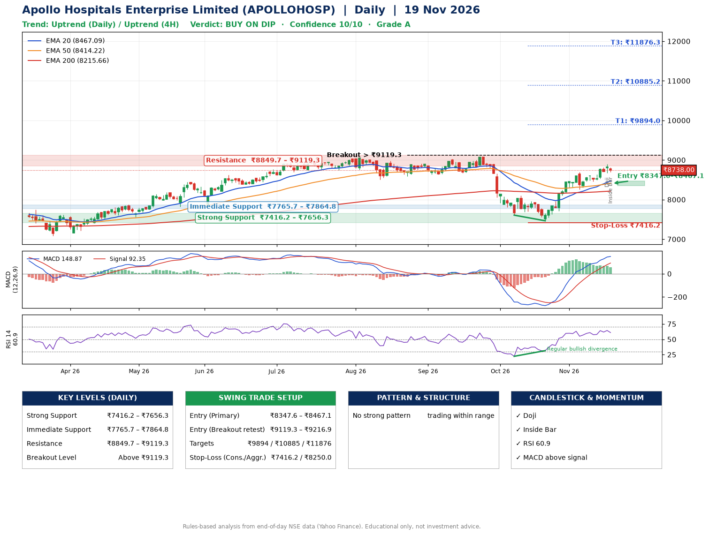

📌 **Apollo Hospitals Enterprise Limited (APOLLOHOSP) – Multi-Timeframe Technical Analysis (Daily + 4H Combined)**
_Data up to 19 Nov 2026 · Close ₹8738.00_

**📍 Daily Timeframe Trend**
- Trend: **Uptrend** (price above rising EMAs)
- Recent swing highs: ₹9070.5, ₹8100.0, ₹8696.0 · swing lows: ₹8672.5, ₹7607.5, ₹7465.0
- EMAs: EMA20 ₹8467.1, EMA50 ₹8414.2, EMA200 ₹8215.7; bullish stack (EMA20 > EMA50 > EMA200); price above EMA20, EMA50, EMA200
- MACD 148.87 above signal 92.35 (above zero); histogram falling
- RSI(14) 60.9; Regular bullish divergence

**📍 4-Hour Timeframe Trend**
- Structure: **Uptrend** (higher highs and higher lows)
- Pullback/support area: recent 4H swing lows ₹8455.0, ₹8675.0; EMA20 ₹8600.6
- EMA20/50: bullish stack (EMA20 > EMA50); price above EMA20, EMA50
- MACD 137.96 below signal 140.15 (above zero), fresh bearish crossover; histogram falling
- RSI(14) 62.0; no divergence

**📍 Pattern Detection (Both Timeframes)**
- 4H: **Double Top** – tops near ₹8649.5/₹8897.0, neckline ₹8255.5, forming

**📍 Candlestick Patterns (last 3 daily candles)**
- **Doji** – 18 Nov: indecision; wait for the next candle to confirm direction
- **Inside Bar** – 19 Nov: compression inside the prior range ₹8675.0–₹8898.5

**📍 Price Action Key Levels (Daily Structure)**

| Zone | Price Level (₹) | Context |
|------|-----------------|---------|
| Strong Support | ₹7416.2 – ₹7656.3 | Cluster of earlier swing lows (demand) |
| Immediate Support | ₹7765.7 – ₹7864.8 | Nearest swing-low / wick area |
| Resistance | ₹8849.7 – ₹9119.3 | Nearest swing-high supply |
| Breakout Level | Above ₹9119.3 | Swing continuation trigger (52-week high ₹9070.5) |

**📍 Swing Trade Setup**

🟢 **Entry Zone**
- Primary: ₹8347.6 – ₹8467.1 (daily support / EMA20 area; enter on a bullish 4H candle)
- Alternate: ₹9119.3 – ₹9216.9 (breakout retest)

🎯 **Profit Targets**
- T1: ₹9894.0
- T2: ₹10885.2
- T3: ₹11876.3

🛑 **Stop-Loss**
- Conservative: below daily swing low (₹7416.2)
- Aggressive: below 4H structure (₹8250.0)
- Risk per share ≈ ₹991.1; reward:risk to T1 ≈ 1.5
- Time to T1: about 48 trading days (it rose this much within 60 trading days 4% of the time in the last 2 years)
- Time to T2: it never rose this much within 60 trading days in the price history

**📌 Strategy Notes**
- Higher timeframe: daily trend is uptrend; only take longs while price holds above ₹7416.2.
- Entry timing: wait for a bullish 4H candle (engulfing/hammer) inside ₹8347.6 – ₹8467.1 rather than buying mid-range.
- EMA stacking: bullish stack (EMA20 > EMA50 > EMA200); price above EMA20, EMA50, EMA200.
- Breakout rule: a daily close above ₹9119.3 with volume above its 20-day average (≈526,433) opens T2/T3.
- Momentum: RSI 61 – room to run; Regular bullish divergence.
- Exit discipline: move the stop to entry once T1 is hit; book partial profits at each target.

**STEP 2 — Marked Up Chart**

**✅ Trade Validation Checklist**
- Trend + momentum aligned: Yes · Price at entry zone: No
- Stop defined (₹7416.2) · Reward:risk ≥ 1.5 to T1: No

## 📌 Final Verdict

Recommendation: **🟡 BUY ON DIP**

Confidence: **10/10**

Trade Quality: **A**

Reason:
• Daily uptrend (price above rising EMAs)
• EMAs stacked bullishly

Next Action:
• Wait for a pullback to ₹8347.6–₹8467.1

_Rules-based analysis from end-of-day data. Educational only, not investment advice. Never place orders without your own confirmation._