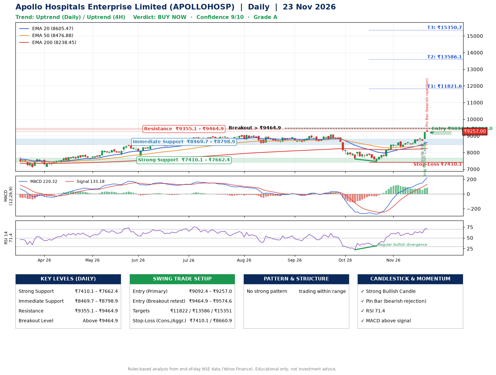

📌 **Apollo Hospitals Enterprise Limited (APOLLOHOSP) – Multi-Timeframe Technical Analysis (Daily + 4H Combined)**
_Data up to 23 Nov 2026 · Close ₹9257.00_

**📍 Daily Timeframe Trend**
- Trend: **Uptrend** (price above rising EMAs)
- Recent swing highs: ₹9070.5, ₹8100.0, ₹8696.0 · swing lows: ₹8672.5, ₹7607.5, ₹7465.0
- EMAs: EMA20 ₹8605.5, EMA50 ₹8476.9, EMA200 ₹8238.5; bullish stack (EMA20 > EMA50 > EMA200); price above EMA20, EMA50, EMA200
- MACD 220.32 above signal 133.18 (above zero); histogram rising
- RSI(14) 71.4; Regular bullish divergence

**📍 4-Hour Timeframe Trend**
- Structure: **Uptrend** (higher highs and higher lows)
- Pullback/support area: recent 4H swing lows ₹8455.0, ₹8675.0; EMA20 ₹8812.0
- EMA20/50: bullish stack (EMA20 > EMA50); price above EMA20, EMA50
- MACD 226.49 above signal 179.29 (above zero), fresh bullish crossover; histogram rising
- RSI(14) 74.8; no divergence

**📍 Pattern Detection (Both Timeframes)**
- No strong pattern detected. Trading within range.

**📍 Candlestick Patterns (last 3 daily candles)**
- **Inside Bar** – 19 Nov: compression inside the prior range ₹8675.0–₹8898.5
- **Strong Bullish Candle** – 20 Nov: wide-range green candle, buyers in control
- **Pin Bar (bearish rejection)** – 23 Nov: long upper wick shows selling near ₹9410.0

**📍 Price Action Key Levels (Daily Structure)**

| Zone | Price Level (₹) | Context |
|------|-----------------|---------|
| Strong Support | ₹7410.1 – ₹7662.4 | Cluster of earlier swing lows (demand) |
| Immediate Support | ₹8469.7 – ₹8798.9 | Nearest swing-low / wick area |
| Resistance | ₹9355.1 – ₹9464.9 | Nearest swing-high supply |
| Breakout Level | Above ₹9464.9 | Swing continuation trigger (52-week high ₹9410.0) |

**📍 Swing Trade Setup**

🟢 **Entry Zone**
- Primary: ₹9092.4 – ₹9257.0 (daily support / EMA20 area; enter on a bullish 4H candle)
- Alternate: ₹9464.9 – ₹9574.6 (breakout retest)

🎯 **Profit Targets**
- T1: ₹11821.6
- T2: ₹13586.1
- T3: ₹15350.7

🛑 **Stop-Loss**
- Conservative: below daily swing low (₹7410.1)
- Aggressive: below 4H structure (₹8660.9)
- Risk per share ≈ ₹1764.6; reward:risk to T1 ≈ 1.5
- Time to T1: it never rose this much within 60 trading days in the price history
- Time to T2: it never rose this much within 60 trading days in the price history

**📌 Strategy Notes**
- Higher timeframe: daily trend is uptrend; only take longs while price holds above ₹7410.1.
- Entry timing: wait for a bullish 4H candle (engulfing/hammer) inside ₹9092.4 – ₹9257.0 rather than buying mid-range.
- EMA stacking: bullish stack (EMA20 > EMA50 > EMA200); price above EMA20, EMA50, EMA200.
- Breakout rule: a daily close above ₹9464.9 with volume above its 20-day average (≈572,556) opens T2/T3.
- Momentum: RSI 71 – elevated, prefer dips; Regular bullish divergence.
- Exit discipline: move the stop to entry once T1 is hit; book partial profits at each target.

**STEP 2 — Marked Up Chart**

**✅ Trade Validation Checklist**
- Trend + momentum aligned: Yes · Price at entry zone: Yes
- Stop defined (₹7410.1) · Reward:risk ≥ 1.5 to T1: Yes

## 📌 Final Verdict

Recommendation: **🟢 BUY NOW**

Confidence: **9/10**

Trade Quality: **A**

Reason:
• Daily uptrend (price above rising EMAs)
• EMAs stacked bullishly

Next Action:
• Buy now within the entry zone, with the stop-loss in place

_Rules-based analysis from end-of-day data. Educational only, not investment advice. Never place orders without your own confirmation._