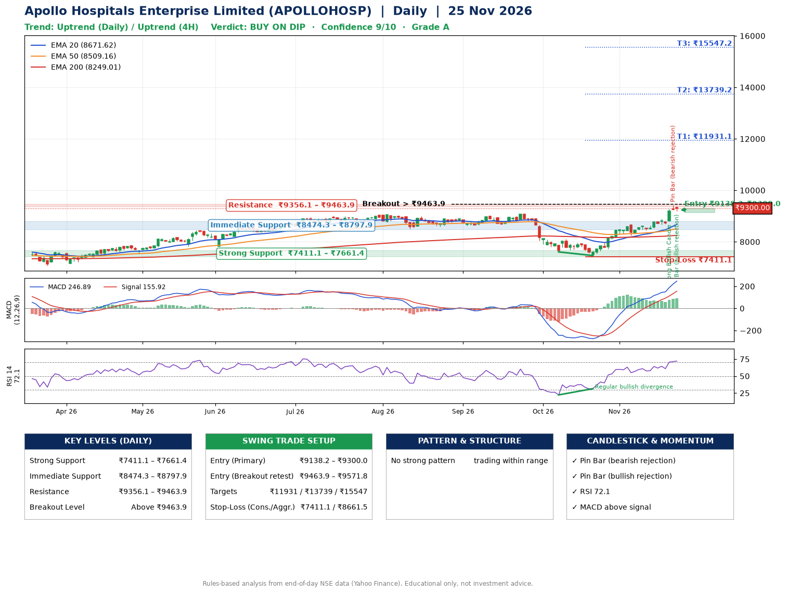

📌 **Apollo Hospitals Enterprise Limited (APOLLOHOSP) – Multi-Timeframe Technical Analysis (Daily + 4H Combined)**
_Data up to 25 Nov 2026 · Close ₹9300.00_

**📍 Daily Timeframe Trend**
- Trend: **Uptrend** (price above rising EMAs)
- Recent swing highs: ₹9070.5, ₹8100.0, ₹8696.0 · swing lows: ₹8672.5, ₹7607.5, ₹7465.0
- EMAs: EMA20 ₹8671.6, EMA50 ₹8509.2, EMA200 ₹8249.0; bullish stack (EMA20 > EMA50 > EMA200); price above EMA20, EMA50, EMA200
- MACD 246.89 above signal 155.92 (above zero); histogram rising
- RSI(14) 72.1; Regular bullish divergence

**📍 4-Hour Timeframe Trend**
- Structure: **Uptrend** (higher highs and higher lows)
- Pullback/support area: recent 4H swing lows ₹8455.0, ₹8675.0; EMA20 ₹8900.3
- EMA20/50: bullish stack (EMA20 > EMA50); price above EMA20, EMA50
- MACD 242.73 above signal 201.21 (above zero); histogram falling
- RSI(14) 75.8; no divergence

**📍 Pattern Detection (Both Timeframes)**
- No strong pattern detected. Trading within range.

**📍 Candlestick Patterns (last 3 daily candles)**
- **Strong Bullish Candle** – 20 Nov: wide-range green candle, buyers in control
- **Pin Bar (bearish rejection)** – 23 Nov: long upper wick shows selling near ₹9410.0
- **Pin Bar (bullish rejection)** – 25 Nov: long lower wick shows dip-buying near ₹9186.0

**📍 Price Action Key Levels (Daily Structure)**

| Zone | Price Level (₹) | Context |
|------|-----------------|---------|
| Strong Support | ₹7411.1 – ₹7661.4 | Cluster of earlier swing lows (demand) |
| Immediate Support | ₹8474.3 – ₹8797.9 | Nearest swing-low / wick area |
| Resistance | ₹9356.1 – ₹9463.9 | Nearest swing-high supply |
| Breakout Level | Above ₹9463.9 | Swing continuation trigger (52-week high ₹9410.0) |

**📍 Swing Trade Setup**

🟢 **Entry Zone**
- Primary: ₹9138.2 – ₹9300.0 (daily support / EMA20 area; enter on a bullish 4H candle)
- Alternate: ₹9463.9 – ₹9571.8 (breakout retest)

🎯 **Profit Targets**
- T1: ₹11931.1
- T2: ₹13739.2
- T3: ₹15547.2

🛑 **Stop-Loss**
- Conservative: below daily swing low (₹7411.1)
- Aggressive: below 4H structure (₹8661.5)
- Risk per share ≈ ₹1808.0; reward:risk to T1 ≈ 1.5
- Time to T1: it never rose this much within 60 trading days in the price history
- Time to T2: it never rose this much within 60 trading days in the price history

**📌 Strategy Notes**
- Higher timeframe: daily trend is uptrend; only take longs while price holds above ₹7411.1.
- Entry timing: wait for a bullish 4H candle (engulfing/hammer) inside ₹9138.2 – ₹9300.0 rather than buying mid-range.
- EMA stacking: bullish stack (EMA20 > EMA50 > EMA200); price above EMA20, EMA50, EMA200.
- Breakout rule: a daily close above ₹9463.9 with volume above its 20-day average (≈601,102) opens T2/T3.
- Momentum: RSI 72 – elevated, prefer dips; Regular bullish divergence.
- Exit discipline: move the stop to entry once T1 is hit; book partial profits at each target.

**STEP 2 — Marked Up Chart**

**✅ Trade Validation Checklist**
- Trend + momentum aligned: Yes · Price at entry zone: Yes
- Stop defined (₹7411.1) · Reward:risk ≥ 1.5 to T1: No

## 📌 Final Verdict

Recommendation: **🟡 BUY ON DIP**

Confidence: **9/10**

Trade Quality: **A**

Reason:
• Daily uptrend (price above rising EMAs)
• EMAs stacked bullishly

Next Action:
• Wait for a pullback to ₹9138.2–₹9300.0, or a breakout above ₹9463.9

_Rules-based analysis from end-of-day data. Educational only, not investment advice. Never place orders without your own confirmation._