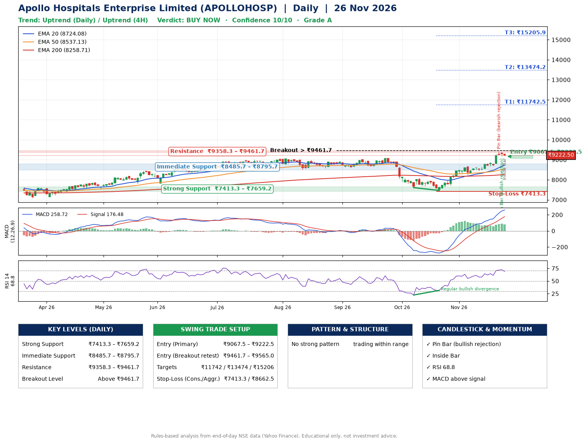

📌 **Apollo Hospitals Enterprise Limited (APOLLOHOSP) – Multi-Timeframe Technical Analysis (Daily + 4H Combined)**
_Data up to 26 Nov 2026 · Close ₹9222.50_

**📍 Daily Timeframe Trend**
- Trend: **Uptrend** (price above rising EMAs)
- Recent swing highs: ₹9070.5, ₹8100.0, ₹8696.0 · swing lows: ₹8672.5, ₹7607.5, ₹7465.0
- EMAs: EMA20 ₹8724.1, EMA50 ₹8537.1, EMA200 ₹8258.7; bullish stack (EMA20 > EMA50 > EMA200); price above EMA20, EMA50, EMA200
- MACD 258.72 above signal 176.48 (above zero); histogram falling
- RSI(14) 68.8; Regular bullish divergence

**📍 4-Hour Timeframe Trend**
- Structure: **Uptrend** (higher highs and higher lows)
- Pullback/support area: recent 4H swing lows ₹8455.0, ₹8675.0; EMA20 ₹8959.5
- EMA20/50: bullish stack (EMA20 > EMA50); price above EMA20, EMA50
- MACD 232.64 above signal 213.53 (above zero); histogram falling
- RSI(14) 70.1; no divergence

**📍 Pattern Detection (Both Timeframes)**
- No strong pattern detected. Trading within range.

**📍 Candlestick Patterns (last 3 daily candles)**
- **Pin Bar (bearish rejection)** – 23 Nov: long upper wick shows selling near ₹9410.0
- **Pin Bar (bullish rejection)** – 25 Nov: long lower wick shows dip-buying near ₹9186.0
- **Inside Bar** – 26 Nov: compression inside the prior range ₹9186.0–₹9354.0

**📍 Price Action Key Levels (Daily Structure)**

| Zone | Price Level (₹) | Context |
|------|-----------------|---------|
| Strong Support | ₹7413.3 – ₹7659.2 | Cluster of earlier swing lows (demand) |
| Immediate Support | ₹8485.7 – ₹8795.7 | Nearest swing-low / wick area |
| Resistance | ₹9358.3 – ₹9461.7 | Nearest swing-high supply |
| Breakout Level | Above ₹9461.7 | Swing continuation trigger (52-week high ₹9410.0) |

**📍 Swing Trade Setup**

🟢 **Entry Zone**
- Primary: ₹9067.5 – ₹9222.5 (daily support / EMA20 area; enter on a bullish 4H candle)
- Alternate: ₹9461.7 – ₹9565.0 (breakout retest)

🎯 **Profit Targets**
- T1: ₹11742.5
- T2: ₹13474.2
- T3: ₹15205.9

🛑 **Stop-Loss**
- Conservative: below daily swing low (₹7413.3)
- Aggressive: below 4H structure (₹8662.5)
- Risk per share ≈ ₹1731.7; reward:risk to T1 ≈ 1.5
- Time to T1: it never rose this much within 60 trading days in the price history
- Time to T2: it never rose this much within 60 trading days in the price history

**📌 Strategy Notes**
- Higher timeframe: daily trend is uptrend; only take longs while price holds above ₹7413.3.
- Entry timing: wait for a bullish 4H candle (engulfing/hammer) inside ₹9067.5 – ₹9222.5 rather than buying mid-range.
- EMA stacking: bullish stack (EMA20 > EMA50 > EMA200); price above EMA20, EMA50, EMA200.
- Breakout rule: a daily close above ₹9461.7 with volume above its 20-day average (≈584,665) opens T2/T3.
- Momentum: RSI 69 – elevated, prefer dips; Regular bullish divergence.
- Exit discipline: move the stop to entry once T1 is hit; book partial profits at each target.

**STEP 2 — Marked Up Chart**

**✅ Trade Validation Checklist**
- Trend + momentum aligned: Yes · Price at entry zone: Yes
- Stop defined (₹7413.3) · Reward:risk ≥ 1.5 to T1: No

## 📌 Final Verdict

Recommendation: **🟢 BUY NOW**

Confidence: **10/10**

Trade Quality: **A**

Reason:
• Daily uptrend (price above rising EMAs)
• EMAs stacked bullishly

Next Action:
• Buy now within the entry zone, with the stop-loss in place

_Rules-based analysis from end-of-day data. Educational only, not investment advice. Never place orders without your own confirmation._