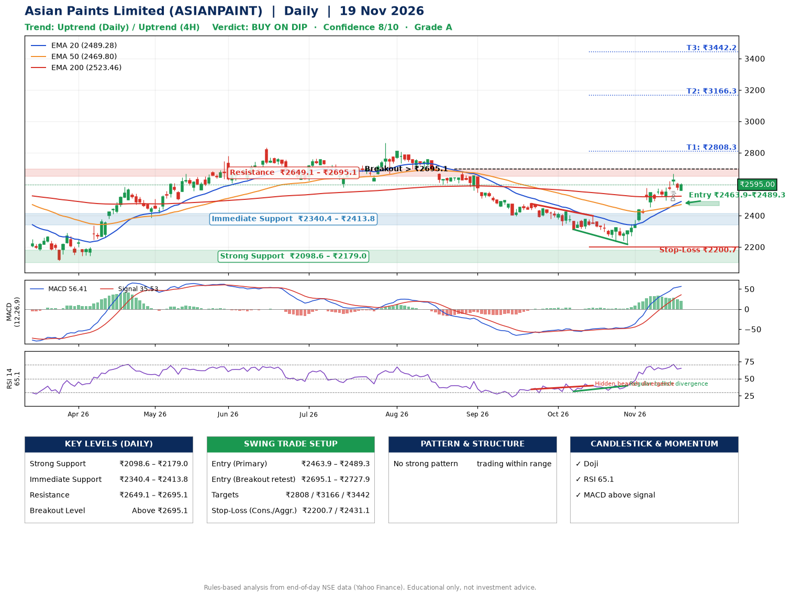

📌 **Asian Paints Limited (ASIANPAINT) – Multi-Timeframe Technical Analysis (Daily + 4H Combined)**
_Data up to 19 Nov 2026 · Close ₹2595.00_

**📍 Daily Timeframe Trend**
- Trend: **Uptrend** (price above rising EMAs)
- Recent swing highs: ₹2678.7, ₹2475.1, ₹2398.4 · swing lows: ₹2397.4, ₹2311.6, ₹2217.1
- EMAs: EMA20 ₹2489.3, EMA50 ₹2469.8, EMA200 ₹2523.5; mixed / crossing; price above EMA20, EMA50, EMA200
- MACD 56.41 above signal 35.53 (above zero); histogram falling
- RSI(14) 65.1; Regular bullish divergence; Hidden bearish divergence

**📍 4-Hour Timeframe Trend**
- Structure: **Uptrend** (higher highs and higher lows)
- Pullback/support area: recent 4H swing lows ₹2220.0, ₹2495.2; EMA20 ₹2541.1
- EMA20/50: bullish stack (EMA20 > EMA50); price above EMA20, EMA50
- MACD 51.99 below signal 54.20 (above zero), fresh bearish crossover; histogram falling
- RSI(14) 61.1; no divergence

**📍 Pattern Detection (Both Timeframes)**
- No strong pattern detected. Trading within range.

**📍 Candlestick Patterns (last 3 daily candles)**
- **Doji** – 17 Nov: indecision; wait for the next candle to confirm direction

**📍 Price Action Key Levels (Daily Structure)**

| Zone | Price Level (₹) | Context |
|------|-----------------|---------|
| Strong Support | ₹2098.6 – ₹2179.0 | Cluster of earlier swing lows (demand) |
| Immediate Support | ₹2340.4 – ₹2413.8 | Nearest swing-low / wick area |
| Resistance | ₹2649.1 – ₹2695.1 | Nearest swing-high supply |
| Breakout Level | Above ₹2695.1 | Swing continuation trigger (52-week high ₹2985.7) |

**📍 Swing Trade Setup**

🟢 **Entry Zone**
- Primary: ₹2463.9 – ₹2489.3 (daily support / EMA20 area; enter on a bullish 4H candle)
- Alternate: ₹2695.1 – ₹2727.9 (breakout retest)

🎯 **Profit Targets**
- T1: ₹2808.3
- T2: ₹3166.3
- T3: ₹3442.2

🛑 **Stop-Loss**
- Conservative: below daily swing low (₹2200.7)
- Aggressive: below 4H structure (₹2431.1)
- Risk per share ≈ ₹275.9; reward:risk to T1 ≈ 1.2
- Time to T1: about 30 trading days (it rose this much within 60 trading days 28% of the time in the last 2 years)
- Time to T2: about 46 trading days (it rose this much within 60 trading days 3% of the time in the last 2 years)

**📌 Strategy Notes**
- Higher timeframe: daily trend is uptrend; only take longs while price holds above ₹2098.6.
- Entry timing: wait for a bullish 4H candle (engulfing/hammer) inside ₹2463.9 – ₹2489.3 rather than buying mid-range.
- EMA stacking: mixed / crossing; price above EMA20, EMA50, EMA200.
- Breakout rule: a daily close above ₹2695.1 with volume above its 20-day average (≈1,149,061) opens T2/T3.
- Momentum: RSI 65 – elevated, prefer dips; Regular bullish divergence; Hidden bearish divergence.
- Exit discipline: move the stop to entry once T1 is hit; book partial profits at each target.

**STEP 2 — Marked Up Chart**

**✅ Trade Validation Checklist**
- Trend + momentum aligned: Yes · Price at entry zone: No
- Stop defined (₹2200.7) · Reward:risk ≥ 1.5 to T1: No

## 📌 Final Verdict

Recommendation: **🟡 BUY ON DIP**

Confidence: **8/10**

Trade Quality: **A**

Reason:
• Daily uptrend (price above rising EMAs)

Next Action:
• Wait for a pullback to ₹2463.9–₹2489.3

_Rules-based analysis from end-of-day data. Educational only, not investment advice. Never place orders without your own confirmation._