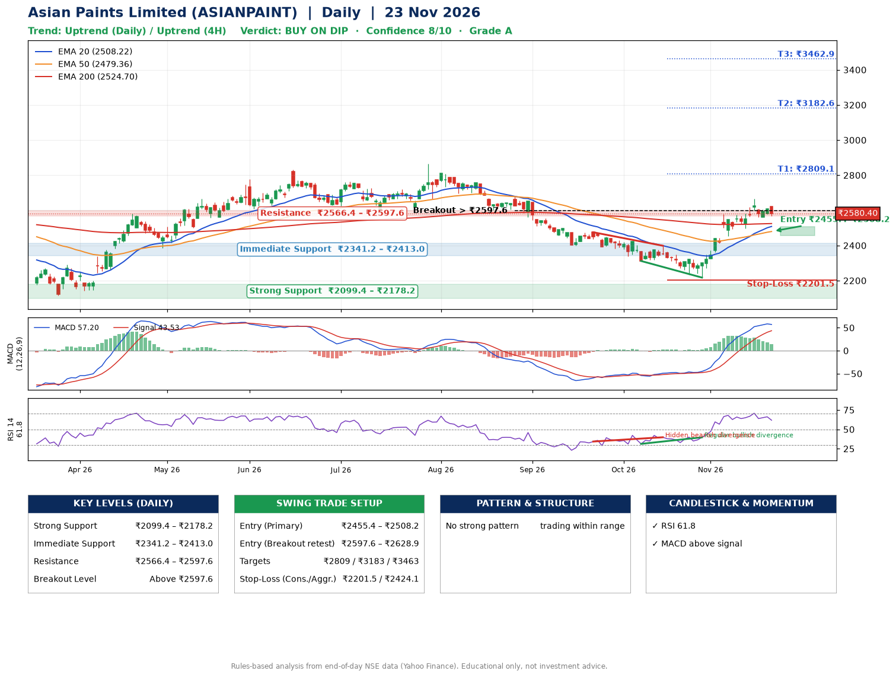

📌 **Asian Paints Limited (ASIANPAINT) – Multi-Timeframe Technical Analysis (Daily + 4H Combined)**
_Data up to 23 Nov 2026 · Close ₹2580.40_

**📍 Daily Timeframe Trend**
- Trend: **Uptrend** (price above rising EMAs)
- Recent swing highs: ₹2678.7, ₹2475.1, ₹2398.4 · swing lows: ₹2397.4, ₹2311.6, ₹2217.1
- EMAs: EMA20 ₹2508.2, EMA50 ₹2479.4, EMA200 ₹2524.7; mixed / crossing; price above EMA20, EMA50, EMA200
- MACD 57.20 above signal 43.53 (above zero); histogram falling
- RSI(14) 61.8; Regular bullish divergence; Hidden bearish divergence

**📍 4-Hour Timeframe Trend**
- Structure: **Uptrend** (higher highs and higher lows)
- Pullback/support area: recent 4H swing lows ₹2495.2, ₹2560.4; EMA20 ₹2557.0
- EMA20/50: bullish stack (EMA20 > EMA50); price above EMA20, EMA50
- MACD 41.67 below signal 49.12 (above zero); histogram falling
- RSI(14) 57.3; no divergence

**📍 Pattern Detection (Both Timeframes)**
- No strong pattern detected. Trading within range.

**📍 Candlestick Patterns (last 3 daily candles)**
- No notable candlestick signal in the last 3 sessions.

**📍 Price Action Key Levels (Daily Structure)**

| Zone | Price Level (₹) | Context |
|------|-----------------|---------|
| Strong Support | ₹2099.4 – ₹2178.2 | Cluster of earlier swing lows (demand) |
| Immediate Support | ₹2341.2 – ₹2413.0 | Nearest swing-low / wick area |
| Resistance | ₹2566.4 – ₹2597.6 | Nearest swing-high supply |
| Breakout Level | Above ₹2597.6 | Swing continuation trigger (52-week high ₹2985.7) |

**📍 Swing Trade Setup**

🟢 **Entry Zone**
- Primary: ₹2455.4 – ₹2508.2 (daily support / EMA20 area; enter on a bullish 4H candle)
- Alternate: ₹2597.6 – ₹2628.9 (breakout retest)

🎯 **Profit Targets**
- T1: ₹2809.1
- T2: ₹3182.6
- T3: ₹3462.9

🛑 **Stop-Loss**
- Conservative: below daily swing low (₹2201.5)
- Aggressive: below 4H structure (₹2424.1)
- Risk per share ≈ ₹280.3; reward:risk to T1 ≈ 1.2
- Time to T1: about 28 trading days (it rose this much within 60 trading days 28% of the time in the last 2 years)
- Time to T2: about 47 trading days (it rose this much within 60 trading days 2% of the time in the last 2 years)

**📌 Strategy Notes**
- Higher timeframe: daily trend is uptrend; only take longs while price holds above ₹2099.4.
- Entry timing: wait for a bullish 4H candle (engulfing/hammer) inside ₹2455.4 – ₹2508.2 rather than buying mid-range.
- EMA stacking: mixed / crossing; price above EMA20, EMA50, EMA200.
- Breakout rule: a daily close above ₹2597.6 with volume above its 20-day average (≈1,129,249) opens T2/T3.
- Momentum: RSI 62 – room to run; Regular bullish divergence; Hidden bearish divergence.
- Exit discipline: move the stop to entry once T1 is hit; book partial profits at each target.

**STEP 2 — Marked Up Chart**

**✅ Trade Validation Checklist**
- Trend + momentum aligned: Yes · Price at entry zone: No
- Stop defined (₹2201.5) · Reward:risk ≥ 1.5 to T1: No

## 📌 Final Verdict

Recommendation: **🟡 BUY ON DIP**

Confidence: **8/10**

Trade Quality: **A**

Reason:
• Daily uptrend (price above rising EMAs)

Next Action:
• Wait for a pullback to ₹2455.4–₹2508.2, or a breakout above ₹2597.6

_Rules-based analysis from end-of-day data. Educational only, not investment advice. Never place orders without your own confirmation._