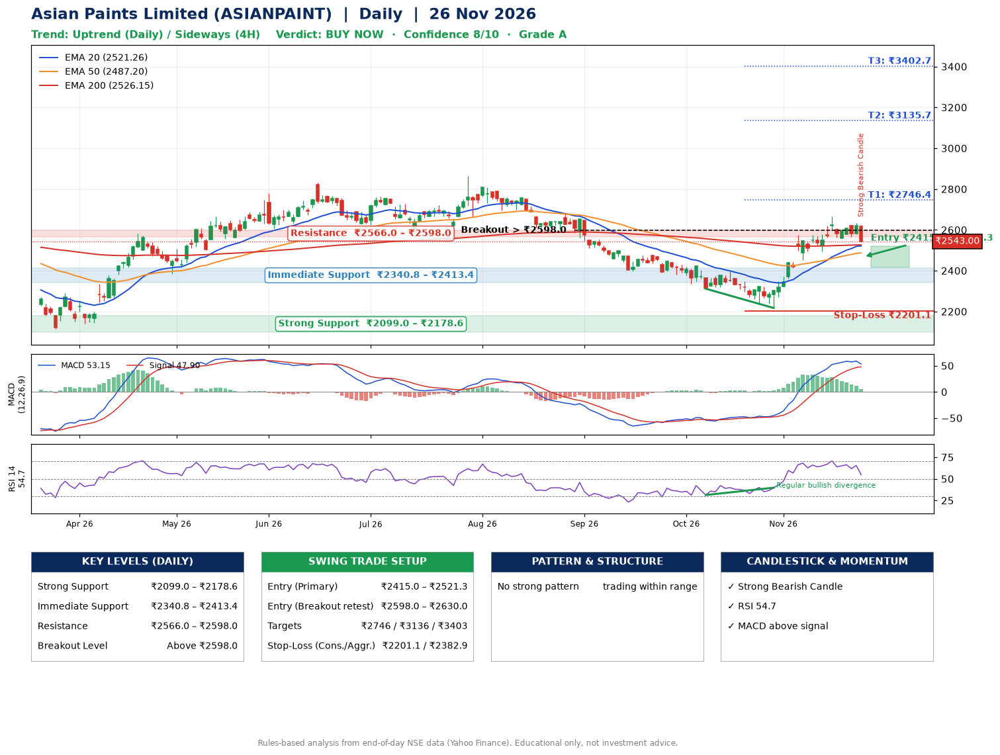

📌 **Asian Paints Limited (ASIANPAINT) – Multi-Timeframe Technical Analysis (Daily + 4H Combined)**
_Data up to 26 Nov 2026 · Close ₹2543.00_

**📍 Daily Timeframe Trend**
- Trend: **Uptrend** (price above rising EMAs)
- Recent swing highs: ₹2475.1, ₹2398.4, ₹2665.5 · swing lows: ₹2397.4, ₹2311.6, ₹2217.1
- EMAs: EMA20 ₹2521.3, EMA50 ₹2487.2, EMA200 ₹2526.1; mixed / crossing; price above EMA20, EMA50, EMA200
- MACD 53.15 above signal 47.90 (above zero); histogram falling
- RSI(14) 54.7; Regular bullish divergence

**📍 4-Hour Timeframe Trend**
- Structure: **Sideways** (mixed swing structure)
- Pullback/support area: recent 4H swing lows ₹2495.2, ₹2560.4; EMA20 ₹2563.2
- EMA20/50: bullish stack (EMA20 > EMA50); price above EMA50
- MACD 28.50 below signal 40.61 (above zero); histogram falling
- RSI(14) 49.5; no divergence

**📍 Pattern Detection (Both Timeframes)**
- 4H: **Double Top** – tops near ₹2665.5/₹2633.0, neckline ₹2560.4, confirmed (closed below neckline)

**📍 Candlestick Patterns (last 3 daily candles)**
- **Strong Bearish Candle** – 26 Nov: wide-range red candle, sellers in control

**📍 Price Action Key Levels (Daily Structure)**

| Zone | Price Level (₹) | Context |
|------|-----------------|---------|
| Strong Support | ₹2099.0 – ₹2178.6 | Cluster of earlier swing lows (demand) |
| Immediate Support | ₹2340.8 – ₹2413.4 | Nearest swing-low / wick area |
| Resistance | ₹2566.0 – ₹2598.0 | Nearest swing-high supply |
| Breakout Level | Above ₹2598.0 | Swing continuation trigger (52-week high ₹2985.7) |

**📍 Swing Trade Setup**

🟢 **Entry Zone**
- Primary: ₹2415.0 – ₹2521.3 (daily support / EMA20 area; enter on a bullish 4H candle)
- Alternate: ₹2598.0 – ₹2630.0 (breakout retest)

🎯 **Profit Targets**
- T1: ₹2746.4
- T2: ₹3135.7
- T3: ₹3402.7

🛑 **Stop-Loss**
- Conservative: below daily swing low (₹2201.1)
- Aggressive: below 4H structure (₹2382.9)
- Risk per share ≈ ₹267.0; reward:risk to T1 ≈ 1.0
- Time to T1: about 25 trading days (it rose this much within 60 trading days 35% of the time in the last 2 years)
- Time to T2: about 43 trading days (it rose this much within 60 trading days 5% of the time in the last 2 years)

**📌 Strategy Notes**
- Higher timeframe: daily trend is uptrend; only take longs while price holds above ₹2099.0.
- Entry timing: wait for a bullish 4H candle (engulfing/hammer) inside ₹2415.0 – ₹2521.3 rather than buying mid-range.
- EMA stacking: mixed / crossing; price above EMA20, EMA50, EMA200.
- Breakout rule: a daily close above ₹2598.0 with volume above its 20-day average (≈1,125,341) opens T2/T3.
- Momentum: RSI 55 – room to run; Regular bullish divergence.
- Exit discipline: move the stop to entry once T1 is hit; book partial profits at each target.

**STEP 2 — Marked Up Chart**

**✅ Trade Validation Checklist**
- Trend + momentum aligned: Yes · Price at entry zone: No
- Stop defined (₹2201.1) · Reward:risk ≥ 1.5 to T1: No

## 📌 Final Verdict

Recommendation: **🟢 BUY NOW**

Confidence: **8/10**

Trade Quality: **A**

Reason:
• Daily uptrend (price above rising EMAs)

Next Action:
• Buy now within the entry zone, with the stop-loss in place

_Rules-based analysis from end-of-day data. Educational only, not investment advice. Never place orders without your own confirmation._