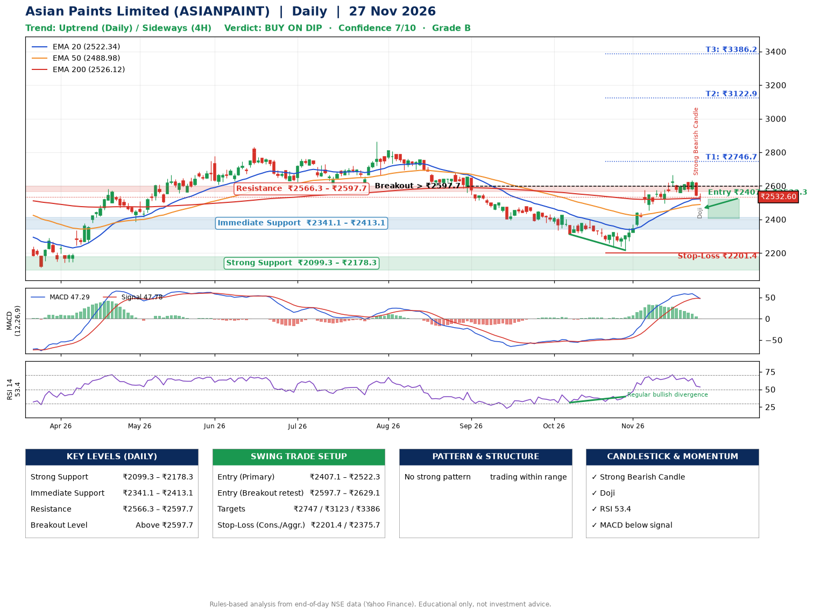

📌 **Asian Paints Limited (ASIANPAINT) – Multi-Timeframe Technical Analysis (Daily + 4H Combined)**
_Data up to 27 Nov 2026 · Close ₹2532.60_

**📍 Daily Timeframe Trend**
- Trend: **Uptrend** (price above rising EMAs)
- Recent swing highs: ₹2475.1, ₹2398.4, ₹2665.5 · swing lows: ₹2397.4, ₹2311.6, ₹2217.1
- EMAs: EMA20 ₹2522.3, EMA50 ₹2489.0, EMA200 ₹2526.1; mixed / crossing; price above EMA20, EMA50, EMA200
- MACD 47.29 below signal 47.78 (above zero), fresh bearish crossover; histogram falling
- RSI(14) 53.4; Regular bullish divergence

**📍 4-Hour Timeframe Trend**
- Structure: **Sideways** (mixed swing structure)
- Pullback/support area: recent 4H swing lows ₹2495.2, ₹2560.4; EMA20 ₹2558.8
- EMA20/50: bullish stack (EMA20 > EMA50); price above EMA50
- MACD 18.97 below signal 33.61 (above zero); histogram falling
- RSI(14) 47.9; no divergence

**📍 Pattern Detection (Both Timeframes)**
- 4H: **Double Top** – tops near ₹2665.5/₹2633.0, neckline ₹2560.4, confirmed (closed below neckline)

**📍 Candlestick Patterns (last 3 daily candles)**
- **Strong Bearish Candle** – 26 Nov: wide-range red candle, sellers in control
- **Doji** – 27 Nov: indecision; wait for the next candle to confirm direction

**📍 Price Action Key Levels (Daily Structure)**

| Zone | Price Level (₹) | Context |
|------|-----------------|---------|
| Strong Support | ₹2099.3 – ₹2178.3 | Cluster of earlier swing lows (demand) |
| Immediate Support | ₹2341.1 – ₹2413.1 | Nearest swing-low / wick area |
| Resistance | ₹2566.3 – ₹2597.7 | Nearest swing-high supply |
| Breakout Level | Above ₹2597.7 | Swing continuation trigger (52-week high ₹2985.7) |

**📍 Swing Trade Setup**

🟢 **Entry Zone**
- Primary: ₹2407.1 – ₹2522.3 (daily support / EMA20 area; enter on a bullish 4H candle)
- Alternate: ₹2597.7 – ₹2629.1 (breakout retest)

🎯 **Profit Targets**
- T1: ₹2746.7
- T2: ₹3122.9
- T3: ₹3386.2

🛑 **Stop-Loss**
- Conservative: below daily swing low (₹2201.4)
- Aggressive: below 4H structure (₹2375.7)
- Risk per share ≈ ₹263.3; reward:risk to T1 ≈ 1.1
- Time to T1: about 24 trading days (it rose this much within 60 trading days 33% of the time in the last 2 years)
- Time to T2: about 41 trading days (it rose this much within 60 trading days 5% of the time in the last 2 years)

**📌 Strategy Notes**
- Higher timeframe: daily trend is uptrend; only take longs while price holds above ₹2099.3.
- Entry timing: wait for a bullish 4H candle (engulfing/hammer) inside ₹2407.1 – ₹2522.3 rather than buying mid-range.
- EMA stacking: mixed / crossing; price above EMA20, EMA50, EMA200.
- Breakout rule: a daily close above ₹2597.7 with volume above its 20-day average (≈1,120,424) opens T2/T3.
- Momentum: RSI 53 – room to run; Regular bullish divergence.
- Exit discipline: move the stop to entry once T1 is hit; book partial profits at each target.

**STEP 2 — Marked Up Chart**

**✅ Trade Validation Checklist**
- Trend + momentum aligned: No · Price at entry zone: No
- Stop defined (₹2201.4) · Reward:risk ≥ 1.5 to T1: No

## 📌 Final Verdict

Recommendation: **🟡 BUY ON DIP**

Confidence: **7/10**

Trade Quality: **B**

Reason:
• Daily uptrend (price above rising EMAs)

Next Action:
• Wait for a pullback to ₹2407.1–₹2522.3, or a breakout above ₹2597.7

_Rules-based analysis from end-of-day data. Educational only, not investment advice. Never place orders without your own confirmation._