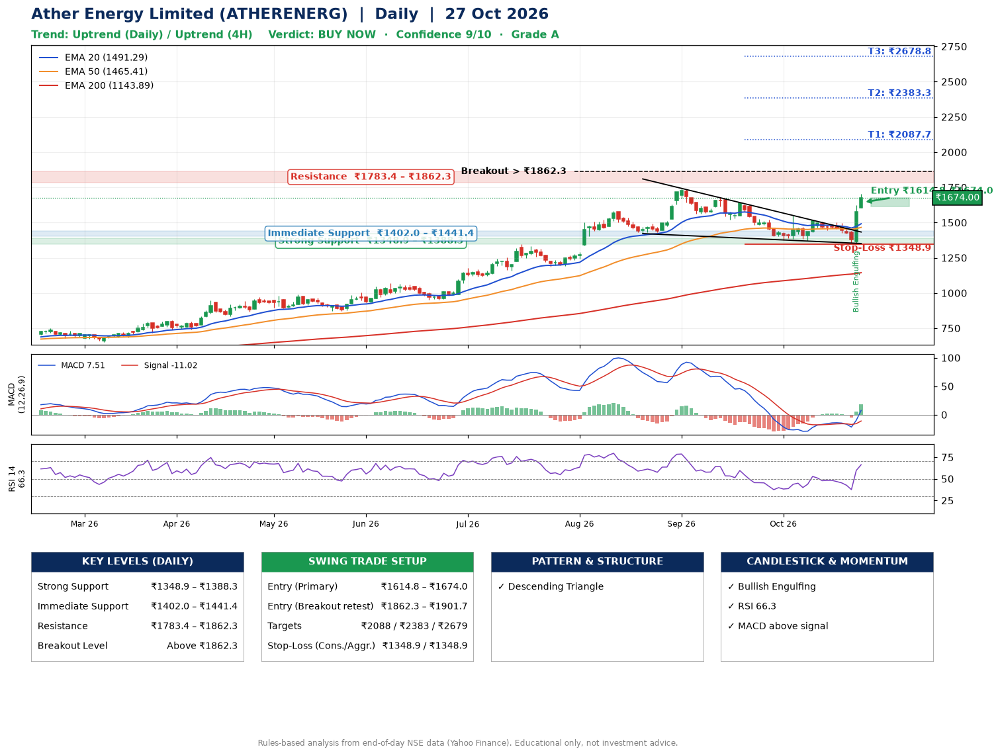

📌 **Ather Energy Limited (ATHERENERG) – Multi-Timeframe Technical Analysis (Daily + 4H Combined)**
_Data up to 27 Oct 2026 · Close ₹1674.00_

**📍 Daily Timeframe Trend**
- Trend: **Uptrend** (price above rising EMAs)
- Recent swing highs: ₹1744.0, ₹1673.5, ₹1550.8 · swing lows: ₹1188.1, ₹1421.7, ₹1368.6
- EMAs: EMA20 ₹1491.3, EMA50 ₹1465.4, EMA200 ₹1143.9; bullish stack (EMA20 > EMA50 > EMA200); price above EMA20, EMA50, EMA200
- MACD 7.51 above signal -11.02 (above zero), fresh bullish crossover; histogram rising
- RSI(14) 66.3; no divergence on the last two swings

**📍 4-Hour Timeframe Trend**
- Structure: **Uptrend** (price above rising EMAs)
- Pullback/support area: recent 4H swing lows ₹1446.1, ₹1346.0; EMA20 ₹1490.9
- EMA20/50: bullish stack (EMA20 > EMA50); price above EMA20, EMA50
- MACD 28.25 above signal 2.42 (above zero), fresh bullish crossover; histogram rising
- RSI(14) 71.7; no divergence

**📍 Pattern Detection (Both Timeframes)**
- Daily: **Descending Triangle** – converging swing highs and lows over the last ~60 sessions

**📍 Candlestick Patterns (last 3 daily candles)**
- **Bullish Engulfing** – 26 Oct: buyers fully reversed the prior red candle

**📍 Price Action Key Levels (Daily Structure)**

| Zone | Price Level (₹) | Context |
|------|-----------------|---------|
| Strong Support | ₹1348.9 – ₹1388.3 | Cluster of earlier swing lows (demand) |
| Immediate Support | ₹1402.0 – ₹1441.4 | Nearest swing-low / wick area |
| Resistance | ₹1783.4 – ₹1862.3 | Nearest swing-high supply |
| Breakout Level | Above ₹1862.3 | Swing continuation trigger (52-week high ₹1744.0) |

**📍 Swing Trade Setup**

🟢 **Entry Zone**
- Primary: ₹1614.8 – ₹1674.0 (daily support / EMA20 area; enter on a bullish 4H candle)
- Alternate: ₹1862.3 – ₹1901.7 (breakout retest)

🎯 **Profit Targets**
- T1: ₹2087.7
- T2: ₹2383.3
- T3: ₹2678.8

🛑 **Stop-Loss**
- Conservative: below daily swing low (₹1348.9)
- Aggressive: below 4H structure (₹1348.9)
- Risk per share ≈ ₹295.5; reward:risk to T1 ≈ 1.5

**📌 Strategy Notes**
- Higher timeframe: daily trend is uptrend; only take longs while price holds above ₹1348.9.
- Entry timing: wait for a bullish 4H candle (engulfing/hammer) inside ₹1614.8 – ₹1674.0 rather than buying mid-range.
- EMA stacking: bullish stack (EMA20 > EMA50 > EMA200); price above EMA20, EMA50, EMA200.
- Breakout rule: a daily close above ₹1862.3 with volume above its 20-day average (≈3,805,804) opens T2/T3.
- Momentum: RSI 66 – elevated, prefer dips; no divergence on the last two swings.
- Exit discipline: move the stop to entry once T1 is hit; book partial profits at each target.

**STEP 2 — Marked Up Chart**

**✅ Trade Validation Checklist**
- Trend + momentum aligned: Yes · Price at entry zone: Yes
- Stop defined (₹1348.9) · Reward:risk ≥ 1.5 to T1: No

## 📌 Final Verdict

Recommendation: **🟢 BUY NOW**

Confidence: **9/10**

Trade Quality: **A**

Reason:
• Daily uptrend (price above rising EMAs)
• EMAs stacked bullishly

Next Action:
• Buy now within the entry zone, with the stop-loss in place

_Rules-based analysis from end-of-day data. Educational only, not investment advice. Never place orders without your own confirmation._