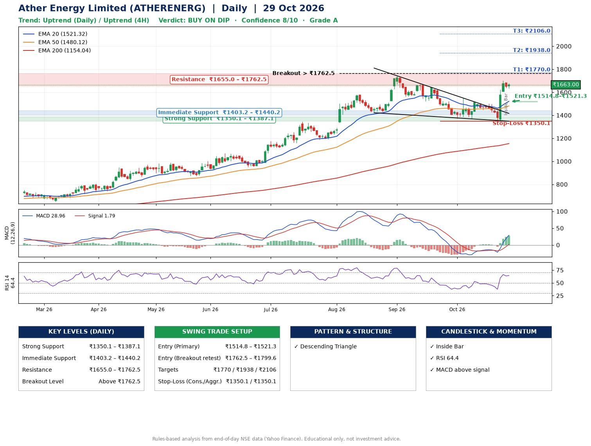

📌 **Ather Energy Limited (ATHERENERG) – Multi-Timeframe Technical Analysis (Daily + 4H Combined)**
_Data up to 29 Oct 2026 · Close ₹1663.00_

**📍 Daily Timeframe Trend**
- Trend: **Uptrend** (price above rising EMAs)
- Recent swing highs: ₹1744.0, ₹1673.5, ₹1550.8 · swing lows: ₹1188.1, ₹1421.7, ₹1368.6
- EMAs: EMA20 ₹1521.3, EMA50 ₹1480.1, EMA200 ₹1154.0; bullish stack (EMA20 > EMA50 > EMA200); price above EMA20, EMA50, EMA200
- MACD 28.96 above signal 1.79 (above zero), fresh bullish crossover; histogram rising
- RSI(14) 64.4; no divergence on the last two swings

**📍 4-Hour Timeframe Trend**
- Structure: **Uptrend** (price above rising EMAs)
- Pullback/support area: recent 4H swing lows ₹1446.1, ₹1346.0; EMA20 ₹1546.6
- EMA20/50: bullish stack (EMA20 > EMA50); price above EMA20, EMA50
- MACD 53.51 above signal 29.15 (above zero); histogram falling
- RSI(14) 68.6; no divergence

**📍 Pattern Detection (Both Timeframes)**
- Daily: **Descending Triangle** – converging swing highs and lows over the last ~60 sessions

**📍 Candlestick Patterns (last 3 daily candles)**
- **Inside Bar** – 28 Oct: compression inside the prior range ₹1607.0–₹1702.0

**📍 Price Action Key Levels (Daily Structure)**

| Zone | Price Level (₹) | Context |
|------|-----------------|---------|
| Strong Support | ₹1350.1 – ₹1387.1 | Cluster of earlier swing lows (demand) |
| Immediate Support | ₹1403.2 – ₹1440.2 | Nearest swing-low / wick area |
| Resistance | ₹1655.0 – ₹1762.5 | Nearest swing-high supply |
| Breakout Level | Above ₹1762.5 | Swing continuation trigger (52-week high ₹1744.0) |

**📍 Swing Trade Setup**

🟢 **Entry Zone**
- Primary: ₹1514.8 – ₹1521.3 (daily support / EMA20 area; enter on a bullish 4H candle)
- Alternate: ₹1762.5 – ₹1799.6 (breakout retest)

🎯 **Profit Targets**
- T1: ₹1770.0
- T2: ₹1938.0
- T3: ₹2106.0

🛑 **Stop-Loss**
- Conservative: below daily swing low (₹1350.1)
- Aggressive: below 4H structure (₹1350.1)
- Risk per share ≈ ₹168.0; reward:risk to T1 ≈ 1.5

**📌 Strategy Notes**
- Higher timeframe: daily trend is uptrend; only take longs while price holds above ₹1350.1.
- Entry timing: wait for a bullish 4H candle (engulfing/hammer) inside ₹1514.8 – ₹1521.3 rather than buying mid-range.
- EMA stacking: bullish stack (EMA20 > EMA50 > EMA200); price above EMA20, EMA50, EMA200.
- Breakout rule: a daily close above ₹1762.5 with volume above its 20-day average (≈3,587,007) opens T2/T3.
- Momentum: RSI 64 – room to run; no divergence on the last two swings.
- Exit discipline: move the stop to entry once T1 is hit; book partial profits at each target.

**STEP 2 — Marked Up Chart**

**✅ Trade Validation Checklist**
- Trend + momentum aligned: Yes · Price at entry zone: No
- Stop defined (₹1350.1) · Reward:risk ≥ 1.5 to T1: No

## 📌 Final Verdict

Recommendation: **🟡 BUY ON DIP**

Confidence: **8/10**

Trade Quality: **A**

Reason:
• Daily uptrend (price above rising EMAs)
• EMAs stacked bullishly

Next Action:
• Wait for a pullback to ₹1514.8–₹1521.3

_Rules-based analysis from end-of-day data. Educational only, not investment advice. Never place orders without your own confirmation._