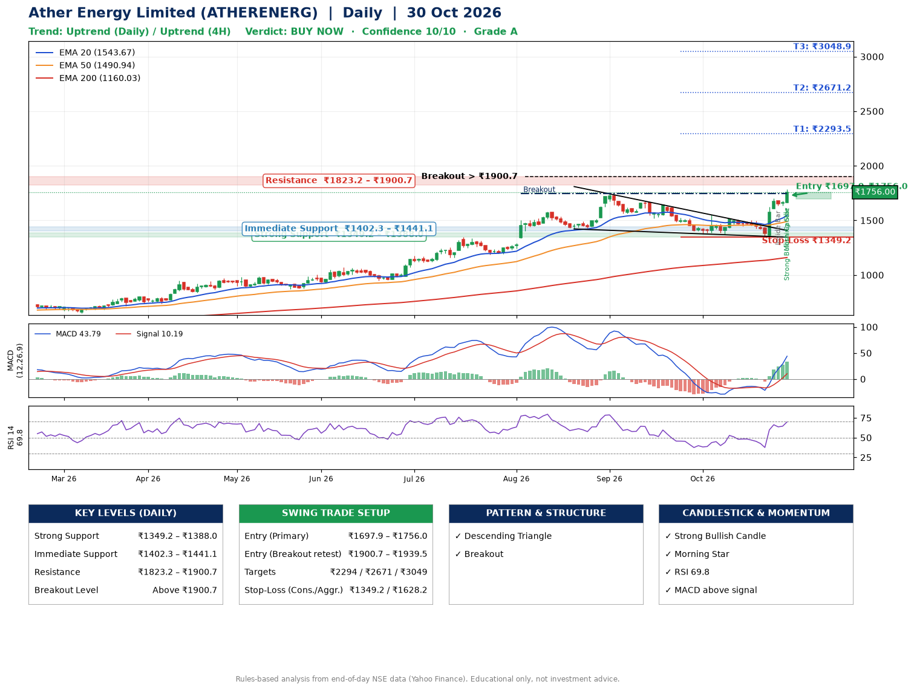

📌 **Ather Energy Limited (ATHERENERG) – Multi-Timeframe Technical Analysis (Daily + 4H Combined)**
_Data up to 30 Oct 2026 · Close ₹1756.00_

**📍 Daily Timeframe Trend**
- Trend: **Uptrend** (price above rising EMAs)
- Recent swing highs: ₹1744.0, ₹1673.5, ₹1550.8 · swing lows: ₹1188.1, ₹1421.7, ₹1368.6
- EMAs: EMA20 ₹1543.7, EMA50 ₹1490.9, EMA200 ₹1160.0; bullish stack (EMA20 > EMA50 > EMA200); price above EMA20, EMA50, EMA200
- MACD 43.79 above signal 10.19 (above zero), fresh bullish crossover; histogram rising
- RSI(14) 69.8; no divergence on the last two swings

**📍 4-Hour Timeframe Trend**
- Structure: **Uptrend** (higher highs and higher lows)
- Pullback/support area: recent 4H swing lows ₹1346.0, ₹1633.3; EMA20 ₹1585.7
- EMA20/50: bullish stack (EMA20 > EMA50); price above EMA20, EMA50
- MACD 70.95 above signal 43.14 (above zero); histogram falling
- RSI(14) 73.5; no divergence

**📍 Pattern Detection (Both Timeframes)**
- Daily: **Descending Triangle** – converging swing highs and lows over the last ~60 sessions
- Daily: **Breakout** – closed above the 60-session high ₹1744.0 on strong volume

**📍 Candlestick Patterns (last 3 daily candles)**
- **Inside Bar** – 28 Oct: compression inside the prior range ₹1607.0–₹1702.0
- **Strong Bullish Candle** – 30 Oct: wide-range green candle, buyers in control
- **Morning Star** – 30 Oct: three-candle bullish reversal

**📍 Price Action Key Levels (Daily Structure)**

| Zone | Price Level (₹) | Context |
|------|-----------------|---------|
| Strong Support | ₹1349.2 – ₹1388.0 | Cluster of earlier swing lows (demand) |
| Immediate Support | ₹1402.3 – ₹1441.1 | Nearest swing-low / wick area |
| Resistance | ₹1823.2 – ₹1900.7 | Nearest swing-high supply |
| Breakout Level | Above ₹1900.7 | Swing continuation trigger (52-week high ₹1784.5) |

**📍 Swing Trade Setup**

🟢 **Entry Zone**
- Primary: ₹1697.9 – ₹1756.0 (daily support / EMA20 area; enter on a bullish 4H candle)
- Alternate: ₹1900.7 – ₹1939.5 (breakout retest)

🎯 **Profit Targets**
- T1: ₹2293.5
- T2: ₹2671.2
- T3: ₹3048.9

🛑 **Stop-Loss**
- Conservative: below daily swing low (₹1349.2)
- Aggressive: below 4H structure (₹1628.2)
- Risk per share ≈ ₹377.7; reward:risk to T1 ≈ 1.5

**📌 Strategy Notes**
- Higher timeframe: daily trend is uptrend; only take longs while price holds above ₹1349.2.
- Entry timing: wait for a bullish 4H candle (engulfing/hammer) inside ₹1697.9 – ₹1756.0 rather than buying mid-range.
- EMA stacking: bullish stack (EMA20 > EMA50 > EMA200); price above EMA20, EMA50, EMA200.
- Breakout rule: a daily close above ₹1900.7 with volume above its 20-day average (≈3,828,754) opens T2/T3.
- Momentum: RSI 70 – elevated, prefer dips; no divergence on the last two swings.
- Exit discipline: move the stop to entry once T1 is hit; book partial profits at each target.

**STEP 2 — Marked Up Chart**

**✅ Trade Validation Checklist**
- Trend + momentum aligned: Yes · Price at entry zone: Yes
- Stop defined (₹1349.2) · Reward:risk ≥ 1.5 to T1: No

## 📌 Final Verdict

Recommendation: **🟢 BUY NOW**

Confidence: **10/10**

Trade Quality: **A**

Reason:
• Daily uptrend (price above rising EMAs)
• EMAs stacked bullishly

Next Action:
• Buy now within the entry zone, with the stop-loss in place

_Rules-based analysis from end-of-day data. Educational only, not investment advice. Never place orders without your own confirmation._