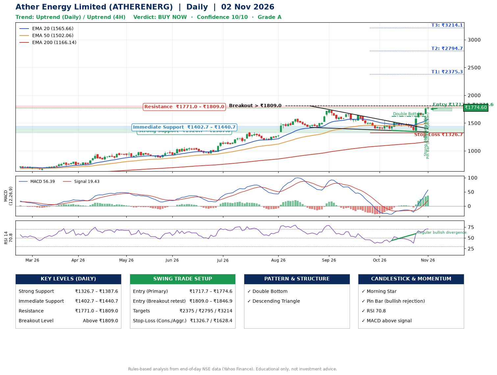

📌 **Ather Energy Limited (ATHERENERG) – Multi-Timeframe Technical Analysis (Daily + 4H Combined)**
_Data up to 02 Nov 2026 · Close ₹1774.60_

**📍 Daily Timeframe Trend**
- Trend: **Uptrend** (price above rising EMAs)
- Recent swing highs: ₹1744.0, ₹1673.5, ₹1550.8 · swing lows: ₹1421.7, ₹1368.6, ₹1345.7
- EMAs: EMA20 ₹1565.7, EMA50 ₹1502.1, EMA200 ₹1166.1; bullish stack (EMA20 > EMA50 > EMA200); price above EMA20, EMA50, EMA200
- MACD 56.39 above signal 19.43 (above zero); histogram rising
- RSI(14) 70.8; Regular bullish divergence

**📍 4-Hour Timeframe Trend**
- Structure: **Uptrend** (higher highs and higher lows)
- Pullback/support area: recent 4H swing lows ₹1346.0, ₹1633.3; EMA20 ₹1619.6
- EMA20/50: bullish stack (EMA20 > EMA50); price above EMA20, EMA50
- MACD 80.25 above signal 55.89 (above zero); histogram falling
- RSI(14) 74.6; no divergence

**📍 Pattern Detection (Both Timeframes)**
- Daily: **Double Bottom** – bottoms near ₹1368.6/₹1345.7, neckline ₹1623.0, confirmed (closed above neckline)
- Daily: **Descending Triangle** – converging swing highs and lows over the last ~60 sessions

**📍 Candlestick Patterns (last 3 daily candles)**
- **Strong Bullish Candle** – 30 Oct: wide-range green candle, buyers in control
- **Morning Star** – 30 Oct: three-candle bullish reversal
- **Pin Bar (bullish rejection)** – 02 Nov: long lower wick shows dip-buying near ₹1736.0

**📍 Price Action Key Levels (Daily Structure)**

| Zone | Price Level (₹) | Context |
|------|-----------------|---------|
| Strong Support | ₹1326.7 – ₹1387.6 | Cluster of earlier swing lows (demand) |
| Immediate Support | ₹1402.7 – ₹1440.7 | Nearest swing-low / wick area |
| Resistance | ₹1771.0 – ₹1809.0 | Nearest swing-high supply |
| Breakout Level | Above ₹1809.0 | Swing continuation trigger (52-week high ₹1790.0) |

**📍 Swing Trade Setup**

🟢 **Entry Zone**
- Primary: ₹1717.7 – ₹1774.6 (daily support / EMA20 area; enter on a bullish 4H candle)
- Alternate: ₹1809.0 – ₹1846.9 (breakout retest)

🎯 **Profit Targets**
- T1: ₹2375.3
- T2: ₹2794.7
- T3: ₹3214.1

🛑 **Stop-Loss**
- Conservative: below daily swing low (₹1326.7)
- Aggressive: below 4H structure (₹1628.4)
- Risk per share ≈ ₹419.4; reward:risk to T1 ≈ 1.5

**📌 Strategy Notes**
- Higher timeframe: daily trend is uptrend; only take longs while price holds above ₹1326.7.
- Entry timing: wait for a bullish 4H candle (engulfing/hammer) inside ₹1717.7 – ₹1774.6 rather than buying mid-range.
- EMA stacking: bullish stack (EMA20 > EMA50 > EMA200); price above EMA20, EMA50, EMA200.
- Breakout rule: a daily close above ₹1809.0 with volume above its 20-day average (≈3,781,258) opens T2/T3.
- Momentum: RSI 71 – elevated, prefer dips; Regular bullish divergence.
- Exit discipline: move the stop to entry once T1 is hit; book partial profits at each target.

**STEP 2 — Marked Up Chart**

**✅ Trade Validation Checklist**
- Trend + momentum aligned: Yes · Price at entry zone: Yes
- Stop defined (₹1326.7) · Reward:risk ≥ 1.5 to T1: No

## 📌 Final Verdict

Recommendation: **🟢 BUY NOW**

Confidence: **10/10**

Trade Quality: **A**

Reason:
• Daily uptrend (price above rising EMAs)
• EMAs stacked bullishly

Next Action:
• Buy now within the entry zone, with the stop-loss in place

_Rules-based analysis from end-of-day data. Educational only, not investment advice. Never place orders without your own confirmation._