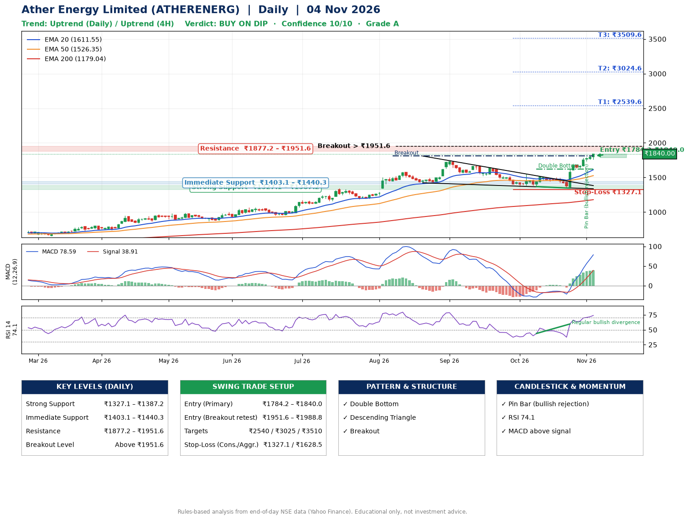

📌 **Ather Energy Limited (ATHERENERG) – Multi-Timeframe Technical Analysis (Daily + 4H Combined)**
_Data up to 04 Nov 2026 · Close ₹1840.00_

**📍 Daily Timeframe Trend**
- Trend: **Uptrend** (price above rising EMAs)
- Recent swing highs: ₹1744.0, ₹1673.5, ₹1550.8 · swing lows: ₹1421.7, ₹1368.6, ₹1345.7
- EMAs: EMA20 ₹1611.6, EMA50 ₹1526.4, EMA200 ₹1179.0; bullish stack (EMA20 > EMA50 > EMA200); price above EMA20, EMA50, EMA200
- MACD 78.59 above signal 38.91 (above zero); histogram rising
- RSI(14) 74.1; Regular bullish divergence

**📍 4-Hour Timeframe Trend**
- Structure: **Uptrend** (higher highs and higher lows)
- Pullback/support area: recent 4H swing lows ₹1346.0, ₹1633.3; EMA20 ₹1678.8
- EMA20/50: bullish stack (EMA20 > EMA50); price above EMA20, EMA50
- MACD 87.52 above signal 73.29 (above zero); histogram rising
- RSI(14) 75.5; no divergence

**📍 Pattern Detection (Both Timeframes)**
- Daily: **Double Bottom** – bottoms near ₹1368.6/₹1345.7, neckline ₹1623.0, confirmed (closed above neckline)
- Daily: **Descending Triangle** – converging swing highs and lows over the last ~60 sessions
- Daily: **Breakout** – closed above the 60-session high ₹1809.5 (volume not confirming yet)

**📍 Candlestick Patterns (last 3 daily candles)**
- **Pin Bar (bullish rejection)** – 02 Nov: long lower wick shows dip-buying near ₹1736.0

**📍 Price Action Key Levels (Daily Structure)**

| Zone | Price Level (₹) | Context |
|------|-----------------|---------|
| Strong Support | ₹1327.1 – ₹1387.2 | Cluster of earlier swing lows (demand) |
| Immediate Support | ₹1403.1 – ₹1440.3 | Nearest swing-low / wick area |
| Resistance | ₹1877.2 – ₹1951.6 | Nearest swing-high supply |
| Breakout Level | Above ₹1951.6 | Swing continuation trigger (52-week high ₹1840.0) |

**📍 Swing Trade Setup**

🟢 **Entry Zone**
- Primary: ₹1784.2 – ₹1840.0 (daily support / EMA20 area; enter on a bullish 4H candle)
- Alternate: ₹1951.6 – ₹1988.8 (breakout retest)

🎯 **Profit Targets**
- T1: ₹2539.6
- T2: ₹3024.6
- T3: ₹3509.6

🛑 **Stop-Loss**
- Conservative: below daily swing low (₹1327.1)
- Aggressive: below 4H structure (₹1628.5)
- Risk per share ≈ ₹485.0; reward:risk to T1 ≈ 1.5

**📌 Strategy Notes**
- Higher timeframe: daily trend is uptrend; only take longs while price holds above ₹1327.1.
- Entry timing: wait for a bullish 4H candle (engulfing/hammer) inside ₹1784.2 – ₹1840.0 rather than buying mid-range.
- EMA stacking: bullish stack (EMA20 > EMA50 > EMA200); price above EMA20, EMA50, EMA200.
- Breakout rule: a daily close above ₹1951.6 with volume above its 20-day average (≈3,620,212) opens T2/T3.
- Momentum: RSI 74 – elevated, prefer dips; Regular bullish divergence.
- Exit discipline: move the stop to entry once T1 is hit; book partial profits at each target.

**STEP 2 — Marked Up Chart**

**✅ Trade Validation Checklist**
- Trend + momentum aligned: Yes · Price at entry zone: Yes
- Stop defined (₹1327.1) · Reward:risk ≥ 1.5 to T1: Yes

## 📌 Final Verdict

Recommendation: **🟡 BUY ON DIP**

Confidence: **10/10**

Trade Quality: **A**

Reason:
• Daily uptrend (price above rising EMAs)
• EMAs stacked bullishly

Next Action:
• Wait for a pullback to ₹1784.2–₹1840.0, or a breakout above ₹1951.6

_Rules-based analysis from end-of-day data. Educational only, not investment advice. Never place orders without your own confirmation._