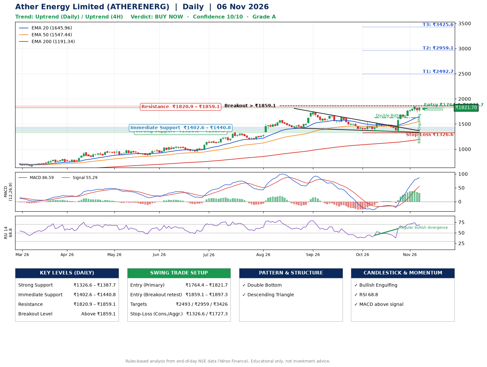

📌 **Ather Energy Limited (ATHERENERG) – Multi-Timeframe Technical Analysis (Daily + 4H Combined)**
_Data up to 06 Nov 2026 · Close ₹1821.70_

**📍 Daily Timeframe Trend**
- Trend: **Uptrend** (price above rising EMAs)
- Recent swing highs: ₹1744.0, ₹1673.5, ₹1550.8 · swing lows: ₹1421.7, ₹1368.6, ₹1345.7
- EMAs: EMA20 ₹1646.0, EMA50 ₹1547.4, EMA200 ₹1191.3; bullish stack (EMA20 > EMA50 > EMA200); price above EMA20, EMA50, EMA200
- MACD 86.59 above signal 55.29 (above zero); histogram falling
- RSI(14) 68.8; Regular bullish divergence

**📍 4-Hour Timeframe Trend**
- Structure: **Uptrend** (higher highs and higher lows)
- Pullback/support area: recent 4H swing lows ₹1633.3, ₹1732.1; EMA20 ₹1716.9
- EMA20/50: bullish stack (EMA20 > EMA50); price above EMA20, EMA50
- MACD 78.13 above signal 77.20 (above zero); histogram falling
- RSI(14) 68.6; Hidden bullish divergence

**📍 Pattern Detection (Both Timeframes)**
- Daily: **Double Bottom** – bottoms near ₹1368.6/₹1345.7, neckline ₹1623.0, confirmed (closed above neckline)
- Daily: **Descending Triangle** – converging swing highs and lows over the last ~60 sessions
- 4H: **Bull Flag** – 25% pole then a tight 6% flag; trigger above ₹1840.0

**📍 Candlestick Patterns (last 3 daily candles)**
- **Bullish Engulfing** – 06 Nov: buyers fully reversed the prior red candle

**📍 Price Action Key Levels (Daily Structure)**

| Zone | Price Level (₹) | Context |
|------|-----------------|---------|
| Strong Support | ₹1326.6 – ₹1387.7 | Cluster of earlier swing lows (demand) |
| Immediate Support | ₹1402.6 – ₹1440.8 | Nearest swing-low / wick area |
| Resistance | ₹1820.9 – ₹1859.1 | Nearest swing-high supply |
| Breakout Level | Above ₹1859.1 | Swing continuation trigger (52-week high ₹1840.0) |

**📍 Swing Trade Setup**

🟢 **Entry Zone**
- Primary: ₹1764.4 – ₹1821.7 (daily support / EMA20 area; enter on a bullish 4H candle)
- Alternate: ₹1859.1 – ₹1897.3 (breakout retest)

🎯 **Profit Targets**
- T1: ₹2492.7
- T2: ₹2959.1
- T3: ₹3425.6

🛑 **Stop-Loss**
- Conservative: below daily swing low (₹1326.6)
- Aggressive: below 4H structure (₹1727.3)
- Risk per share ≈ ₹466.4; reward:risk to T1 ≈ 1.5

**📌 Strategy Notes**
- Higher timeframe: daily trend is uptrend; only take longs while price holds above ₹1326.6.
- Entry timing: wait for a bullish 4H candle (engulfing/hammer) inside ₹1764.4 – ₹1821.7 rather than buying mid-range.
- EMA stacking: bullish stack (EMA20 > EMA50 > EMA200); price above EMA20, EMA50, EMA200.
- Breakout rule: a daily close above ₹1859.1 with volume above its 20-day average (≈3,709,442) opens T2/T3.
- Momentum: RSI 69 – elevated, prefer dips; Regular bullish divergence.
- Exit discipline: move the stop to entry once T1 is hit; book partial profits at each target.

**STEP 2 — Marked Up Chart**

**✅ Trade Validation Checklist**
- Trend + momentum aligned: Yes · Price at entry zone: Yes
- Stop defined (₹1326.6) · Reward:risk ≥ 1.5 to T1: Yes

## 📌 Final Verdict

Recommendation: **🟢 BUY NOW**

Confidence: **10/10**

Trade Quality: **A**

Reason:
• Daily uptrend (price above rising EMAs)
• EMAs stacked bullishly

Next Action:
• Buy now within the entry zone, with the stop-loss in place

_Rules-based analysis from end-of-day data. Educational only, not investment advice. Never place orders without your own confirmation._