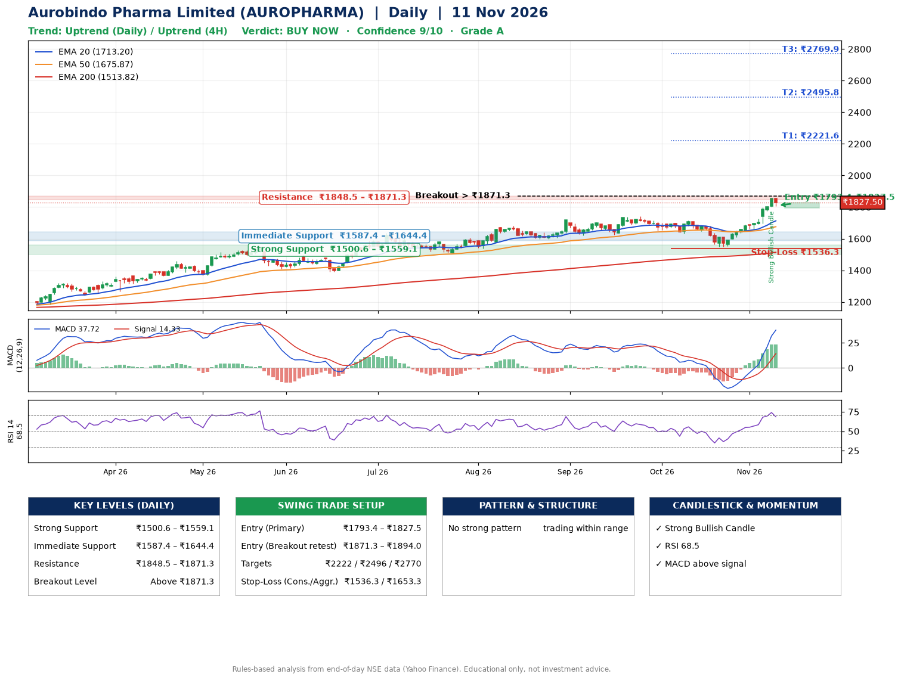

📌 **Aurobindo Pharma Limited (AUROPHARMA) – Multi-Timeframe Technical Analysis (Daily + 4H Combined)**
_Data up to 11 Nov 2026 · Close ₹1827.50_

**📍 Daily Timeframe Trend**
- Trend: **Uptrend** (price above rising EMAs)
- Recent swing highs: ₹1704.0, ₹1740.0, ₹1715.0 · swing lows: ₹1623.0, ₹1633.0, ₹1547.7
- EMAs: EMA20 ₹1713.2, EMA50 ₹1675.9, EMA200 ₹1513.8; bullish stack (EMA20 > EMA50 > EMA200); price above EMA20, EMA50, EMA200
- MACD 37.72 above signal 14.33 (above zero); histogram rising
- RSI(14) 68.5; no divergence on the last two swings

**📍 4-Hour Timeframe Trend**
- Structure: **Uptrend** (price above rising EMAs)
- Pullback/support area: recent 4H swing lows ₹1548.0, ₹1656.2; EMA20 ₹1747.9
- EMA20/50: bullish stack (EMA20 > EMA50); price above EMA20, EMA50
- MACD 50.05 above signal 37.02 (above zero); histogram falling
- RSI(14) 70.5; no divergence

**📍 Pattern Detection (Both Timeframes)**
- 4H: **Inverse Head & Shoulders** – head ₹1548.0, neckline ₹1687.0
- 4H: **Ascending Triangle** – converging swing highs and lows over the last ~60 sessions

**📍 Candlestick Patterns (last 3 daily candles)**
- **Strong Bullish Candle** – 09 Nov: wide-range green candle, buyers in control

**📍 Price Action Key Levels (Daily Structure)**

| Zone | Price Level (₹) | Context |
|------|-----------------|---------|
| Strong Support | ₹1500.6 – ₹1559.1 | Cluster of earlier swing lows (demand) |
| Immediate Support | ₹1587.4 – ₹1644.4 | Nearest swing-low / wick area |
| Resistance | ₹1848.5 – ₹1871.3 | Nearest swing-high supply |
| Breakout Level | Above ₹1871.3 | Swing continuation trigger (52-week high ₹1859.9) |

**📍 Swing Trade Setup**

🟢 **Entry Zone**
- Primary: ₹1793.4 – ₹1827.5 (daily support / EMA20 area; enter on a bullish 4H candle)
- Alternate: ₹1871.3 – ₹1894.0 (breakout retest)

🎯 **Profit Targets**
- T1: ₹2221.6
- T2: ₹2495.8
- T3: ₹2769.9

🛑 **Stop-Loss**
- Conservative: below daily swing low (₹1536.3)
- Aggressive: below 4H structure (₹1653.3)
- Risk per share ≈ ₹274.1; reward:risk to T1 ≈ 1.5

**📌 Strategy Notes**
- Higher timeframe: daily trend is uptrend; only take longs while price holds above ₹1500.6.
- Entry timing: wait for a bullish 4H candle (engulfing/hammer) inside ₹1793.4 – ₹1827.5 rather than buying mid-range.
- EMA stacking: bullish stack (EMA20 > EMA50 > EMA200); price above EMA20, EMA50, EMA200.
- Breakout rule: a daily close above ₹1871.3 with volume above its 20-day average (≈1,204,769) opens T2/T3.
- Momentum: RSI 68 – elevated, prefer dips; no divergence on the last two swings.
- Exit discipline: move the stop to entry once T1 is hit; book partial profits at each target.

**STEP 2 — Marked Up Chart**

**✅ Trade Validation Checklist**
- Trend + momentum aligned: Yes · Price at entry zone: Yes
- Stop defined (₹1536.3) · Reward:risk ≥ 1.5 to T1: No

## 📌 Final Verdict

Recommendation: **🟢 BUY NOW**

Confidence: **9/10**

Trade Quality: **A**

Reason:
• Daily uptrend (price above rising EMAs)
• EMAs stacked bullishly

Next Action:
• Buy now within the entry zone, with the stop-loss in place

_Rules-based analysis from end-of-day data. Educational only, not investment advice. Never place orders without your own confirmation._