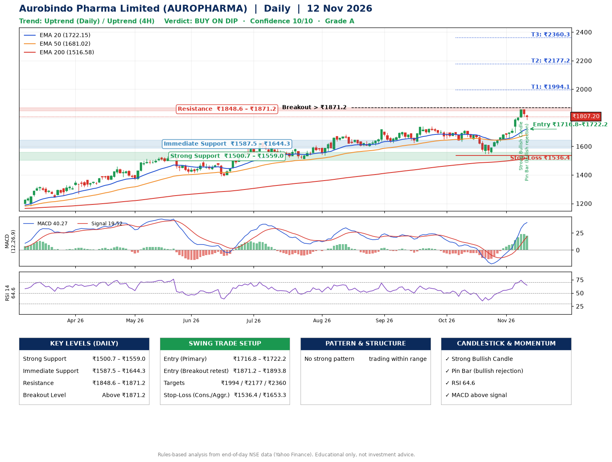

📌 **Aurobindo Pharma Limited (AUROPHARMA) – Multi-Timeframe Technical Analysis (Daily + 4H Combined)**
_Data up to 12 Nov 2026 · Close ₹1807.20_

**📍 Daily Timeframe Trend**
- Trend: **Uptrend** (price above rising EMAs)
- Recent swing highs: ₹1704.0, ₹1740.0, ₹1715.0 · swing lows: ₹1623.0, ₹1633.0, ₹1547.7
- EMAs: EMA20 ₹1722.2, EMA50 ₹1681.0, EMA200 ₹1516.6; bullish stack (EMA20 > EMA50 > EMA200); price above EMA20, EMA50, EMA200
- MACD 40.27 above signal 19.52 (above zero); histogram falling
- RSI(14) 64.6; no divergence on the last two swings

**📍 4-Hour Timeframe Trend**
- Structure: **Uptrend** (higher highs and higher lows)
- Pullback/support area: recent 4H swing lows ₹1548.0, ₹1656.2; EMA20 ₹1758.7
- EMA20/50: bullish stack (EMA20 > EMA50); price above EMA20, EMA50
- MACD 46.50 above signal 40.73 (above zero); histogram falling
- RSI(14) 64.9; no divergence

**📍 Pattern Detection (Both Timeframes)**
- 4H: **Inverse Head & Shoulders** – head ₹1548.0, neckline ₹1687.0
- 4H: **Bull Flag** – 15% pole then a tight 4% flag; trigger above ₹1856.0

**📍 Candlestick Patterns (last 3 daily candles)**
- **Strong Bullish Candle** – 09 Nov: wide-range green candle, buyers in control
- **Pin Bar (bullish rejection)** – 12 Nov: long lower wick shows dip-buying near ₹1785.4

**📍 Price Action Key Levels (Daily Structure)**

| Zone | Price Level (₹) | Context |
|------|-----------------|---------|
| Strong Support | ₹1500.7 – ₹1559.0 | Cluster of earlier swing lows (demand) |
| Immediate Support | ₹1587.5 – ₹1644.3 | Nearest swing-low / wick area |
| Resistance | ₹1848.6 – ₹1871.2 | Nearest swing-high supply |
| Breakout Level | Above ₹1871.2 | Swing continuation trigger (52-week high ₹1859.9) |

**📍 Swing Trade Setup**

🟢 **Entry Zone**
- Primary: ₹1716.8 – ₹1722.2 (daily support / EMA20 area; enter on a bullish 4H candle)
- Alternate: ₹1871.2 – ₹1893.8 (breakout retest)

🎯 **Profit Targets**
- T1: ₹1994.1
- T2: ₹2177.2
- T3: ₹2360.3

🛑 **Stop-Loss**
- Conservative: below daily swing low (₹1536.4)
- Aggressive: below 4H structure (₹1653.3)
- Risk per share ≈ ₹183.1; reward:risk to T1 ≈ 1.5
- Time to T1: about 39 trading days (it rose this much within 60 trading days 27% of the time in the last 2 years)
- Time to T2: about 53 trading days (it rose this much within 60 trading days 6% of the time in the last 2 years)

**📌 Strategy Notes**
- Higher timeframe: daily trend is uptrend; only take longs while price holds above ₹1500.7.
- Entry timing: wait for a bullish 4H candle (engulfing/hammer) inside ₹1716.8 – ₹1722.2 rather than buying mid-range.
- EMA stacking: bullish stack (EMA20 > EMA50 > EMA200); price above EMA20, EMA50, EMA200.
- Breakout rule: a daily close above ₹1871.2 with volume above its 20-day average (≈1,270,907) opens T2/T3.
- Momentum: RSI 65 – room to run; no divergence on the last two swings.
- Exit discipline: move the stop to entry once T1 is hit; book partial profits at each target.

**STEP 2 — Marked Up Chart**

**✅ Trade Validation Checklist**
- Trend + momentum aligned: Yes · Price at entry zone: No
- Stop defined (₹1536.4) · Reward:risk ≥ 1.5 to T1: No

## 📌 Final Verdict

Recommendation: **🟡 BUY ON DIP**

Confidence: **10/10**

Trade Quality: **A**

Reason:
• Daily uptrend (price above rising EMAs)
• EMAs stacked bullishly

Next Action:
• Wait for a pullback to ₹1716.8–₹1722.2

_Rules-based analysis from end-of-day data. Educational only, not investment advice. Never place orders without your own confirmation._