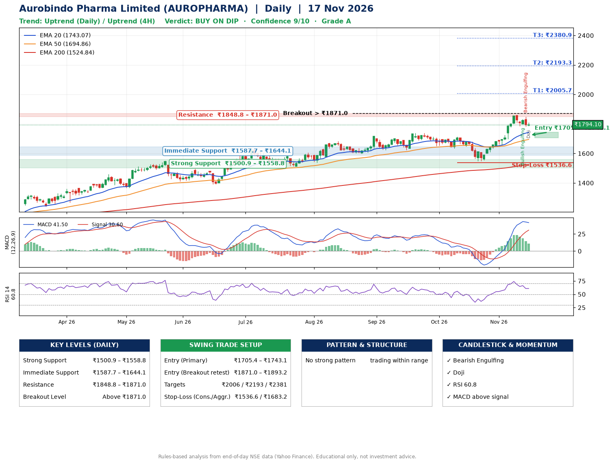

📌 **Aurobindo Pharma Limited (AUROPHARMA) – Multi-Timeframe Technical Analysis (Daily + 4H Combined)**
_Data up to 17 Nov 2026 · Close ₹1794.10_

**📍 Daily Timeframe Trend**
- Trend: **Uptrend** (price above rising EMAs)
- Recent swing highs: ₹1704.0, ₹1740.0, ₹1715.0 · swing lows: ₹1623.0, ₹1633.0, ₹1547.7
- EMAs: EMA20 ₹1743.1, EMA50 ₹1694.9, EMA200 ₹1524.8; bullish stack (EMA20 > EMA50 > EMA200); price above EMA20, EMA50, EMA200
- MACD 41.50 above signal 30.60 (above zero); histogram falling
- RSI(14) 60.8; no divergence on the last two swings

**📍 4-Hour Timeframe Trend**
- Structure: **Uptrend** (price above rising EMAs)
- Pullback/support area: recent 4H swing lows ₹1656.2, ₹1786.4; EMA20 ₹1778.8
- EMA20/50: bullish stack (EMA20 > EMA50); price above EMA20, EMA50
- MACD 32.16 below signal 38.60 (above zero), fresh bearish crossover; histogram falling
- RSI(14) 58.3; no divergence

**📍 Pattern Detection (Both Timeframes)**
- 4H: **Bull Flag** – 16% pole then a tight 4% flag; trigger above ₹1849.3

**📍 Candlestick Patterns (last 3 daily candles)**
- **Bullish Engulfing** – 13 Nov: buyers fully reversed the prior red candle
- **Bearish Engulfing** – 16 Nov: sellers fully reversed the prior green candle
- **Doji** – 17 Nov: indecision; wait for the next candle to confirm direction

**📍 Price Action Key Levels (Daily Structure)**

| Zone | Price Level (₹) | Context |
|------|-----------------|---------|
| Strong Support | ₹1500.9 – ₹1558.8 | Cluster of earlier swing lows (demand) |
| Immediate Support | ₹1587.7 – ₹1644.1 | Nearest swing-low / wick area |
| Resistance | ₹1848.8 – ₹1871.0 | Nearest swing-high supply |
| Breakout Level | Above ₹1871.0 | Swing continuation trigger (52-week high ₹1859.9) |

**📍 Swing Trade Setup**

🟢 **Entry Zone**
- Primary: ₹1705.4 – ₹1743.1 (daily support / EMA20 area; enter on a bullish 4H candle)
- Alternate: ₹1871.0 – ₹1893.2 (breakout retest)

🎯 **Profit Targets**
- T1: ₹2005.7
- T2: ₹2193.3
- T3: ₹2380.9

🛑 **Stop-Loss**
- Conservative: below daily swing low (₹1536.6)
- Aggressive: below 4H structure (₹1683.2)
- Risk per share ≈ ₹187.6; reward:risk to T1 ≈ 1.5
- Time to T1: about 41 trading days (it rose this much within 60 trading days 26% of the time in the last 2 years)
- Time to T2: about 52 trading days (it rose this much within 60 trading days 5% of the time in the last 2 years)

**📌 Strategy Notes**
- Higher timeframe: daily trend is uptrend; only take longs while price holds above ₹1500.9.
- Entry timing: wait for a bullish 4H candle (engulfing/hammer) inside ₹1705.4 – ₹1743.1 rather than buying mid-range.
- EMA stacking: bullish stack (EMA20 > EMA50 > EMA200); price above EMA20, EMA50, EMA200.
- Breakout rule: a daily close above ₹1871.0 with volume above its 20-day average (≈1,326,220) opens T2/T3.
- Momentum: RSI 61 – room to run; no divergence on the last two swings.
- Exit discipline: move the stop to entry once T1 is hit; book partial profits at each target.

**STEP 2 — Marked Up Chart**

**✅ Trade Validation Checklist**
- Trend + momentum aligned: Yes · Price at entry zone: No
- Stop defined (₹1536.6) · Reward:risk ≥ 1.5 to T1: Yes

## 📌 Final Verdict

Recommendation: **🟡 BUY ON DIP**

Confidence: **9/10**

Trade Quality: **A**

Reason:
• Daily uptrend (price above rising EMAs)
• EMAs stacked bullishly

Next Action:
• Wait for a pullback to ₹1705.4–₹1743.1, or a breakout above ₹1871.0

_Rules-based analysis from end-of-day data. Educational only, not investment advice. Never place orders without your own confirmation._