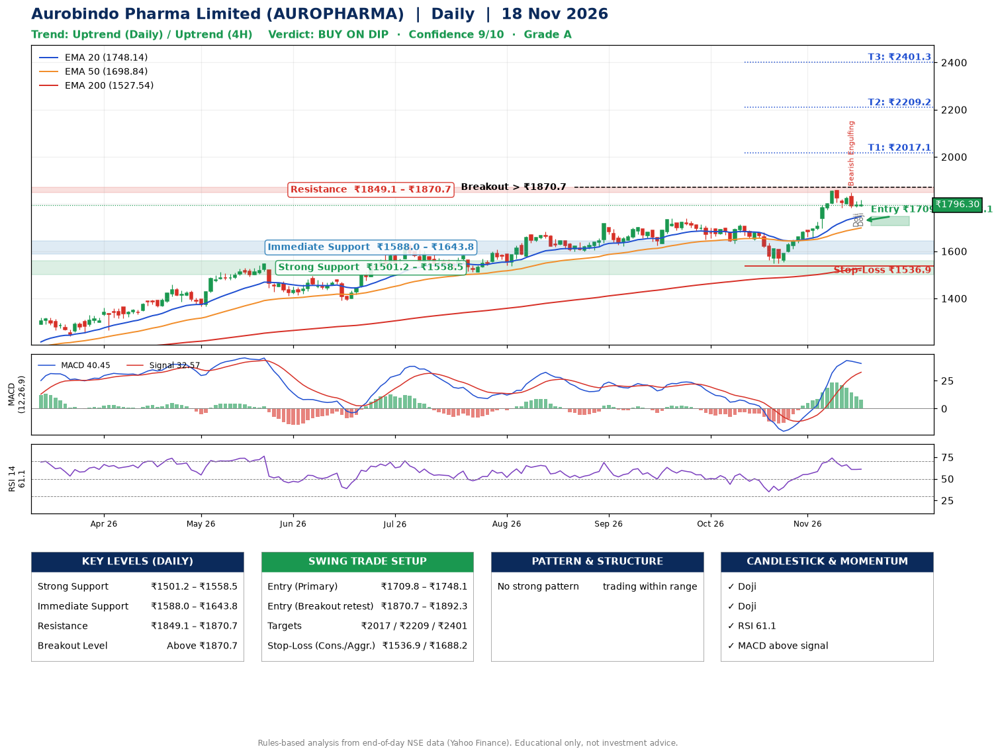

📌 **Aurobindo Pharma Limited (AUROPHARMA) – Multi-Timeframe Technical Analysis (Daily + 4H Combined)**
_Data up to 18 Nov 2026 · Close ₹1796.30_

**📍 Daily Timeframe Trend**
- Trend: **Uptrend** (price above rising EMAs)
- Recent swing highs: ₹1740.0, ₹1715.0, ₹1859.9 · swing lows: ₹1623.0, ₹1633.0, ₹1547.7
- EMAs: EMA20 ₹1748.1, EMA50 ₹1698.8, EMA200 ₹1527.5; bullish stack (EMA20 > EMA50 > EMA200); price above EMA20, EMA50, EMA200
- MACD 40.45 above signal 32.57 (above zero); histogram falling
- RSI(14) 61.1; no divergence on the last two swings

**📍 4-Hour Timeframe Trend**
- Structure: **Uptrend** (price above rising EMAs)
- Pullback/support area: recent 4H swing lows ₹1786.4, ₹1783.2; EMA20 ₹1783.1
- EMA20/50: bullish stack (EMA20 > EMA50); price above EMA20, EMA50
- MACD 28.28 below signal 35.29 (above zero), fresh bearish crossover; histogram falling
- RSI(14) 57.4; no divergence

**📍 Pattern Detection (Both Timeframes)**
- No strong pattern detected. Trading within range.

**📍 Candlestick Patterns (last 3 daily candles)**
- **Bearish Engulfing** – 16 Nov: sellers fully reversed the prior green candle
- **Doji** – 17 Nov: indecision; wait for the next candle to confirm direction
- **Doji** – 18 Nov: indecision; wait for the next candle to confirm direction

**📍 Price Action Key Levels (Daily Structure)**

| Zone | Price Level (₹) | Context |
|------|-----------------|---------|
| Strong Support | ₹1501.2 – ₹1558.5 | Cluster of earlier swing lows (demand) |
| Immediate Support | ₹1588.0 – ₹1643.8 | Nearest swing-low / wick area |
| Resistance | ₹1849.1 – ₹1870.7 | Nearest swing-high supply |
| Breakout Level | Above ₹1870.7 | Swing continuation trigger (52-week high ₹1859.9) |

**📍 Swing Trade Setup**

🟢 **Entry Zone**
- Primary: ₹1709.8 – ₹1748.1 (daily support / EMA20 area; enter on a bullish 4H candle)
- Alternate: ₹1870.7 – ₹1892.3 (breakout retest)

🎯 **Profit Targets**
- T1: ₹2017.1
- T2: ₹2209.2
- T3: ₹2401.3

🛑 **Stop-Loss**
- Conservative: below daily swing low (₹1536.9)
- Aggressive: below 4H structure (₹1688.2)
- Risk per share ≈ ₹192.1; reward:risk to T1 ≈ 1.5
- Time to T1: about 44 trading days (it rose this much within 60 trading days 26% of the time in the last 2 years)
- Time to T2: about 53 trading days (it rose this much within 60 trading days 4% of the time in the last 2 years)

**📌 Strategy Notes**
- Higher timeframe: daily trend is uptrend; only take longs while price holds above ₹1501.2.
- Entry timing: wait for a bullish 4H candle (engulfing/hammer) inside ₹1709.8 – ₹1748.1 rather than buying mid-range.
- EMA stacking: bullish stack (EMA20 > EMA50 > EMA200); price above EMA20, EMA50, EMA200.
- Breakout rule: a daily close above ₹1870.7 with volume above its 20-day average (≈1,349,027) opens T2/T3.
- Momentum: RSI 61 – room to run; no divergence on the last two swings.
- Exit discipline: move the stop to entry once T1 is hit; book partial profits at each target.

**STEP 2 — Marked Up Chart**

**✅ Trade Validation Checklist**
- Trend + momentum aligned: Yes · Price at entry zone: No
- Stop defined (₹1536.9) · Reward:risk ≥ 1.5 to T1: No

## 📌 Final Verdict

Recommendation: **🟡 BUY ON DIP**

Confidence: **9/10**

Trade Quality: **A**

Reason:
• Daily uptrend (price above rising EMAs)
• EMAs stacked bullishly

Next Action:
• Wait for a pullback to ₹1709.8–₹1748.1, or a breakout above ₹1870.7

_Rules-based analysis from end-of-day data. Educational only, not investment advice. Never place orders without your own confirmation._