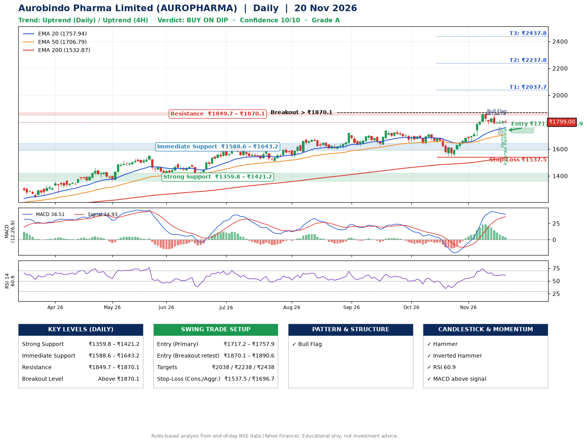

📌 **Aurobindo Pharma Limited (AUROPHARMA) – Multi-Timeframe Technical Analysis (Daily + 4H Combined)**
_Data up to 20 Nov 2026 · Close ₹1799.00_

**📍 Daily Timeframe Trend**
- Trend: **Uptrend** (price above rising EMAs)
- Recent swing highs: ₹1740.0, ₹1715.0, ₹1859.9 · swing lows: ₹1623.0, ₹1633.0, ₹1547.7
- EMAs: EMA20 ₹1757.9, EMA50 ₹1706.8, EMA200 ₹1532.9; bullish stack (EMA20 > EMA50 > EMA200); price above EMA20, EMA50, EMA200
- MACD 38.51 above signal 34.93 (above zero); histogram falling
- RSI(14) 60.9; no divergence on the last two swings

**📍 4-Hour Timeframe Trend**
- Structure: **Uptrend** (price above rising EMAs)
- Pullback/support area: recent 4H swing lows ₹1783.2, ₹1778.1; EMA20 ₹1790.3
- EMA20/50: bullish stack (EMA20 > EMA50); price above EMA20, EMA50
- MACD 22.21 below signal 28.64 (above zero); histogram falling
- RSI(14) 56.2; no divergence

**📍 Pattern Detection (Both Timeframes)**
- Daily: **Bull Flag** – 17% pole then a tight 5% flag; trigger above ₹1859.9

**📍 Candlestick Patterns (last 3 daily candles)**
- **Doji** – 18 Nov: indecision; wait for the next candle to confirm direction
- **Hammer** – 19 Nov: long lower wick shows dip-buying near ₹1778.0
- **Inverted Hammer** – 20 Nov: long upper wick shows selling near ₹1817.5

**📍 Price Action Key Levels (Daily Structure)**

| Zone | Price Level (₹) | Context |
|------|-----------------|---------|
| Strong Support | ₹1359.8 – ₹1421.2 | Cluster of earlier swing lows (demand) |
| Immediate Support | ₹1588.6 – ₹1643.2 | Nearest swing-low / wick area |
| Resistance | ₹1849.7 – ₹1870.1 | Nearest swing-high supply |
| Breakout Level | Above ₹1870.1 | Swing continuation trigger (52-week high ₹1859.9) |

**📍 Swing Trade Setup**

🟢 **Entry Zone**
- Primary: ₹1717.2 – ₹1757.9 (daily support / EMA20 area; enter on a bullish 4H candle)
- Alternate: ₹1870.1 – ₹1890.6 (breakout retest)

🎯 **Profit Targets**
- T1: ₹2037.7
- T2: ₹2237.8
- T3: ₹2437.8

🛑 **Stop-Loss**
- Conservative: below daily swing low (₹1537.5)
- Aggressive: below 4H structure (₹1696.7)
- Risk per share ≈ ₹200.1; reward:risk to T1 ≈ 1.5
- Time to T1: about 44 trading days (it rose this much within 60 trading days 23% of the time in the last 2 years)
- Time to T2: about 52 trading days (it rose this much within 60 trading days 3% of the time in the last 2 years)

**📌 Strategy Notes**
- Higher timeframe: daily trend is uptrend; only take longs while price holds above ₹1359.8.
- Entry timing: wait for a bullish 4H candle (engulfing/hammer) inside ₹1717.2 – ₹1757.9 rather than buying mid-range.
- EMA stacking: bullish stack (EMA20 > EMA50 > EMA200); price above EMA20, EMA50, EMA200.
- Breakout rule: a daily close above ₹1870.1 with volume above its 20-day average (≈1,310,547) opens T2/T3.
- Momentum: RSI 61 – room to run; no divergence on the last two swings.
- Exit discipline: move the stop to entry once T1 is hit; book partial profits at each target.

**STEP 2 — Marked Up Chart**

**✅ Trade Validation Checklist**
- Trend + momentum aligned: Yes · Price at entry zone: No
- Stop defined (₹1537.5) · Reward:risk ≥ 1.5 to T1: Yes

## 📌 Final Verdict

Recommendation: **🟡 BUY ON DIP**

Confidence: **10/10**

Trade Quality: **A**

Reason:
• Daily uptrend (price above rising EMAs)
• EMAs stacked bullishly

Next Action:
• Wait for a pullback to ₹1717.2–₹1757.9, or a breakout above ₹1870.1

_Rules-based analysis from end-of-day data. Educational only, not investment advice. Never place orders without your own confirmation._