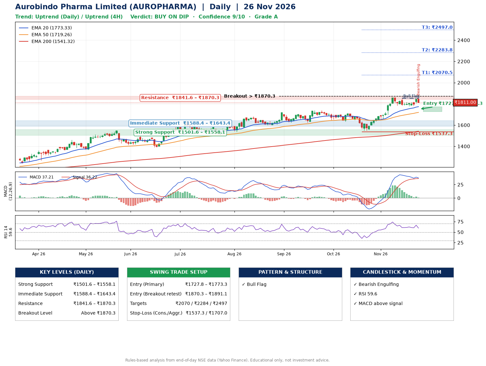

📌 **Aurobindo Pharma Limited (AUROPHARMA) – Multi-Timeframe Technical Analysis (Daily + 4H Combined)**
_Data up to 26 Nov 2026 · Close ₹1811.00_

**📍 Daily Timeframe Trend**
- Trend: **Uptrend** (price above rising EMAs)
- Recent swing highs: ₹1740.0, ₹1715.0, ₹1859.9 · swing lows: ₹1623.0, ₹1633.0, ₹1547.7
- EMAs: EMA20 ₹1773.3, EMA50 ₹1719.3, EMA200 ₹1541.3; bullish stack (EMA20 > EMA50 > EMA200); price above EMA20, EMA50, EMA200
- MACD 37.21 above signal 36.22 (above zero); histogram falling
- RSI(14) 59.6; no divergence on the last two swings

**📍 4-Hour Timeframe Trend**
- Structure: **Uptrend** (price above rising EMAs)
- Pullback/support area: recent 4H swing lows ₹1778.1, ₹1783.3; EMA20 ₹1804.5
- EMA20/50: bullish stack (EMA20 > EMA50); price above EMA20, EMA50
- MACD 19.46 below signal 22.71 (above zero); histogram falling
- RSI(14) 54.7; no divergence

**📍 Pattern Detection (Both Timeframes)**
- Daily: **Bull Flag** – 16% pole then a tight 4% flag; trigger above ₹1852.0

**📍 Candlestick Patterns (last 3 daily candles)**
- **Bearish Engulfing** – 26 Nov: sellers fully reversed the prior green candle

**📍 Price Action Key Levels (Daily Structure)**

| Zone | Price Level (₹) | Context |
|------|-----------------|---------|
| Strong Support | ₹1501.6 – ₹1558.1 | Cluster of earlier swing lows (demand) |
| Immediate Support | ₹1588.4 – ₹1643.4 | Nearest swing-low / wick area |
| Resistance | ₹1841.6 – ₹1870.3 | Nearest swing-high supply |
| Breakout Level | Above ₹1870.3 | Swing continuation trigger (52-week high ₹1859.9) |

**📍 Swing Trade Setup**

🟢 **Entry Zone**
- Primary: ₹1727.8 – ₹1773.3 (daily support / EMA20 area; enter on a bullish 4H candle)
- Alternate: ₹1870.3 – ₹1891.1 (breakout retest)

🎯 **Profit Targets**
- T1: ₹2070.5
- T2: ₹2283.8
- T3: ₹2497.0

🛑 **Stop-Loss**
- Conservative: below daily swing low (₹1537.3)
- Aggressive: below 4H structure (₹1707.0)
- Risk per share ≈ ₹213.3; reward:risk to T1 ≈ 1.5
- Time to T1: about 43 trading days (it rose this much within 60 trading days 19% of the time in the last 2 years)
- Time to T2: about 53 trading days (it rose this much within 60 trading days 2% of the time in the last 2 years)

**📌 Strategy Notes**
- Higher timeframe: daily trend is uptrend; only take longs while price holds above ₹1501.6.
- Entry timing: wait for a bullish 4H candle (engulfing/hammer) inside ₹1727.8 – ₹1773.3 rather than buying mid-range.
- EMA stacking: bullish stack (EMA20 > EMA50 > EMA200); price above EMA20, EMA50, EMA200.
- Breakout rule: a daily close above ₹1870.3 with volume above its 20-day average (≈1,392,073) opens T2/T3.
- Momentum: RSI 60 – room to run; no divergence on the last two swings.
- Exit discipline: move the stop to entry once T1 is hit; book partial profits at each target.

**STEP 2 — Marked Up Chart**

**✅ Trade Validation Checklist**
- Trend + momentum aligned: Yes · Price at entry zone: No
- Stop defined (₹1537.3) · Reward:risk ≥ 1.5 to T1: Yes

## 📌 Final Verdict

Recommendation: **🟡 BUY ON DIP**

Confidence: **9/10**

Trade Quality: **A**

Reason:
• Daily uptrend (price above rising EMAs)
• EMAs stacked bullishly

Next Action:
• Wait for a pullback to ₹1727.8–₹1773.3, or a breakout above ₹1870.3

_Rules-based analysis from end-of-day data. Educational only, not investment advice. Never place orders without your own confirmation._