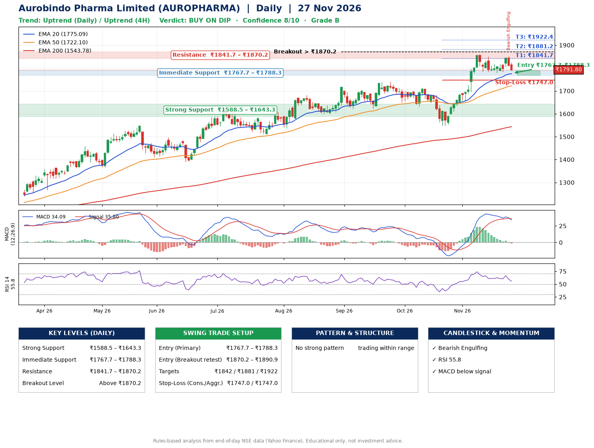

📌 **Aurobindo Pharma Limited (AUROPHARMA) – Multi-Timeframe Technical Analysis (Daily + 4H Combined)**
_Data up to 27 Nov 2026 · Close ₹1791.80_

**📍 Daily Timeframe Trend**
- Trend: **Uptrend** (higher highs and higher lows)
- Recent swing highs: ₹1740.0, ₹1715.0, ₹1859.9 · swing lows: ₹1633.0, ₹1547.7, ₹1778.0
- EMAs: EMA20 ₹1775.1, EMA50 ₹1722.1, EMA200 ₹1543.8; bullish stack (EMA20 > EMA50 > EMA200); price above EMA20, EMA50, EMA200
- MACD 34.09 below signal 35.80 (above zero), fresh bearish crossover; histogram falling
- RSI(14) 55.8; no divergence on the last two swings

**📍 4-Hour Timeframe Trend**
- Structure: **Uptrend** (higher highs and higher lows)
- Pullback/support area: recent 4H swing lows ₹1778.1, ₹1783.3; EMA20 ₹1803.1
- EMA20/50: bullish stack (EMA20 > EMA50); price above EMA50
- MACD 14.08 below signal 20.06 (above zero); histogram falling
- RSI(14) 49.4; Regular bearish divergence

**📍 Pattern Detection (Both Timeframes)**
- 4H: **Double Top** – tops near ₹1849.3/₹1851.2, neckline ₹1778.1, forming

**📍 Candlestick Patterns (last 3 daily candles)**
- **Bearish Engulfing** – 26 Nov: sellers fully reversed the prior green candle

**📍 Price Action Key Levels (Daily Structure)**

| Zone | Price Level (₹) | Context |
|------|-----------------|---------|
| Strong Support | ₹1588.5 – ₹1643.3 | Cluster of earlier swing lows (demand) |
| Immediate Support | ₹1767.7 – ₹1788.3 | Nearest swing-low / wick area |
| Resistance | ₹1841.7 – ₹1870.2 | Nearest swing-high supply |
| Breakout Level | Above ₹1870.2 | Swing continuation trigger (52-week high ₹1859.9) |

**📍 Swing Trade Setup**

🟢 **Entry Zone**
- Primary: ₹1767.7 – ₹1788.3 (daily support / EMA20 area; enter on a bullish 4H candle)
- Alternate: ₹1870.2 – ₹1890.9 (breakout retest)

🎯 **Profit Targets**
- T1: ₹1841.7
- T2: ₹1881.2
- T3: ₹1922.4

🛑 **Stop-Loss**
- Conservative: below daily swing low (₹1747.0)
- Aggressive: below 4H structure (₹1747.0)
- Risk per share ≈ ₹41.3; reward:risk to T1 ≈ 1.5
- Time to T1: about 6 trading days (it rose this much within 60 trading days 88% of the time in the last 2 years)
- Time to T2: about 11 trading days (it rose this much within 60 trading days 79% of the time in the last 2 years)

**📌 Strategy Notes**
- Higher timeframe: daily trend is uptrend; only take longs while price holds above ₹1588.5.
- Entry timing: wait for a bullish 4H candle (engulfing/hammer) inside ₹1767.7 – ₹1788.3 rather than buying mid-range.
- EMA stacking: bullish stack (EMA20 > EMA50 > EMA200); price above EMA20, EMA50, EMA200.
- Breakout rule: a daily close above ₹1870.2 with volume above its 20-day average (≈1,421,896) opens T2/T3.
- Momentum: RSI 56 – room to run; no divergence on the last two swings.
- Exit discipline: move the stop to entry once T1 is hit; book partial profits at each target.

**STEP 2 — Marked Up Chart**

**✅ Trade Validation Checklist**
- Trend + momentum aligned: No · Price at entry zone: No
- Stop defined (₹1747.0) · Reward:risk ≥ 1.5 to T1: Yes

## 📌 Final Verdict

Recommendation: **🟡 BUY ON DIP**

Confidence: **8/10**

Trade Quality: **B**

Reason:
• Daily uptrend (higher highs and higher lows)
• EMAs stacked bullishly

Next Action:
• Wait for a pullback to ₹1767.7–₹1788.3, or a breakout above ₹1870.2

_Rules-based analysis from end-of-day data. Educational only, not investment advice. Never place orders without your own confirmation._