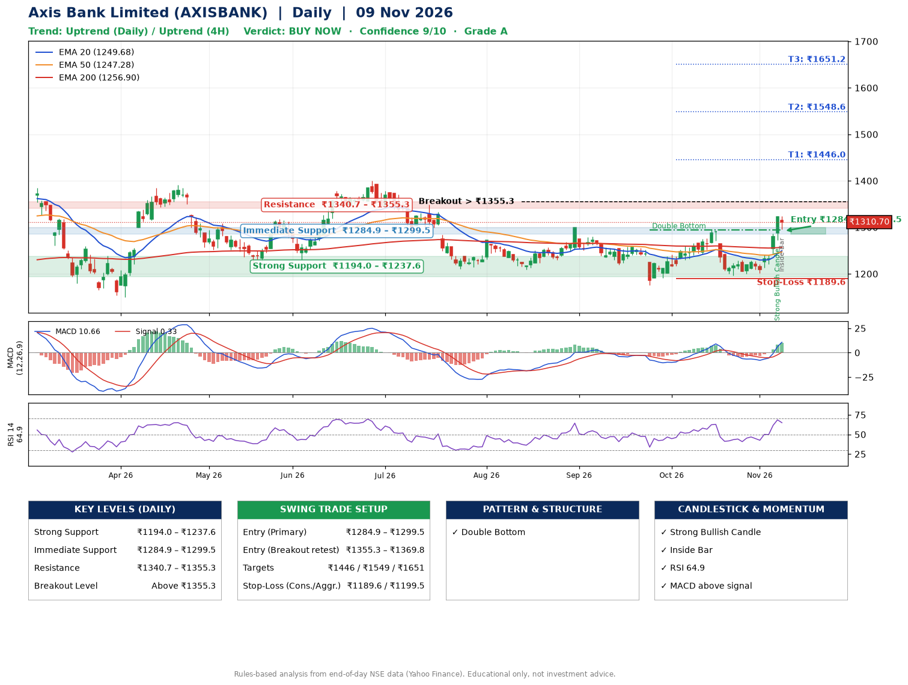

📌 **Axis Bank Limited (AXISBANK) – Multi-Timeframe Technical Analysis (Daily + 4H Combined)**
_Data up to 09 Nov 2026 · Close ₹1310.70_

**📍 Daily Timeframe Trend**
- Trend: **Uptrend** (higher highs and higher lows)
- Recent swing highs: ₹1300.0, ₹1257.6, ₹1293.8 · swing lows: ₹1219.9, ₹1175.0, ₹1196.9
- EMAs: EMA20 ₹1249.7, EMA50 ₹1247.3, EMA200 ₹1256.9; mixed / crossing; price above EMA20, EMA50, EMA200
- MACD 10.66 above signal 0.33 (above zero), fresh bullish crossover; histogram rising
- RSI(14) 64.9; no divergence on the last two swings

**📍 4-Hour Timeframe Trend**
- Structure: **Uptrend** (price above rising EMAs)
- Pullback/support area: recent 4H swing lows ₹1200.0, ₹1201.5; EMA20 ₹1258.6
- EMA20/50: bullish stack (EMA20 > EMA50); price above EMA20, EMA50
- MACD 19.43 above signal 8.79 (above zero); histogram falling
- RSI(14) 68.3; Hidden bullish divergence; Hidden bearish divergence

**📍 Pattern Detection (Both Timeframes)**
- Daily: **Double Bottom** – bottoms near ₹1175.0/₹1196.9, neckline ₹1293.8, confirmed (closed above neckline)
- 4H: **Descending Triangle** – converging swing highs and lows over the last ~60 sessions

**📍 Candlestick Patterns (last 3 daily candles)**
- **Strong Bullish Candle** – 06 Nov: wide-range green candle, buyers in control
- **Inside Bar** – 09 Nov: compression inside the prior range ₹1272.1–₹1324.5

**📍 Price Action Key Levels (Daily Structure)**

| Zone | Price Level (₹) | Context |
|------|-----------------|---------|
| Strong Support | ₹1194.0 – ₹1237.6 | Cluster of earlier swing lows (demand) |
| Immediate Support | ₹1284.9 – ₹1299.5 | Nearest swing-low / wick area |
| Resistance | ₹1340.7 – ₹1355.3 | Nearest swing-high supply |
| Breakout Level | Above ₹1355.3 | Swing continuation trigger (52-week high ₹1418.3) |

**📍 Swing Trade Setup**

🟢 **Entry Zone**
- Primary: ₹1284.9 – ₹1299.5 (daily support / EMA20 area; enter on a bullish 4H candle)
- Alternate: ₹1355.3 – ₹1369.8 (breakout retest)

🎯 **Profit Targets**
- T1: ₹1446.0
- T2: ₹1548.6
- T3: ₹1651.2

🛑 **Stop-Loss**
- Conservative: below daily swing low (₹1189.6)
- Aggressive: below 4H structure (₹1199.5)
- Risk per share ≈ ₹102.6; reward:risk to T1 ≈ 1.5

**📌 Strategy Notes**
- Higher timeframe: daily trend is uptrend; only take longs while price holds above ₹1194.0.
- Entry timing: wait for a bullish 4H candle (engulfing/hammer) inside ₹1284.9 – ₹1299.5 rather than buying mid-range.
- EMA stacking: mixed / crossing; price above EMA20, EMA50, EMA200.
- Breakout rule: a daily close above ₹1355.3 with volume above its 20-day average (≈6,986,982) opens T2/T3.
- Momentum: RSI 65 – room to run; no divergence on the last two swings.
- Exit discipline: move the stop to entry once T1 is hit; book partial profits at each target.

**STEP 2 — Marked Up Chart**

**✅ Trade Validation Checklist**
- Trend + momentum aligned: Yes · Price at entry zone: No
- Stop defined (₹1189.6) · Reward:risk ≥ 1.5 to T1: No

## 📌 Final Verdict

Recommendation: **🟢 BUY NOW**

Confidence: **9/10**

Trade Quality: **A**

Reason:
• Daily uptrend (higher highs and higher lows)
• Double Bottom: bottoms near ₹1175.0/₹1196.9, neckline ₹1293.8, confirmed (closed above neckline)

Next Action:
• Buy now within the entry zone, with the stop-loss in place

_Rules-based analysis from end-of-day data. Educational only, not investment advice. Never place orders without your own confirmation._