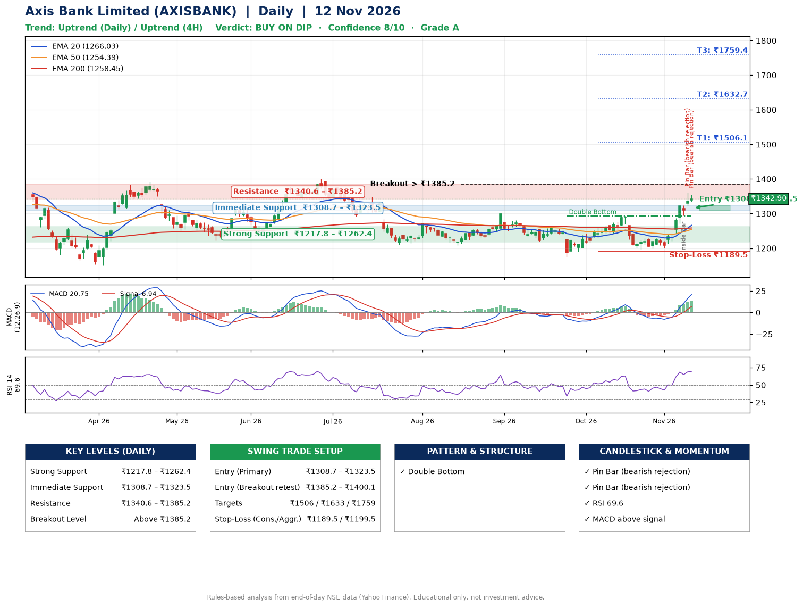

📌 **Axis Bank Limited (AXISBANK) – Multi-Timeframe Technical Analysis (Daily + 4H Combined)**
_Data up to 12 Nov 2026 · Close ₹1342.90_

**📍 Daily Timeframe Trend**
- Trend: **Uptrend** (higher highs and higher lows)
- Recent swing highs: ₹1300.0, ₹1257.6, ₹1293.8 · swing lows: ₹1219.9, ₹1175.0, ₹1196.9
- EMAs: EMA20 ₹1266.0, EMA50 ₹1254.4, EMA200 ₹1258.5; mixed / crossing; price above EMA20, EMA50, EMA200
- MACD 20.75 above signal 6.94 (above zero), fresh bullish crossover; histogram rising
- RSI(14) 69.6; no divergence on the last two swings

**📍 4-Hour Timeframe Trend**
- Structure: **Uptrend** (higher highs and higher lows)
- Pullback/support area: recent 4H swing lows ₹1200.0, ₹1201.5; EMA20 ₹1285.6
- EMA20/50: bullish stack (EMA20 > EMA50); price above EMA20, EMA50
- MACD 29.38 above signal 19.63 (above zero); histogram falling
- RSI(14) 73.1; Hidden bullish divergence

**📍 Pattern Detection (Both Timeframes)**
- Daily: **Double Bottom** – bottoms near ₹1175.0/₹1196.9, neckline ₹1293.8, confirmed (closed above neckline)

**📍 Candlestick Patterns (last 3 daily candles)**
- **Inside Bar** – 09 Nov: compression inside the prior range ₹1272.1–₹1324.5
- **Pin Bar (bearish rejection)** – 11 Nov: long upper wick shows selling near ₹1360.4
- **Pin Bar (bearish rejection)** – 12 Nov: long upper wick shows selling near ₹1354.1

**📍 Price Action Key Levels (Daily Structure)**

| Zone | Price Level (₹) | Context |
|------|-----------------|---------|
| Strong Support | ₹1217.8 – ₹1262.4 | Cluster of earlier swing lows (demand) |
| Immediate Support | ₹1308.7 – ₹1323.5 | Nearest swing-low / wick area |
| Resistance | ₹1340.6 – ₹1385.2 | Nearest swing-high supply |
| Breakout Level | Above ₹1385.2 | Swing continuation trigger (52-week high ₹1418.3) |

**📍 Swing Trade Setup**

🟢 **Entry Zone**
- Primary: ₹1308.7 – ₹1323.5 (daily support / EMA20 area; enter on a bullish 4H candle)
- Alternate: ₹1385.2 – ₹1400.1 (breakout retest)

🎯 **Profit Targets**
- T1: ₹1506.1
- T2: ₹1632.7
- T3: ₹1759.4

🛑 **Stop-Loss**
- Conservative: below daily swing low (₹1189.5)
- Aggressive: below 4H structure (₹1199.5)
- Risk per share ≈ ₹126.6; reward:risk to T1 ≈ 1.5
- Time to T1: about 36 trading days (it rose this much within 60 trading days 27% of the time in the last 2 years)
- Time to T2: about 53 trading days (it rose this much within 60 trading days 4% of the time in the last 2 years)

**📌 Strategy Notes**
- Higher timeframe: daily trend is uptrend; only take longs while price holds above ₹1217.8.
- Entry timing: wait for a bullish 4H candle (engulfing/hammer) inside ₹1308.7 – ₹1323.5 rather than buying mid-range.
- EMA stacking: mixed / crossing; price above EMA20, EMA50, EMA200.
- Breakout rule: a daily close above ₹1385.2 with volume above its 20-day average (≈7,431,635) opens T2/T3.
- Momentum: RSI 70 – elevated, prefer dips; no divergence on the last two swings.
- Exit discipline: move the stop to entry once T1 is hit; book partial profits at each target.

**STEP 2 — Marked Up Chart**

**✅ Trade Validation Checklist**
- Trend + momentum aligned: Yes · Price at entry zone: No
- Stop defined (₹1189.5) · Reward:risk ≥ 1.5 to T1: Yes

## 📌 Final Verdict

Recommendation: **🟡 BUY ON DIP**

Confidence: **8/10**

Trade Quality: **A**

Reason:
• Daily uptrend (higher highs and higher lows)
• Double Bottom: bottoms near ₹1175.0/₹1196.9, neckline ₹1293.8, confirmed (closed above neckline)

Next Action:
• Wait for a pullback to ₹1308.7–₹1323.5, or a breakout above ₹1385.2

_Rules-based analysis from end-of-day data. Educational only, not investment advice. Never place orders without your own confirmation._