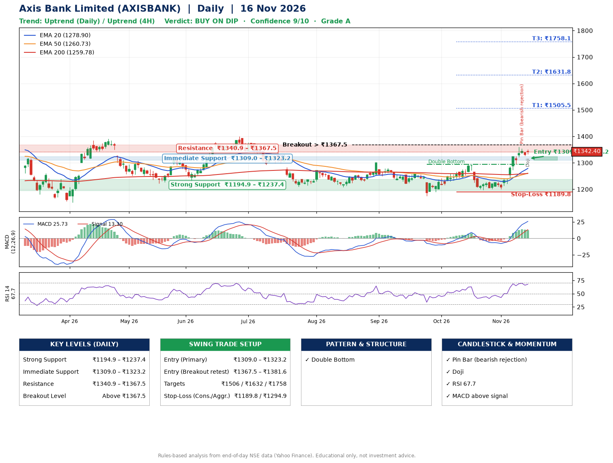

📌 **Axis Bank Limited (AXISBANK) – Multi-Timeframe Technical Analysis (Daily + 4H Combined)**
_Data up to 16 Nov 2026 · Close ₹1342.40_

**📍 Daily Timeframe Trend**
- Trend: **Uptrend** (higher highs and higher lows)
- Recent swing highs: ₹1300.0, ₹1257.6, ₹1293.8 · swing lows: ₹1219.9, ₹1175.0, ₹1196.9
- EMAs: EMA20 ₹1278.9, EMA50 ₹1260.7, EMA200 ₹1259.8; bullish stack (EMA20 > EMA50 > EMA200); price above EMA20, EMA50, EMA200
- MACD 25.73 above signal 13.30 (above zero); histogram falling
- RSI(14) 67.7; no divergence on the last two swings

**📍 4-Hour Timeframe Trend**
- Structure: **Uptrend** (higher highs and higher lows)
- Pullback/support area: recent 4H swing lows ₹1201.5, ₹1326.0; EMA20 ₹1314.5
- EMA20/50: bullish stack (EMA20 > EMA50); price above EMA20, EMA50
- MACD 31.33 above signal 27.22 (above zero); histogram falling
- RSI(14) 75.2; no divergence

**📍 Pattern Detection (Both Timeframes)**
- Daily: **Double Bottom** – bottoms near ₹1175.0/₹1196.9, neckline ₹1293.8, confirmed (closed above neckline)

**📍 Candlestick Patterns (last 3 daily candles)**
- **Pin Bar (bearish rejection)** – 12 Nov: long upper wick shows selling near ₹1354.1
- **Doji** – 16 Nov: indecision; wait for the next candle to confirm direction

**📍 Price Action Key Levels (Daily Structure)**

| Zone | Price Level (₹) | Context |
|------|-----------------|---------|
| Strong Support | ₹1194.9 – ₹1237.4 | Cluster of earlier swing lows (demand) |
| Immediate Support | ₹1309.0 – ₹1323.2 | Nearest swing-low / wick area |
| Resistance | ₹1340.9 – ₹1367.5 | Nearest swing-high supply |
| Breakout Level | Above ₹1367.5 | Swing continuation trigger (52-week high ₹1418.3) |

**📍 Swing Trade Setup**

🟢 **Entry Zone**
- Primary: ₹1309.0 – ₹1323.2 (daily support / EMA20 area; enter on a bullish 4H candle)
- Alternate: ₹1367.5 – ₹1381.6 (breakout retest)

🎯 **Profit Targets**
- T1: ₹1505.5
- T2: ₹1631.8
- T3: ₹1758.1

🛑 **Stop-Loss**
- Conservative: below daily swing low (₹1189.8)
- Aggressive: below 4H structure (₹1294.9)
- Risk per share ≈ ₹126.3; reward:risk to T1 ≈ 1.5
- Time to T1: about 36 trading days (it rose this much within 60 trading days 27% of the time in the last 2 years)
- Time to T2: about 53 trading days (it rose this much within 60 trading days 4% of the time in the last 2 years)

**📌 Strategy Notes**
- Higher timeframe: daily trend is uptrend; only take longs while price holds above ₹1194.9.
- Entry timing: wait for a bullish 4H candle (engulfing/hammer) inside ₹1309.0 – ₹1323.2 rather than buying mid-range.
- EMA stacking: bullish stack (EMA20 > EMA50 > EMA200); price above EMA20, EMA50, EMA200.
- Breakout rule: a daily close above ₹1367.5 with volume above its 20-day average (≈6,897,051) opens T2/T3.
- Momentum: RSI 68 – elevated, prefer dips; no divergence on the last two swings.
- Exit discipline: move the stop to entry once T1 is hit; book partial profits at each target.

**STEP 2 — Marked Up Chart**

**✅ Trade Validation Checklist**
- Trend + momentum aligned: Yes · Price at entry zone: No
- Stop defined (₹1189.8) · Reward:risk ≥ 1.5 to T1: No

## 📌 Final Verdict

Recommendation: **🟡 BUY ON DIP**

Confidence: **9/10**

Trade Quality: **A**

Reason:
• Daily uptrend (higher highs and higher lows)
• EMAs stacked bullishly

Next Action:
• Wait for a pullback to ₹1309.0–₹1323.2, or a breakout above ₹1367.5

_Rules-based analysis from end-of-day data. Educational only, not investment advice. Never place orders without your own confirmation._