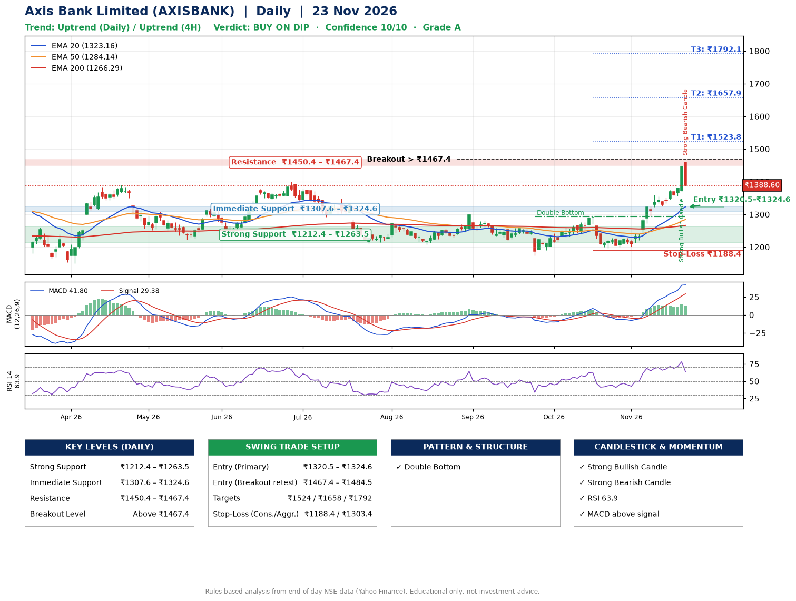

📌 **Axis Bank Limited (AXISBANK) – Multi-Timeframe Technical Analysis (Daily + 4H Combined)**
_Data up to 23 Nov 2026 · Close ₹1388.60_

**📍 Daily Timeframe Trend**
- Trend: **Uptrend** (higher highs and higher lows)
- Recent swing highs: ₹1300.0, ₹1257.6, ₹1293.8 · swing lows: ₹1219.9, ₹1175.0, ₹1196.9
- EMAs: EMA20 ₹1323.2, EMA50 ₹1284.1, EMA200 ₹1266.3; bullish stack (EMA20 > EMA50 > EMA200); price above EMA20, EMA50, EMA200
- MACD 41.80 above signal 29.38 (above zero); histogram falling
- RSI(14) 63.9; no divergence on the last two swings

**📍 4-Hour Timeframe Trend**
- Structure: **Uptrend** (higher highs and higher lows)
- Pullback/support area: recent 4H swing lows ₹1201.5, ₹1326.0; EMA20 ₹1360.1
- EMA20/50: bullish stack (EMA20 > EMA50); price above EMA20, EMA50
- MACD 36.23 above signal 34.08 (above zero); histogram falling
- RSI(14) 61.6; no divergence

**📍 Pattern Detection (Both Timeframes)**
- Daily: **Double Bottom** – bottoms near ₹1175.0/₹1196.9, neckline ₹1293.8, confirmed (closed above neckline)

**📍 Candlestick Patterns (last 3 daily candles)**
- **Strong Bullish Candle** – 20 Nov: wide-range green candle, buyers in control
- **Strong Bearish Candle** – 23 Nov: wide-range red candle, sellers in control

**📍 Price Action Key Levels (Daily Structure)**

| Zone | Price Level (₹) | Context |
|------|-----------------|---------|
| Strong Support | ₹1212.4 – ₹1263.5 | Cluster of earlier swing lows (demand) |
| Immediate Support | ₹1307.6 – ₹1324.6 | Nearest swing-low / wick area |
| Resistance | ₹1450.4 – ₹1467.4 | Nearest swing-high supply |
| Breakout Level | Above ₹1467.4 | Swing continuation trigger (52-week high ₹1458.9) |

**📍 Swing Trade Setup**

🟢 **Entry Zone**
- Primary: ₹1320.5 – ₹1324.6 (daily support / EMA20 area; enter on a bullish 4H candle)
- Alternate: ₹1467.4 – ₹1484.5 (breakout retest)

🎯 **Profit Targets**
- T1: ₹1523.8
- T2: ₹1657.9
- T3: ₹1792.1

🛑 **Stop-Loss**
- Conservative: below daily swing low (₹1188.4)
- Aggressive: below 4H structure (₹1303.4)
- Risk per share ≈ ₹134.2; reward:risk to T1 ≈ 1.5
- Time to T1: about 36 trading days (it rose this much within 60 trading days 25% of the time in the last 2 years)
- Time to T2: about 54 trading days (it rose this much within 60 trading days 2% of the time in the last 2 years)

**📌 Strategy Notes**
- Higher timeframe: daily trend is uptrend; only take longs while price holds above ₹1212.4.
- Entry timing: wait for a bullish 4H candle (engulfing/hammer) inside ₹1320.5 – ₹1324.6 rather than buying mid-range.
- EMA stacking: bullish stack (EMA20 > EMA50 > EMA200); price above EMA20, EMA50, EMA200.
- Breakout rule: a daily close above ₹1467.4 with volume above its 20-day average (≈7,364,417) opens T2/T3.
- Momentum: RSI 64 – room to run; no divergence on the last two swings.
- Exit discipline: move the stop to entry once T1 is hit; book partial profits at each target.

**STEP 2 — Marked Up Chart**

**✅ Trade Validation Checklist**
- Trend + momentum aligned: Yes · Price at entry zone: No
- Stop defined (₹1188.4) · Reward:risk ≥ 1.5 to T1: Yes

## 📌 Final Verdict

Recommendation: **🟡 BUY ON DIP**

Confidence: **10/10**

Trade Quality: **A**

Reason:
• Daily uptrend (higher highs and higher lows)
• EMAs stacked bullishly

Next Action:
• Wait for a pullback to ₹1320.5–₹1324.6

_Rules-based analysis from end-of-day data. Educational only, not investment advice. Never place orders without your own confirmation._