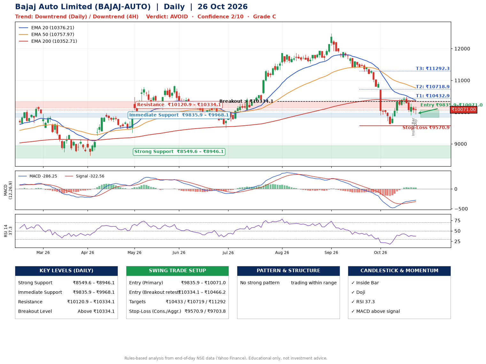

📌 **Bajaj Auto Limited (BAJAJ-AUTO) – Multi-Timeframe Technical Analysis (Daily + 4H Combined)**
_Data up to 26 Oct 2026 · Close ₹10071.00_

**📍 Daily Timeframe Trend**
- Trend: **Downtrend** (price below falling EMAs)
- Recent swing highs: ₹11856.0, ₹11863.0, ₹12470.0 · swing lows: ₹11534.0, ₹11618.0, ₹9637.0
- EMAs: EMA20 ₹10376.2, EMA50 ₹10758.0, EMA200 ₹10352.7; mixed / crossing; price below all EMAs
- MACD -286.25 above signal -322.56 (below zero); histogram falling
- RSI(14) 37.3; no divergence on the last two swings

**📍 4-Hour Timeframe Trend**
- Structure: **Downtrend** (price below falling EMAs)
- Pullback/support area: recent 4H swing lows ₹9637.0, ₹9917.0; EMA20 ₹10176.5
- EMA20/50: bearish stack (EMA20 < EMA50); price below all EMAs
- MACD -102.31 above signal -108.51 (below zero); histogram rising
- RSI(14) 42.2; no divergence

**📍 Pattern Detection (Both Timeframes)**
- 4H: **Double Bottom** – bottoms near ₹9637.0/₹9917.0, neckline ₹10499.0, forming
- 4H: **Descending Triangle** – converging swing highs and lows over the last ~60 sessions

**📍 Candlestick Patterns (last 3 daily candles)**
- **Inside Bar** – 23 Oct: compression inside the prior range ₹9906.0–₹10271.0
- **Doji** – 26 Oct: indecision; wait for the next candle to confirm direction

**📍 Price Action Key Levels (Daily Structure)**

| Zone | Price Level (₹) | Context |
|------|-----------------|---------|
| Strong Support | ₹8549.6 – ₹8946.1 | Cluster of earlier swing lows (demand) |
| Immediate Support | ₹9835.9 – ₹9968.1 | Nearest swing-low / wick area |
| Resistance | ₹10120.9 – ₹10334.1 | Nearest swing-high supply |
| Breakout Level | Above ₹10334.1 | Swing continuation trigger (52-week high ₹12470.0) |

**📍 Swing Trade Setup**

🟢 **Entry Zone**
- Primary: ₹9835.9 – ₹10071.0 (daily support / EMA20 area; enter on a bullish 4H candle)
- Alternate: ₹10334.1 – ₹10466.2 (breakout retest)

🎯 **Profit Targets**
- T1: ₹10432.9
- T2: ₹10718.9
- T3: ₹11292.3

🛑 **Stop-Loss**
- Conservative: below daily swing low (₹9570.9)
- Aggressive: below 4H structure (₹9703.8)
- Risk per share ≈ ₹382.5; reward:risk to T1 ≈ 1.3

**📌 Strategy Notes**
- Higher timeframe: daily trend is downtrend; only take longs while price holds above ₹8549.6.
- Entry timing: wait for a bullish 4H candle (engulfing/hammer) inside ₹9835.9 – ₹10071.0 rather than buying mid-range.
- EMA stacking: mixed / crossing; price below all EMAs.
- Breakout rule: a daily close above ₹10334.1 with volume above its 20-day average (≈315,753) opens T2/T3.
- Momentum: RSI 37 – room to run; no divergence on the last two swings.
- Exit discipline: move the stop to entry once T1 is hit; book partial profits at each target.

**STEP 2 — Marked Up Chart**

**✅ Trade Validation Checklist**
- Trend + momentum aligned: No · Price at entry zone: Yes
- Stop defined (₹9570.9) · Reward:risk ≥ 1.5 to T1: No

## 📌 Final Verdict

Recommendation: **🔴 AVOID**

Confidence: **2/10**

Trade Quality: **C**

Reason:
• Daily downtrend (price below falling EMAs)

Next Action:
• Avoid until the trend changes (reclaim EMA50 and a higher low)

_Rules-based analysis from end-of-day data. Educational only, not investment advice. Never place orders without your own confirmation._