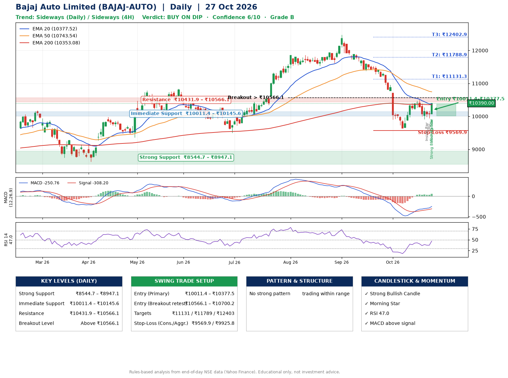

📌 **Bajaj Auto Limited (BAJAJ-AUTO) – Multi-Timeframe Technical Analysis (Daily + 4H Combined)**
_Data up to 27 Oct 2026 · Close ₹10390.00_

**📍 Daily Timeframe Trend**
- Trend: **Sideways** (mixed swing structure)
- Recent swing highs: ₹11863.0, ₹12470.0, ₹10499.0 · swing lows: ₹11534.0, ₹11618.0, ₹9637.0
- EMAs: EMA20 ₹10377.5, EMA50 ₹10743.5, EMA200 ₹10353.1; mixed / crossing; price above EMA20, EMA200
- MACD -250.76 above signal -308.20 (below zero); histogram rising
- RSI(14) 47.0; no divergence on the last two swings

**📍 4-Hour Timeframe Trend**
- Structure: **Sideways** (mixed swing structure)
- Pullback/support area: recent 4H swing lows ₹9917.0, ₹9943.0; EMA20 ₹10205.6
- EMA20/50: bearish stack (EMA20 < EMA50); price above EMA20
- MACD -57.41 above signal -94.17 (below zero); histogram rising
- RSI(14) 55.7; Hidden bullish divergence

**📍 Pattern Detection (Both Timeframes)**
- 4H: **Symmetrical Triangle** – converging swing highs and lows over the last ~60 sessions

**📍 Candlestick Patterns (last 3 daily candles)**
- **Inside Bar** – 23 Oct: compression inside the prior range ₹9906.0–₹10271.0
- **Doji** – 26 Oct: indecision; wait for the next candle to confirm direction
- **Strong Bullish Candle** – 27 Oct: wide-range green candle, buyers in control
- **Morning Star** – 27 Oct: three-candle bullish reversal

**📍 Price Action Key Levels (Daily Structure)**

| Zone | Price Level (₹) | Context |
|------|-----------------|---------|
| Strong Support | ₹8544.7 – ₹8947.1 | Cluster of earlier swing lows (demand) |
| Immediate Support | ₹10011.4 – ₹10145.6 | Nearest swing-low / wick area |
| Resistance | ₹10431.9 – ₹10566.1 | Nearest swing-high supply |
| Breakout Level | Above ₹10566.1 | Swing continuation trigger (52-week high ₹12470.0) |

**📍 Swing Trade Setup**

🟢 **Entry Zone**
- Primary: ₹10011.4 – ₹10377.5 (daily support / EMA20 area; enter on a bullish 4H candle)
- Alternate: ₹10566.1 – ₹10700.2 (breakout retest)

🎯 **Profit Targets**
- T1: ₹11131.3
- T2: ₹11788.9
- T3: ₹12402.9

🛑 **Stop-Loss**
- Conservative: below daily swing low (₹9569.9)
- Aggressive: below 4H structure (₹9925.8)
- Risk per share ≈ ₹624.5; reward:risk to T1 ≈ 1.5

**📌 Strategy Notes**
- Higher timeframe: daily trend is sideways; only take longs while price holds above ₹8544.7.
- Entry timing: wait for a bullish 4H candle (engulfing/hammer) inside ₹10011.4 – ₹10377.5 rather than buying mid-range.
- EMA stacking: mixed / crossing; price above EMA20, EMA200.
- Breakout rule: a daily close above ₹10566.1 with volume above its 20-day average (≈326,690) opens T2/T3.
- Momentum: RSI 47 – room to run; no divergence on the last two swings.
- Exit discipline: move the stop to entry once T1 is hit; book partial profits at each target.

**STEP 2 — Marked Up Chart**

**✅ Trade Validation Checklist**
- Trend + momentum aligned: No · Price at entry zone: No
- Stop defined (₹9569.9) · Reward:risk ≥ 1.5 to T1: Yes

## 📌 Final Verdict

Recommendation: **🟡 BUY ON DIP**

Confidence: **6/10**

Trade Quality: **B**

Reason:
• No strong edge from trend, momentum or patterns

Next Action:
• Wait for a pullback to ₹10011.4–₹10377.5, or a breakout above ₹10566.1

_Rules-based analysis from end-of-day data. Educational only, not investment advice. Never place orders without your own confirmation._