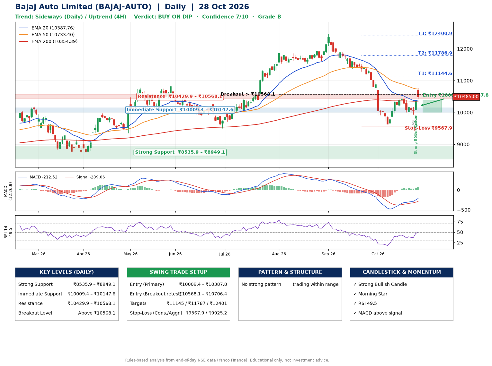

📌 **Bajaj Auto Limited (BAJAJ-AUTO) – Multi-Timeframe Technical Analysis (Daily + 4H Combined)**
_Data up to 28 Oct 2026 · Close ₹10485.00_

**📍 Daily Timeframe Trend**
- Trend: **Sideways** (mixed swing structure)
- Recent swing highs: ₹11863.0, ₹12470.0, ₹10499.0 · swing lows: ₹11534.0, ₹11618.0, ₹9637.0
- EMAs: EMA20 ₹10387.8, EMA50 ₹10733.4, EMA200 ₹10354.4; mixed / crossing; price above EMA20, EMA200
- MACD -212.52 above signal -289.06 (below zero); histogram rising
- RSI(14) 49.5; no divergence on the last two swings

**📍 4-Hour Timeframe Trend**
- Structure: **Uptrend** (higher highs and higher lows)
- Pullback/support area: recent 4H swing lows ₹9917.0, ₹9943.0; EMA20 ₹10258.3
- EMA20/50: bearish stack (EMA20 < EMA50); price above EMA20, EMA50
- MACD -5.67 above signal -65.81 (below zero); histogram rising
- RSI(14) 58.6; Hidden bullish divergence

**📍 Pattern Detection (Both Timeframes)**
- 4H: **Symmetrical Triangle** – converging swing highs and lows over the last ~60 sessions

**📍 Candlestick Patterns (last 3 daily candles)**
- **Doji** – 26 Oct: indecision; wait for the next candle to confirm direction
- **Strong Bullish Candle** – 27 Oct: wide-range green candle, buyers in control
- **Morning Star** – 27 Oct: three-candle bullish reversal

**📍 Price Action Key Levels (Daily Structure)**

| Zone | Price Level (₹) | Context |
|------|-----------------|---------|
| Strong Support | ₹8535.9 – ₹8949.1 | Cluster of earlier swing lows (demand) |
| Immediate Support | ₹10009.4 – ₹10147.6 | Nearest swing-low / wick area |
| Resistance | ₹10429.9 – ₹10568.1 | Nearest swing-high supply |
| Breakout Level | Above ₹10568.1 | Swing continuation trigger (52-week high ₹12470.0) |

**📍 Swing Trade Setup**

🟢 **Entry Zone**
- Primary: ₹10009.4 – ₹10387.8 (daily support / EMA20 area; enter on a bullish 4H candle)
- Alternate: ₹10568.1 – ₹10706.4 (breakout retest)

🎯 **Profit Targets**
- T1: ₹11144.6
- T2: ₹11786.9
- T3: ₹12400.9

🛑 **Stop-Loss**
- Conservative: below daily swing low (₹9567.9)
- Aggressive: below 4H structure (₹9925.2)
- Risk per share ≈ ₹630.7; reward:risk to T1 ≈ 1.5

**📌 Strategy Notes**
- Higher timeframe: daily trend is sideways; only take longs while price holds above ₹8535.9.
- Entry timing: wait for a bullish 4H candle (engulfing/hammer) inside ₹10009.4 – ₹10387.8 rather than buying mid-range.
- EMA stacking: mixed / crossing; price above EMA20, EMA200.
- Breakout rule: a daily close above ₹10568.1 with volume above its 20-day average (≈363,008) opens T2/T3.
- Momentum: RSI 49 – room to run; no divergence on the last two swings.
- Exit discipline: move the stop to entry once T1 is hit; book partial profits at each target.

**STEP 2 — Marked Up Chart**

**✅ Trade Validation Checklist**
- Trend + momentum aligned: No · Price at entry zone: No
- Stop defined (₹9567.9) · Reward:risk ≥ 1.5 to T1: No

## 📌 Final Verdict

Recommendation: **🟡 BUY ON DIP**

Confidence: **7/10**

Trade Quality: **B**

Reason:
• No strong edge from trend, momentum or patterns

Next Action:
• Wait for a pullback to ₹10009.4–₹10387.8, or a breakout above ₹10568.1

_Rules-based analysis from end-of-day data. Educational only, not investment advice. Never place orders without your own confirmation._