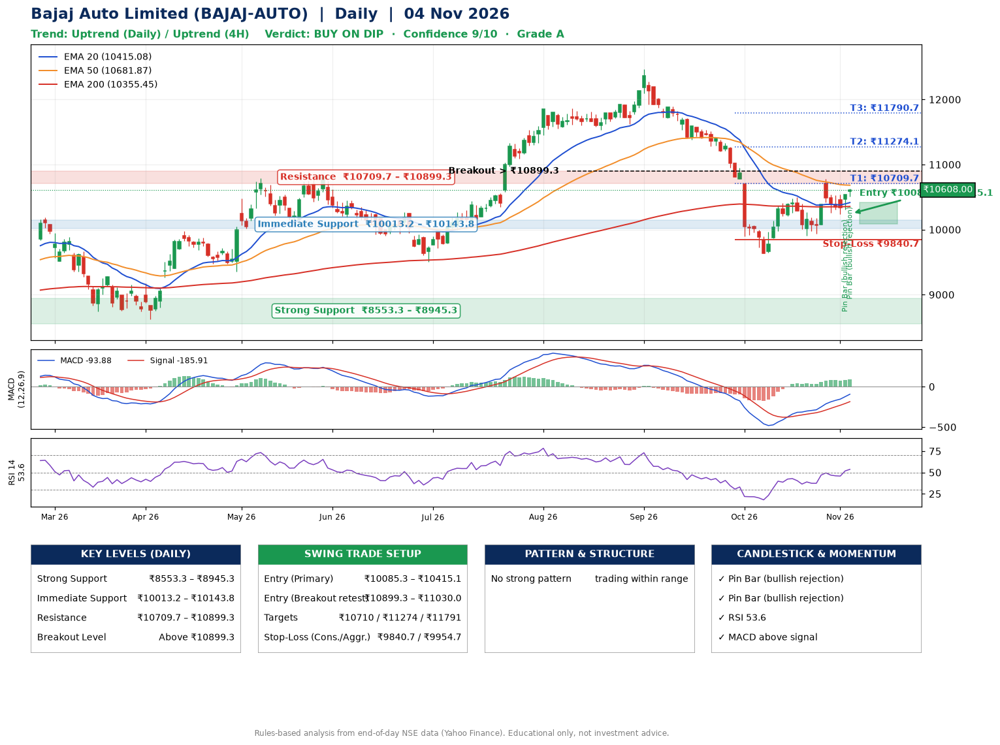

📌 **Bajaj Auto Limited (BAJAJ-AUTO) – Multi-Timeframe Technical Analysis (Daily + 4H Combined)**
_Data up to 04 Nov 2026 · Close ₹10608.00_

**📍 Daily Timeframe Trend**
- Trend: **Uptrend** (higher highs and higher lows)
- Recent swing highs: ₹12470.0, ₹10499.0, ₹10775.0 · swing lows: ₹11618.0, ₹9637.0, ₹9906.0
- EMAs: EMA20 ₹10415.1, EMA50 ₹10681.9, EMA200 ₹10355.5; mixed / crossing; price above EMA20, EMA200
- MACD -93.88 above signal -185.91 (below zero); histogram rising
- RSI(14) 53.6; no divergence on the last two swings

**📍 4-Hour Timeframe Trend**
- Structure: **Uptrend** (higher highs and higher lows)
- Pullback/support area: recent 4H swing lows ₹9943.0, ₹10240.0; EMA20 ₹10384.3
- EMA20/50: bearish stack (EMA20 < EMA50); price above EMA20, EMA50
- MACD 63.90 above signal 25.97 (above zero); histogram rising
- RSI(14) 60.2; no divergence

**📍 Pattern Detection (Both Timeframes)**
- 4H: **Double Top** – tops near ₹10499.0/₹10770.0, neckline ₹9917.0, forming
- 4H: **Double Bottom** – bottoms near ₹9943.0/₹10240.0, neckline ₹10770.0, forming

**📍 Candlestick Patterns (last 3 daily candles)**
- **Pin Bar (bullish rejection)** – 03 Nov: long lower wick shows dip-buying near ₹10309.0
- **Pin Bar (bullish rejection)** – 04 Nov: long lower wick shows dip-buying near ₹10504.0

**📍 Price Action Key Levels (Daily Structure)**

| Zone | Price Level (₹) | Context |
|------|-----------------|---------|
| Strong Support | ₹8553.3 – ₹8945.3 | Cluster of earlier swing lows (demand) |
| Immediate Support | ₹10013.2 – ₹10143.8 | Nearest swing-low / wick area |
| Resistance | ₹10709.7 – ₹10899.3 | Nearest swing-high supply |
| Breakout Level | Above ₹10899.3 | Swing continuation trigger (52-week high ₹12470.0) |

**📍 Swing Trade Setup**

🟢 **Entry Zone**
- Primary: ₹10085.3 – ₹10415.1 (daily support / EMA20 area; enter on a bullish 4H candle)
- Alternate: ₹10899.3 – ₹11030.0 (breakout retest)

🎯 **Profit Targets**
- T1: ₹10709.7
- T2: ₹11274.1
- T3: ₹11790.7

🛑 **Stop-Loss**
- Conservative: below daily swing low (₹9840.7)
- Aggressive: below 4H structure (₹9954.7)
- Risk per share ≈ ₹409.5; reward:risk to T1 ≈ 1.1

**📌 Strategy Notes**
- Higher timeframe: daily trend is uptrend; only take longs while price holds above ₹8553.3.
- Entry timing: wait for a bullish 4H candle (engulfing/hammer) inside ₹10085.3 – ₹10415.1 rather than buying mid-range.
- EMA stacking: mixed / crossing; price above EMA20, EMA200.
- Breakout rule: a daily close above ₹10899.3 with volume above its 20-day average (≈312,430) opens T2/T3.
- Momentum: RSI 54 – room to run; no divergence on the last two swings.
- Exit discipline: move the stop to entry once T1 is hit; book partial profits at each target.

**STEP 2 — Marked Up Chart**

**✅ Trade Validation Checklist**
- Trend + momentum aligned: Yes · Price at entry zone: No
- Stop defined (₹9840.7) · Reward:risk ≥ 1.5 to T1: No

## 📌 Final Verdict

Recommendation: **🟡 BUY ON DIP**

Confidence: **9/10**

Trade Quality: **A**

Reason:
• Daily uptrend (higher highs and higher lows)

Next Action:
• Wait for a pullback to ₹10085.3–₹10415.1, or a breakout above ₹10899.3

_Rules-based analysis from end-of-day data. Educational only, not investment advice. Never place orders without your own confirmation._