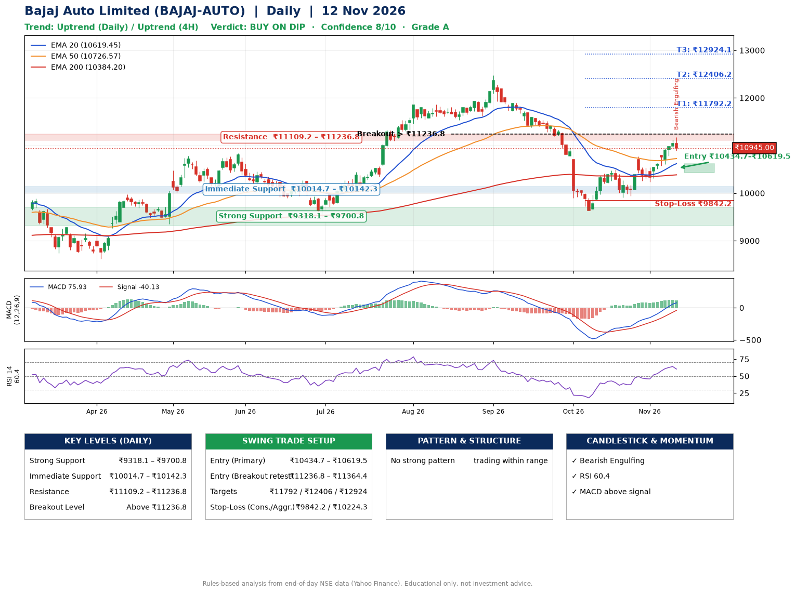

📌 **Bajaj Auto Limited (BAJAJ-AUTO) – Multi-Timeframe Technical Analysis (Daily + 4H Combined)**
_Data up to 12 Nov 2026 · Close ₹10945.00_

**📍 Daily Timeframe Trend**
- Trend: **Uptrend** (higher highs and higher lows)
- Recent swing highs: ₹12470.0, ₹10499.0, ₹10775.0 · swing lows: ₹11618.0, ₹9637.0, ₹9906.0
- EMAs: EMA20 ₹10619.5, EMA50 ₹10726.6, EMA200 ₹10384.2; mixed / crossing; price above EMA20, EMA50, EMA200
- MACD 75.93 above signal -40.13 (above zero); histogram falling
- RSI(14) 60.4; no divergence on the last two swings

**📍 4-Hour Timeframe Trend**
- Structure: **Uptrend** (higher highs and higher lows)
- Pullback/support area: recent 4H swing lows ₹9943.0, ₹10240.0; EMA20 ₹10732.5
- EMA20/50: bullish stack (EMA20 > EMA50); price above EMA20, EMA50
- MACD 179.56 above signal 149.82 (above zero); histogram falling
- RSI(14) 65.1; no divergence

**📍 Pattern Detection (Both Timeframes)**
- 4H: **Double Bottom** – bottoms near ₹9943.0/₹10240.0, neckline ₹10770.0, confirmed (closed above neckline)

**📍 Candlestick Patterns (last 3 daily candles)**
- **Bearish Engulfing** – 12 Nov: sellers fully reversed the prior green candle

**📍 Price Action Key Levels (Daily Structure)**

| Zone | Price Level (₹) | Context |
|------|-----------------|---------|
| Strong Support | ₹9318.1 – ₹9700.8 | Cluster of earlier swing lows (demand) |
| Immediate Support | ₹10014.7 – ₹10142.3 | Nearest swing-low / wick area |
| Resistance | ₹11109.2 – ₹11236.8 | Nearest swing-high supply |
| Breakout Level | Above ₹11236.8 | Swing continuation trigger (52-week high ₹12470.0) |

**📍 Swing Trade Setup**

🟢 **Entry Zone**
- Primary: ₹10434.7 – ₹10619.5 (daily support / EMA20 area; enter on a bullish 4H candle)
- Alternate: ₹11236.8 – ₹11364.4 (breakout retest)

🎯 **Profit Targets**
- T1: ₹11792.2
- T2: ₹12406.2
- T3: ₹12924.1

🛑 **Stop-Loss**
- Conservative: below daily swing low (₹9842.2)
- Aggressive: below 4H structure (₹10224.3)
- Risk per share ≈ ₹684.9; reward:risk to T1 ≈ 1.8
- Time to T1: about 31 trading days (it rose this much within 60 trading days 42% of the time in the last 2 years)
- Time to T2: about 32 trading days (it rose this much within 60 trading days 15% of the time in the last 2 years)

**📌 Strategy Notes**
- Higher timeframe: daily trend is uptrend; only take longs while price holds above ₹9318.1.
- Entry timing: wait for a bullish 4H candle (engulfing/hammer) inside ₹10434.7 – ₹10619.5 rather than buying mid-range.
- EMA stacking: mixed / crossing; price above EMA20, EMA50, EMA200.
- Breakout rule: a daily close above ₹11236.8 with volume above its 20-day average (≈346,997) opens T2/T3.
- Momentum: RSI 60 – room to run; no divergence on the last two swings.
- Exit discipline: move the stop to entry once T1 is hit; book partial profits at each target.

**STEP 2 — Marked Up Chart**

**✅ Trade Validation Checklist**
- Trend + momentum aligned: Yes · Price at entry zone: No
- Stop defined (₹9842.2) · Reward:risk ≥ 1.5 to T1: Yes

## 📌 Final Verdict

Recommendation: **🟡 BUY ON DIP**

Confidence: **8/10**

Trade Quality: **A**

Reason:
• Daily uptrend (higher highs and higher lows)

Next Action:
• Wait for a pullback to ₹10434.7–₹10619.5

_Rules-based analysis from end-of-day data. Educational only, not investment advice. Never place orders without your own confirmation._