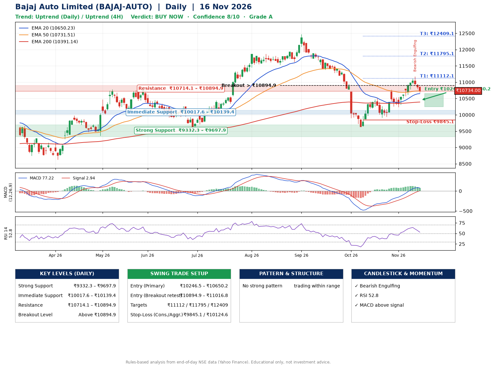

📌 **Bajaj Auto Limited (BAJAJ-AUTO) – Multi-Timeframe Technical Analysis (Daily + 4H Combined)**
_Data up to 16 Nov 2026 · Close ₹10734.00_

**📍 Daily Timeframe Trend**
- Trend: **Uptrend** (higher highs and higher lows)
- Recent swing highs: ₹12470.0, ₹10499.0, ₹10775.0 · swing lows: ₹11618.0, ₹9637.0, ₹9906.0
- EMAs: EMA20 ₹10650.2, EMA50 ₹10731.5, EMA200 ₹10391.1; mixed / crossing; price above EMA20, EMA50, EMA200
- MACD 77.22 above signal 2.94 (above zero); histogram falling
- RSI(14) 52.8; no divergence on the last two swings

**📍 4-Hour Timeframe Trend**
- Structure: **Uptrend** (higher highs and higher lows)
- Pullback/support area: recent 4H swing lows ₹10240.0, ₹10683.0; EMA20 ₹10750.1
- EMA20/50: bullish stack (EMA20 > EMA50); price above EMA20, EMA50
- MACD 90.56 below signal 124.40 (above zero), fresh bearish crossover; histogram falling
- RSI(14) 53.9; no divergence

**📍 Pattern Detection (Both Timeframes)**
- No strong pattern detected. Trading within range.

**📍 Candlestick Patterns (last 3 daily candles)**
- **Bearish Engulfing** – 12 Nov: sellers fully reversed the prior green candle

**📍 Price Action Key Levels (Daily Structure)**

| Zone | Price Level (₹) | Context |
|------|-----------------|---------|
| Strong Support | ₹9332.3 – ₹9697.9 | Cluster of earlier swing lows (demand) |
| Immediate Support | ₹10017.6 – ₹10139.4 | Nearest swing-low / wick area |
| Resistance | ₹10714.1 – ₹10894.9 | Nearest swing-high supply |
| Breakout Level | Above ₹10894.9 | Swing continuation trigger (52-week high ₹12470.0) |

**📍 Swing Trade Setup**

🟢 **Entry Zone**
- Primary: ₹10246.5 – ₹10650.2 (daily support / EMA20 area; enter on a bullish 4H candle)
- Alternate: ₹10894.9 – ₹11016.8 (breakout retest)

🎯 **Profit Targets**
- T1: ₹11112.1
- T2: ₹11795.1
- T3: ₹12409.1

🛑 **Stop-Loss**
- Conservative: below daily swing low (₹9845.1)
- Aggressive: below 4H structure (₹10124.6)
- Risk per share ≈ ₹603.3; reward:risk to T1 ≈ 1.1
- Time to T1: about 20 trading days (it rose this much within 60 trading days 77% of the time in the last 2 years)
- Time to T2: about 31 trading days (it rose this much within 60 trading days 35% of the time in the last 2 years)

**📌 Strategy Notes**
- Higher timeframe: daily trend is uptrend; only take longs while price holds above ₹9332.3.
- Entry timing: wait for a bullish 4H candle (engulfing/hammer) inside ₹10246.5 – ₹10650.2 rather than buying mid-range.
- EMA stacking: mixed / crossing; price above EMA20, EMA50, EMA200.
- Breakout rule: a daily close above ₹10894.9 with volume above its 20-day average (≈345,601) opens T2/T3.
- Momentum: RSI 53 – room to run; no divergence on the last two swings.
- Exit discipline: move the stop to entry once T1 is hit; book partial profits at each target.

**STEP 2 — Marked Up Chart**

**✅ Trade Validation Checklist**
- Trend + momentum aligned: Yes · Price at entry zone: No
- Stop defined (₹9845.1) · Reward:risk ≥ 1.5 to T1: No

## 📌 Final Verdict

Recommendation: **🟢 BUY NOW**

Confidence: **8/10**

Trade Quality: **A**

Reason:
• Daily uptrend (higher highs and higher lows)

Next Action:
• Buy now within the entry zone, with the stop-loss in place

_Rules-based analysis from end-of-day data. Educational only, not investment advice. Never place orders without your own confirmation._