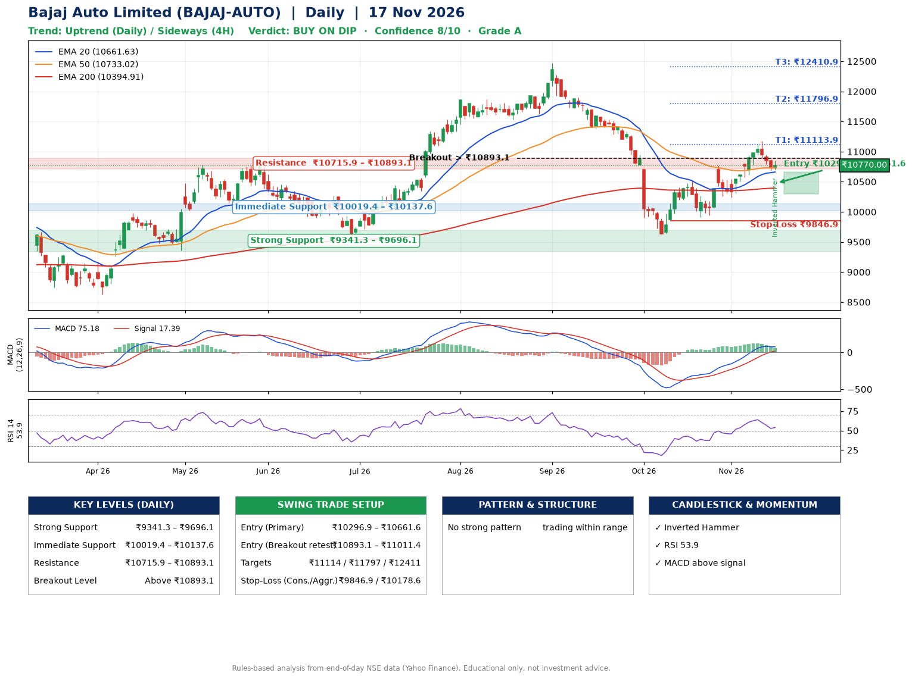

📌 **Bajaj Auto Limited (BAJAJ-AUTO) – Multi-Timeframe Technical Analysis (Daily + 4H Combined)**
_Data up to 17 Nov 2026 · Close ₹10770.00_

**📍 Daily Timeframe Trend**
- Trend: **Uptrend** (higher highs and higher lows)
- Recent swing highs: ₹12470.0, ₹10499.0, ₹10775.0 · swing lows: ₹11618.0, ₹9637.0, ₹9906.0
- EMAs: EMA20 ₹10661.6, EMA50 ₹10733.0, EMA200 ₹10394.9; mixed / crossing; price above EMA20, EMA50, EMA200
- MACD 75.18 above signal 17.39 (above zero); histogram falling
- RSI(14) 53.9; no divergence on the last two swings

**📍 4-Hour Timeframe Trend**
- Structure: **Sideways** (mixed swing structure)
- Pullback/support area: recent 4H swing lows ₹10240.0, ₹10683.0; EMA20 ₹10718.3
- EMA20/50: bullish stack (EMA20 > EMA50); price below all EMAs
- MACD 45.82 below signal 99.40 (above zero); histogram falling
- RSI(14) 43.7; no divergence

**📍 Pattern Detection (Both Timeframes)**
- No strong pattern detected. Trading within range.

**📍 Candlestick Patterns (last 3 daily candles)**
- **Inverted Hammer** – 17 Nov: long upper wick shows selling near ₹10849.0

**📍 Price Action Key Levels (Daily Structure)**

| Zone | Price Level (₹) | Context |
|------|-----------------|---------|
| Strong Support | ₹9341.3 – ₹9696.1 | Cluster of earlier swing lows (demand) |
| Immediate Support | ₹10019.4 – ₹10137.6 | Nearest swing-low / wick area |
| Resistance | ₹10715.9 – ₹10893.1 | Nearest swing-high supply |
| Breakout Level | Above ₹10893.1 | Swing continuation trigger (52-week high ₹12470.0) |

**📍 Swing Trade Setup**

🟢 **Entry Zone**
- Primary: ₹10296.9 – ₹10661.6 (daily support / EMA20 area; enter on a bullish 4H candle)
- Alternate: ₹10893.1 – ₹11011.4 (breakout retest)

🎯 **Profit Targets**
- T1: ₹11113.9
- T2: ₹11796.9
- T3: ₹12410.9

🛑 **Stop-Loss**
- Conservative: below daily swing low (₹9846.9)
- Aggressive: below 4H structure (₹10178.6)
- Risk per share ≈ ₹632.4; reward:risk to T1 ≈ 1.0
- Time to T1: about 18 trading days (it rose this much within 60 trading days 78% of the time in the last 2 years)
- Time to T2: about 29 trading days (it rose this much within 60 trading days 36% of the time in the last 2 years)

**📌 Strategy Notes**
- Higher timeframe: daily trend is uptrend; only take longs while price holds above ₹9341.3.
- Entry timing: wait for a bullish 4H candle (engulfing/hammer) inside ₹10296.9 – ₹10661.6 rather than buying mid-range.
- EMA stacking: mixed / crossing; price above EMA20, EMA50, EMA200.
- Breakout rule: a daily close above ₹10893.1 with volume above its 20-day average (≈351,555) opens T2/T3.
- Momentum: RSI 54 – room to run; no divergence on the last two swings.
- Exit discipline: move the stop to entry once T1 is hit; book partial profits at each target.

**STEP 2 — Marked Up Chart**

**✅ Trade Validation Checklist**
- Trend + momentum aligned: Yes · Price at entry zone: No
- Stop defined (₹9846.9) · Reward:risk ≥ 1.5 to T1: No

## 📌 Final Verdict

Recommendation: **🟡 BUY ON DIP**

Confidence: **8/10**

Trade Quality: **A**

Reason:
• Daily uptrend (higher highs and higher lows)

Next Action:
• Wait for a pullback to ₹10296.9–₹10661.6, or a breakout above ₹10893.1

_Rules-based analysis from end-of-day data. Educational only, not investment advice. Never place orders without your own confirmation._