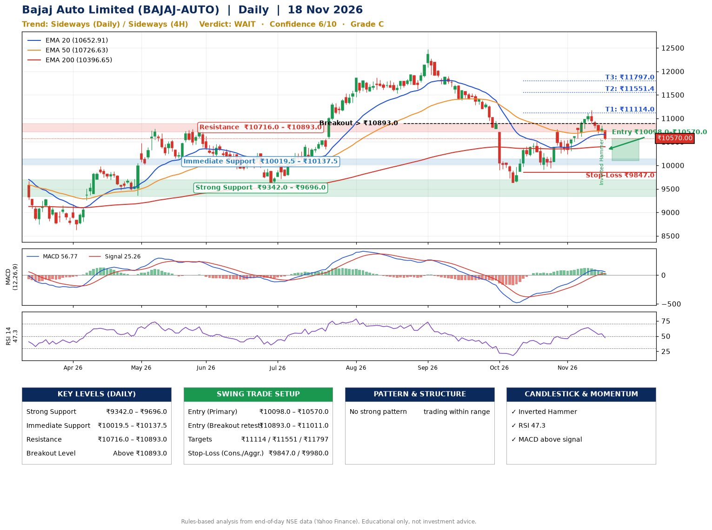

📌 **Bajaj Auto Limited (BAJAJ-AUTO) – Multi-Timeframe Technical Analysis (Daily + 4H Combined)**
_Data up to 18 Nov 2026 · Close ₹10570.00_

**📍 Daily Timeframe Trend**
- Trend: **Sideways** (mixed swing structure)
- Recent swing highs: ₹12470.0, ₹10499.0, ₹10775.0 · swing lows: ₹11618.0, ₹9637.0, ₹9906.0
- EMAs: EMA20 ₹10652.9, EMA50 ₹10726.6, EMA200 ₹10396.7; mixed / crossing; price above EMA200
- MACD 56.77 above signal 25.26 (above zero); histogram falling
- RSI(14) 47.3; no divergence on the last two swings

**📍 4-Hour Timeframe Trend**
- Structure: **Sideways** (mixed swing structure)
- Pullback/support area: recent 4H swing lows ₹10240.0, ₹10683.0; EMA20 ₹10718.3
- EMA20/50: bullish stack (EMA20 > EMA50); price below all EMAs
- MACD 45.82 below signal 99.40 (above zero); histogram falling
- RSI(14) 43.7; no divergence

**📍 Pattern Detection (Both Timeframes)**
- No strong pattern detected. Trading within range.

**📍 Candlestick Patterns (last 3 daily candles)**
- **Inverted Hammer** – 17 Nov: long upper wick shows selling near ₹10849.0

**📍 Price Action Key Levels (Daily Structure)**

| Zone | Price Level (₹) | Context |
|------|-----------------|---------|
| Strong Support | ₹9342.0 – ₹9696.0 | Cluster of earlier swing lows (demand) |
| Immediate Support | ₹10019.5 – ₹10137.5 | Nearest swing-low / wick area |
| Resistance | ₹10716.0 – ₹10893.0 | Nearest swing-high supply |
| Breakout Level | Above ₹10893.0 | Swing continuation trigger (52-week high ₹12470.0) |

**📍 Swing Trade Setup**

🟢 **Entry Zone**
- Primary: ₹10098.0 – ₹10570.0 (daily support / EMA20 area; enter on a bullish 4H candle)
- Alternate: ₹10893.0 – ₹11011.0 (breakout retest)

🎯 **Profit Targets**
- T1: ₹11114.0
- T2: ₹11551.4
- T3: ₹11797.0

🛑 **Stop-Loss**
- Conservative: below daily swing low (₹9847.0)
- Aggressive: below 4H structure (₹9980.0)
- Risk per share ≈ ₹487.0; reward:risk to T1 ≈ 1.6
- Time to T1: about 24 trading days (it rose this much within 60 trading days 69% of the time in the last 2 years)
- Time to T2: about 32 trading days (it rose this much within 60 trading days 44% of the time in the last 2 years)

**📌 Strategy Notes**
- Higher timeframe: daily trend is sideways; only take longs while price holds above ₹9342.0.
- Entry timing: wait for a bullish 4H candle (engulfing/hammer) inside ₹10098.0 – ₹10570.0 rather than buying mid-range.
- EMA stacking: mixed / crossing; price above EMA200.
- Breakout rule: a daily close above ₹10893.0 with volume above its 20-day average (≈365,104) opens T2/T3.
- Momentum: RSI 47 – room to run; no divergence on the last two swings.
- Exit discipline: move the stop to entry once T1 is hit; book partial profits at each target.

**STEP 2 — Marked Up Chart**

**✅ Trade Validation Checklist**
- Trend + momentum aligned: No · Price at entry zone: Yes
- Stop defined (₹9847.0) · Reward:risk ≥ 1.5 to T1: Yes

## 📌 Final Verdict

Recommendation: **🟠 WAIT**

Confidence: **6/10**

Trade Quality: **C**

Reason:
• No strong edge from trend, momentum or patterns

Next Action:
• Wait for a breakout above ₹10893.0

_Rules-based analysis from end-of-day data. Educational only, not investment advice. Never place orders without your own confirmation._