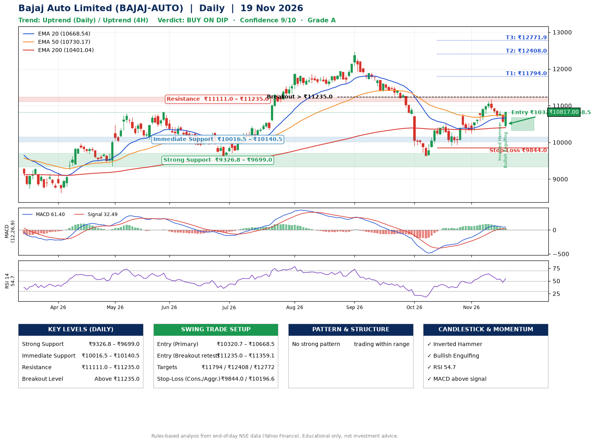

📌 **Bajaj Auto Limited (BAJAJ-AUTO) – Multi-Timeframe Technical Analysis (Daily + 4H Combined)**
_Data up to 19 Nov 2026 · Close ₹10817.00_

**📍 Daily Timeframe Trend**
- Trend: **Uptrend** (higher highs and higher lows)
- Recent swing highs: ₹10499.0, ₹10775.0, ₹11173.0 · swing lows: ₹11618.0, ₹9637.0, ₹9906.0
- EMAs: EMA20 ₹10668.5, EMA50 ₹10730.2, EMA200 ₹10401.0; mixed / crossing; price above EMA20, EMA50, EMA200
- MACD 61.40 above signal 32.49 (above zero); histogram falling
- RSI(14) 54.7; no divergence on the last two swings

**📍 4-Hour Timeframe Trend**
- Structure: **Uptrend** (higher highs and higher lows)
- Pullback/support area: recent 4H swing lows ₹10240.0, ₹10683.0; EMA20 ₹10731.0
- EMA20/50: bullish stack (EMA20 > EMA50); price above EMA20, EMA50
- MACD 47.02 below signal 80.05 (above zero); histogram rising
- RSI(14) 55.9; no divergence

**📍 Pattern Detection (Both Timeframes)**
- No strong pattern detected. Trading within range.

**📍 Candlestick Patterns (last 3 daily candles)**
- **Inverted Hammer** – 17 Nov: long upper wick shows selling near ₹10849.0
- **Bullish Engulfing** – 19 Nov: buyers fully reversed the prior red candle

**📍 Price Action Key Levels (Daily Structure)**

| Zone | Price Level (₹) | Context |
|------|-----------------|---------|
| Strong Support | ₹9326.8 – ₹9699.0 | Cluster of earlier swing lows (demand) |
| Immediate Support | ₹10016.5 – ₹10140.5 | Nearest swing-low / wick area |
| Resistance | ₹11111.0 – ₹11235.0 | Nearest swing-high supply |
| Breakout Level | Above ₹11235.0 | Swing continuation trigger (52-week high ₹12470.0) |

**📍 Swing Trade Setup**

🟢 **Entry Zone**
- Primary: ₹10320.7 – ₹10668.5 (daily support / EMA20 area; enter on a bullish 4H candle)
- Alternate: ₹11235.0 – ₹11359.1 (breakout retest)

🎯 **Profit Targets**
- T1: ₹11794.0
- T2: ₹12408.0
- T3: ₹12771.9

🛑 **Stop-Loss**
- Conservative: below daily swing low (₹9844.0)
- Aggressive: below 4H structure (₹10196.6)
- Risk per share ≈ ₹650.6; reward:risk to T1 ≈ 2.0
- Time to T1: about 31 trading days (it rose this much within 60 trading days 39% of the time in the last 2 years)
- Time to T2: about 34 trading days (it rose this much within 60 trading days 14% of the time in the last 2 years)

**📌 Strategy Notes**
- Higher timeframe: daily trend is uptrend; only take longs while price holds above ₹9326.8.
- Entry timing: wait for a bullish 4H candle (engulfing/hammer) inside ₹10320.7 – ₹10668.5 rather than buying mid-range.
- EMA stacking: mixed / crossing; price above EMA20, EMA50, EMA200.
- Breakout rule: a daily close above ₹11235.0 with volume above its 20-day average (≈376,510) opens T2/T3.
- Momentum: RSI 55 – room to run; no divergence on the last two swings.
- Exit discipline: move the stop to entry once T1 is hit; book partial profits at each target.

**STEP 2 — Marked Up Chart**

**✅ Trade Validation Checklist**
- Trend + momentum aligned: Yes · Price at entry zone: No
- Stop defined (₹9844.0) · Reward:risk ≥ 1.5 to T1: Yes

## 📌 Final Verdict

Recommendation: **🟡 BUY ON DIP**

Confidence: **9/10**

Trade Quality: **A**

Reason:
• Daily uptrend (higher highs and higher lows)

Next Action:
• Wait for a pullback to ₹10320.7–₹10668.5, or a breakout above ₹11235.0

_Rules-based analysis from end-of-day data. Educational only, not investment advice. Never place orders without your own confirmation._