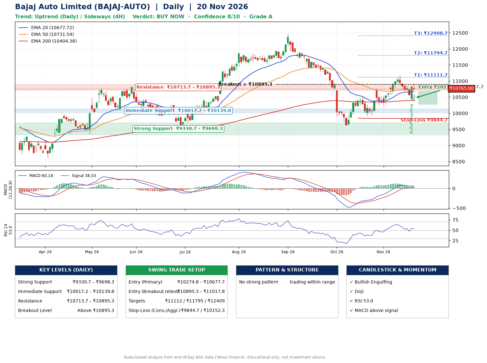

📌 **Bajaj Auto Limited (BAJAJ-AUTO) – Multi-Timeframe Technical Analysis (Daily + 4H Combined)**
_Data up to 20 Nov 2026 · Close ₹10765.00_

**📍 Daily Timeframe Trend**
- Trend: **Uptrend** (higher highs and higher lows)
- Recent swing highs: ₹10499.0, ₹10775.0, ₹11173.0 · swing lows: ₹11618.0, ₹9637.0, ₹9906.0
- EMAs: EMA20 ₹10677.7, EMA50 ₹10731.5, EMA200 ₹10404.4; mixed / crossing; price above EMA20, EMA50, EMA200
- MACD 60.18 above signal 38.03 (above zero); histogram falling
- RSI(14) 53.0; no divergence on the last two swings

**📍 4-Hour Timeframe Trend**
- Structure: **Sideways** (mixed swing structure)
- Pullback/support area: recent 4H swing lows ₹10683.0, ₹10438.0; EMA20 ₹10738.1
- EMA20/50: bullish stack (EMA20 > EMA50); price above EMA20, EMA50
- MACD 43.00 below signal 67.13 (above zero); histogram rising
- RSI(14) 53.1; Regular bullish divergence

**📍 Pattern Detection (Both Timeframes)**
- No strong pattern detected. Trading within range.

**📍 Candlestick Patterns (last 3 daily candles)**
- **Bullish Engulfing** – 19 Nov: buyers fully reversed the prior red candle
- **Doji** – 20 Nov: indecision; wait for the next candle to confirm direction

**📍 Price Action Key Levels (Daily Structure)**

| Zone | Price Level (₹) | Context |
|------|-----------------|---------|
| Strong Support | ₹9330.7 – ₹9698.3 | Cluster of earlier swing lows (demand) |
| Immediate Support | ₹10017.2 – ₹10139.8 | Nearest swing-low / wick area |
| Resistance | ₹10713.7 – ₹10895.3 | Nearest swing-high supply |
| Breakout Level | Above ₹10895.3 | Swing continuation trigger (52-week high ₹12470.0) |

**📍 Swing Trade Setup**

🟢 **Entry Zone**
- Primary: ₹10274.8 – ₹10677.7 (daily support / EMA20 area; enter on a bullish 4H candle)
- Alternate: ₹10895.3 – ₹11017.8 (breakout retest)

🎯 **Profit Targets**
- T1: ₹11111.7
- T2: ₹11794.7
- T3: ₹12408.7

🛑 **Stop-Loss**
- Conservative: below daily swing low (₹9844.7)
- Aggressive: below 4H structure (₹10152.3)
- Risk per share ≈ ₹631.6; reward:risk to T1 ≈ 1.0
- Time to T1: about 18 trading days (it rose this much within 60 trading days 78% of the time in the last 2 years)
- Time to T2: about 29 trading days (it rose this much within 60 trading days 36% of the time in the last 2 years)

**📌 Strategy Notes**
- Higher timeframe: daily trend is uptrend; only take longs while price holds above ₹9330.7.
- Entry timing: wait for a bullish 4H candle (engulfing/hammer) inside ₹10274.8 – ₹10677.7 rather than buying mid-range.
- EMA stacking: mixed / crossing; price above EMA20, EMA50, EMA200.
- Breakout rule: a daily close above ₹10895.3 with volume above its 20-day average (≈394,707) opens T2/T3.
- Momentum: RSI 53 – room to run; no divergence on the last two swings.
- Exit discipline: move the stop to entry once T1 is hit; book partial profits at each target.

**STEP 2 — Marked Up Chart**

**✅ Trade Validation Checklist**
- Trend + momentum aligned: Yes · Price at entry zone: No
- Stop defined (₹9844.7) · Reward:risk ≥ 1.5 to T1: No

## 📌 Final Verdict

Recommendation: **🟢 BUY NOW**

Confidence: **8/10**

Trade Quality: **A**

Reason:
• Daily uptrend (higher highs and higher lows)

Next Action:
• Buy now within the entry zone, with the stop-loss in place

_Rules-based analysis from end-of-day data. Educational only, not investment advice. Never place orders without your own confirmation._