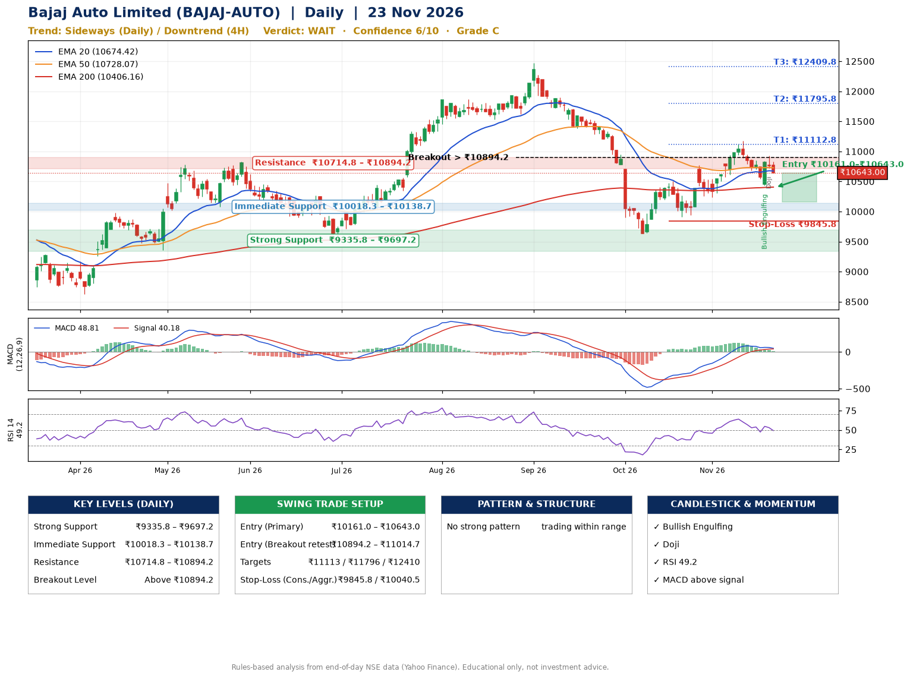

📌 **Bajaj Auto Limited (BAJAJ-AUTO) – Multi-Timeframe Technical Analysis (Daily + 4H Combined)**
_Data up to 23 Nov 2026 · Close ₹10643.00_

**📍 Daily Timeframe Trend**
- Trend: **Sideways** (mixed swing structure)
- Recent swing highs: ₹10499.0, ₹10775.0, ₹11173.0 · swing lows: ₹11618.0, ₹9637.0, ₹9906.0
- EMAs: EMA20 ₹10674.4, EMA50 ₹10728.1, EMA200 ₹10406.2; mixed / crossing; price above EMA200
- MACD 48.81 above signal 40.18 (above zero); histogram falling
- RSI(14) 49.2; no divergence on the last two swings

**📍 4-Hour Timeframe Trend**
- Structure: **Downtrend** (lower highs and lower lows)
- Pullback/support area: recent 4H swing lows ₹10683.0, ₹10438.0; EMA20 ₹10724.8
- EMA20/50: bullish stack (EMA20 > EMA50); price below all EMAs
- MACD 23.69 below signal 53.21 (above zero); histogram falling
- RSI(14) 46.6; Regular bullish divergence

**📍 Pattern Detection (Both Timeframes)**
- 4H: **Double Top** – tops near ₹11169.0/₹10930.0, neckline ₹10438.0, forming

**📍 Candlestick Patterns (last 3 daily candles)**
- **Bullish Engulfing** – 19 Nov: buyers fully reversed the prior red candle
- **Doji** – 20 Nov: indecision; wait for the next candle to confirm direction

**📍 Price Action Key Levels (Daily Structure)**

| Zone | Price Level (₹) | Context |
|------|-----------------|---------|
| Strong Support | ₹9335.8 – ₹9697.2 | Cluster of earlier swing lows (demand) |
| Immediate Support | ₹10018.3 – ₹10138.7 | Nearest swing-low / wick area |
| Resistance | ₹10714.8 – ₹10894.2 | Nearest swing-high supply |
| Breakout Level | Above ₹10894.2 | Swing continuation trigger (52-week high ₹12470.0) |

**📍 Swing Trade Setup**

🟢 **Entry Zone**
- Primary: ₹10161.0 – ₹10643.0 (daily support / EMA20 area; enter on a bullish 4H candle)
- Alternate: ₹10894.2 – ₹11014.7 (breakout retest)

🎯 **Profit Targets**
- T1: ₹11112.8
- T2: ₹11795.8
- T3: ₹12409.8

🛑 **Stop-Loss**
- Conservative: below daily swing low (₹9845.8)
- Aggressive: below 4H structure (₹10040.5)
- Risk per share ≈ ₹556.3; reward:risk to T1 ≈ 1.3
- Time to T1: about 21 trading days (it rose this much within 60 trading days 74% of the time in the last 2 years)
- Time to T2: about 28 trading days (it rose this much within 60 trading days 30% of the time in the last 2 years)

**📌 Strategy Notes**
- Higher timeframe: daily trend is sideways; only take longs while price holds above ₹9335.8.
- Entry timing: wait for a bullish 4H candle (engulfing/hammer) inside ₹10161.0 – ₹10643.0 rather than buying mid-range.
- EMA stacking: mixed / crossing; price above EMA200.
- Breakout rule: a daily close above ₹10894.2 with volume above its 20-day average (≈401,256) opens T2/T3.
- Momentum: RSI 49 – room to run; no divergence on the last two swings.
- Exit discipline: move the stop to entry once T1 is hit; book partial profits at each target.

**STEP 2 — Marked Up Chart**

**✅ Trade Validation Checklist**
- Trend + momentum aligned: No · Price at entry zone: Yes
- Stop defined (₹9845.8) · Reward:risk ≥ 1.5 to T1: No

## 📌 Final Verdict

Recommendation: **🟠 WAIT**

Confidence: **6/10**

Trade Quality: **C**

Reason:
• No strong edge from trend, momentum or patterns

Next Action:
• Wait for a breakout above ₹10894.2

_Rules-based analysis from end-of-day data. Educational only, not investment advice. Never place orders without your own confirmation._