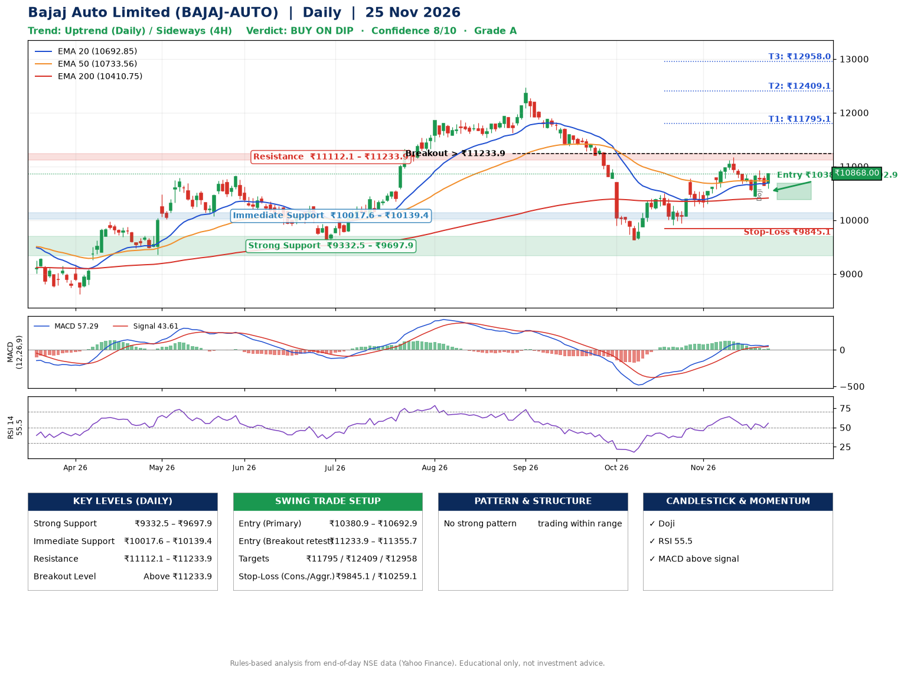

📌 **Bajaj Auto Limited (BAJAJ-AUTO) – Multi-Timeframe Technical Analysis (Daily + 4H Combined)**
_Data up to 25 Nov 2026 · Close ₹10868.00_

**📍 Daily Timeframe Trend**
- Trend: **Uptrend** (higher highs and higher lows)
- Recent swing highs: ₹10499.0, ₹10775.0, ₹11173.0 · swing lows: ₹11618.0, ₹9637.0, ₹9906.0
- EMAs: EMA20 ₹10692.9, EMA50 ₹10733.6, EMA200 ₹10410.8; mixed / crossing; price above EMA20, EMA50, EMA200
- MACD 57.29 above signal 43.61 (above zero); histogram rising
- RSI(14) 55.5; no divergence on the last two swings

**📍 4-Hour Timeframe Trend**
- Structure: **Sideways** (mixed swing structure)
- Pullback/support area: recent 4H swing lows ₹10683.0, ₹10438.0; EMA20 ₹10736.7
- EMA20/50: bullish stack (EMA20 > EMA50); price above EMA20, EMA50
- MACD 29.77 below signal 43.21 (above zero); histogram rising
- RSI(14) 57.8; Regular bullish divergence

**📍 Pattern Detection (Both Timeframes)**
- 4H: **Double Top** – tops near ₹11169.0/₹10930.0, neckline ₹10438.0, forming

**📍 Candlestick Patterns (last 3 daily candles)**
- **Doji** – 20 Nov: indecision; wait for the next candle to confirm direction

**📍 Price Action Key Levels (Daily Structure)**

| Zone | Price Level (₹) | Context |
|------|-----------------|---------|
| Strong Support | ₹9332.5 – ₹9697.9 | Cluster of earlier swing lows (demand) |
| Immediate Support | ₹10017.6 – ₹10139.4 | Nearest swing-low / wick area |
| Resistance | ₹11112.1 – ₹11233.9 | Nearest swing-high supply |
| Breakout Level | Above ₹11233.9 | Swing continuation trigger (52-week high ₹12470.0) |

**📍 Swing Trade Setup**

🟢 **Entry Zone**
- Primary: ₹10380.9 – ₹10692.9 (daily support / EMA20 area; enter on a bullish 4H candle)
- Alternate: ₹11233.9 – ₹11355.7 (breakout retest)

🎯 **Profit Targets**
- T1: ₹11795.1
- T2: ₹12409.1
- T3: ₹12958.0

🛑 **Stop-Loss**
- Conservative: below daily swing low (₹9845.1)
- Aggressive: below 4H structure (₹10259.1)
- Risk per share ≈ ₹691.7; reward:risk to T1 ≈ 1.8
- Time to T1: about 31 trading days (it rose this much within 60 trading days 42% of the time in the last 2 years)
- Time to T2: about 32 trading days (it rose this much within 60 trading days 15% of the time in the last 2 years)

**📌 Strategy Notes**
- Higher timeframe: daily trend is uptrend; only take longs while price holds above ₹9332.5.
- Entry timing: wait for a bullish 4H candle (engulfing/hammer) inside ₹10380.9 – ₹10692.9 rather than buying mid-range.
- EMA stacking: mixed / crossing; price above EMA20, EMA50, EMA200.
- Breakout rule: a daily close above ₹11233.9 with volume above its 20-day average (≈409,690) opens T2/T3.
- Momentum: RSI 56 – room to run; no divergence on the last two swings.
- Exit discipline: move the stop to entry once T1 is hit; book partial profits at each target.

**STEP 2 — Marked Up Chart**

**✅ Trade Validation Checklist**
- Trend + momentum aligned: Yes · Price at entry zone: No
- Stop defined (₹9845.1) · Reward:risk ≥ 1.5 to T1: Yes

## 📌 Final Verdict

Recommendation: **🟡 BUY ON DIP**

Confidence: **8/10**

Trade Quality: **A**

Reason:
• Daily uptrend (higher highs and higher lows)

Next Action:
• Wait for a pullback to ₹10380.9–₹10692.9, or a breakout above ₹11233.9

_Rules-based analysis from end-of-day data. Educational only, not investment advice. Never place orders without your own confirmation._