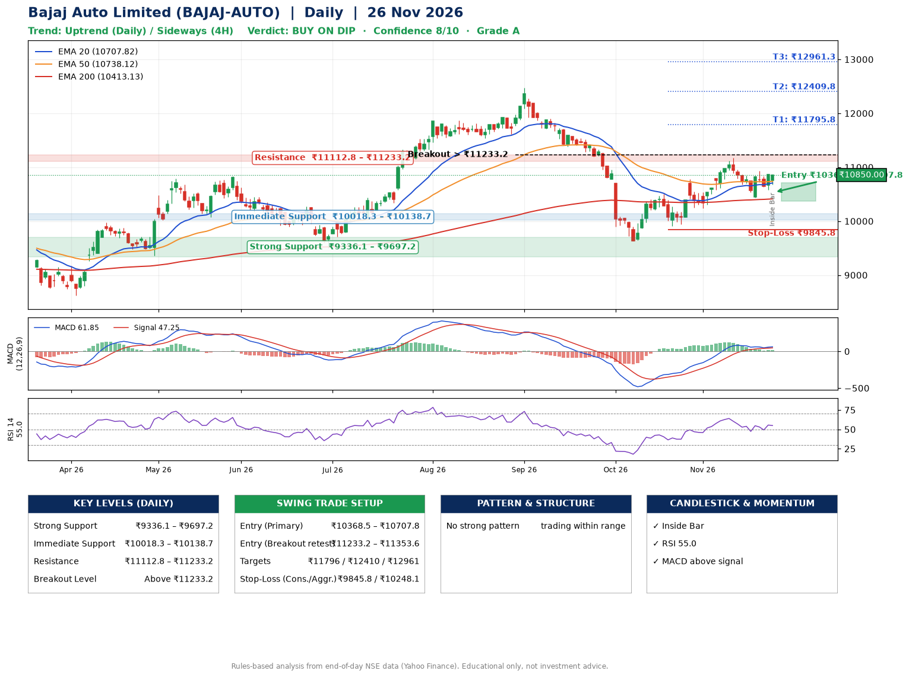

📌 **Bajaj Auto Limited (BAJAJ-AUTO) – Multi-Timeframe Technical Analysis (Daily + 4H Combined)**
_Data up to 26 Nov 2026 · Close ₹10850.00_

**📍 Daily Timeframe Trend**
- Trend: **Uptrend** (higher highs and higher lows)
- Recent swing highs: ₹10499.0, ₹10775.0, ₹11173.0 · swing lows: ₹11618.0, ₹9637.0, ₹9906.0
- EMAs: EMA20 ₹10707.8, EMA50 ₹10738.1, EMA200 ₹10413.1; mixed / crossing; price above EMA20, EMA50, EMA200
- MACD 61.85 above signal 47.25 (above zero); histogram rising
- RSI(14) 55.0; no divergence on the last two swings

**📍 4-Hour Timeframe Trend**
- Structure: **Sideways** (mixed swing structure)
- Pullback/support area: recent 4H swing lows ₹10438.0, ₹10591.0; EMA20 ₹10754.4
- EMA20/50: bullish stack (EMA20 > EMA50); price above EMA20, EMA50
- MACD 37.88 below signal 40.49 (above zero); histogram rising
- RSI(14) 56.5; Hidden bullish divergence

**📍 Pattern Detection (Both Timeframes)**
- 4H: **Double Top** – tops near ₹11169.0/₹10930.0, neckline ₹10438.0, forming

**📍 Candlestick Patterns (last 3 daily candles)**
- **Inside Bar** – 26 Nov: compression inside the prior range ₹10580.0–₹10868.0

**📍 Price Action Key Levels (Daily Structure)**

| Zone | Price Level (₹) | Context |
|------|-----------------|---------|
| Strong Support | ₹9336.1 – ₹9697.2 | Cluster of earlier swing lows (demand) |
| Immediate Support | ₹10018.3 – ₹10138.7 | Nearest swing-low / wick area |
| Resistance | ₹11112.8 – ₹11233.2 | Nearest swing-high supply |
| Breakout Level | Above ₹11233.2 | Swing continuation trigger (52-week high ₹12470.0) |

**📍 Swing Trade Setup**

🟢 **Entry Zone**
- Primary: ₹10368.5 – ₹10707.8 (daily support / EMA20 area; enter on a bullish 4H candle)
- Alternate: ₹11233.2 – ₹11353.6 (breakout retest)

🎯 **Profit Targets**
- T1: ₹11795.8
- T2: ₹12409.8
- T3: ₹12961.3

🛑 **Stop-Loss**
- Conservative: below daily swing low (₹9845.8)
- Aggressive: below 4H structure (₹10248.1)
- Risk per share ≈ ₹692.3; reward:risk to T1 ≈ 1.8
- Time to T1: about 31 trading days (it rose this much within 60 trading days 42% of the time in the last 2 years)
- Time to T2: about 32 trading days (it rose this much within 60 trading days 15% of the time in the last 2 years)

**📌 Strategy Notes**
- Higher timeframe: daily trend is uptrend; only take longs while price holds above ₹9336.1.
- Entry timing: wait for a bullish 4H candle (engulfing/hammer) inside ₹10368.5 – ₹10707.8 rather than buying mid-range.
- EMA stacking: mixed / crossing; price above EMA20, EMA50, EMA200.
- Breakout rule: a daily close above ₹11233.2 with volume above its 20-day average (≈414,820) opens T2/T3.
- Momentum: RSI 55 – room to run; no divergence on the last two swings.
- Exit discipline: move the stop to entry once T1 is hit; book partial profits at each target.

**STEP 2 — Marked Up Chart**

**✅ Trade Validation Checklist**
- Trend + momentum aligned: Yes · Price at entry zone: No
- Stop defined (₹9845.8) · Reward:risk ≥ 1.5 to T1: Yes

## 📌 Final Verdict

Recommendation: **🟡 BUY ON DIP**

Confidence: **8/10**

Trade Quality: **A**

Reason:
• Daily uptrend (higher highs and higher lows)

Next Action:
• Wait for a pullback to ₹10368.5–₹10707.8, or a breakout above ₹11233.2

_Rules-based analysis from end-of-day data. Educational only, not investment advice. Never place orders without your own confirmation._