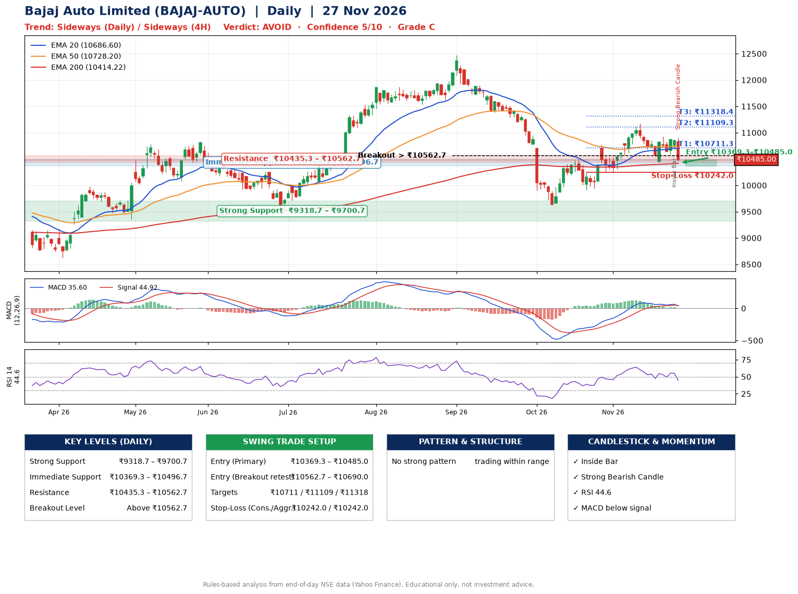

📌 **Bajaj Auto Limited (BAJAJ-AUTO) – Multi-Timeframe Technical Analysis (Daily + 4H Combined)**
_Data up to 27 Nov 2026 · Close ₹10485.00_

**📍 Daily Timeframe Trend**
- Trend: **Sideways** (mixed swing structure)
- Recent swing highs: ₹10499.0, ₹10775.0, ₹11173.0 · swing lows: ₹9637.0, ₹9906.0, ₹10433.0
- EMAs: EMA20 ₹10686.6, EMA50 ₹10728.2, EMA200 ₹10414.2; mixed / crossing; price above EMA200
- MACD 35.60 below signal 44.92 (above zero), fresh bearish crossover; histogram falling
- RSI(14) 44.6; no divergence on the last two swings

**📍 4-Hour Timeframe Trend**
- Structure: **Sideways** (mixed swing structure)
- Pullback/support area: recent 4H swing lows ₹10438.0, ₹10591.0; EMA20 ₹10710.3
- EMA20/50: bullish stack (EMA20 > EMA50); price below all EMAs
- MACD -4.81 below signal 27.59 (below zero); histogram falling
- RSI(14) 40.3; Hidden bullish divergence

**📍 Pattern Detection (Both Timeframes)**
- 4H: **Double Top** – tops near ₹11169.0/₹10930.0, neckline ₹10438.0, forming

**📍 Candlestick Patterns (last 3 daily candles)**
- **Inside Bar** – 26 Nov: compression inside the prior range ₹10580.0–₹10868.0
- **Strong Bearish Candle** – 27 Nov: wide-range red candle, sellers in control

**📍 Price Action Key Levels (Daily Structure)**

| Zone | Price Level (₹) | Context |
|------|-----------------|---------|
| Strong Support | ₹9318.7 – ₹9700.7 | Cluster of earlier swing lows (demand) |
| Immediate Support | ₹10369.3 – ₹10496.7 | Nearest swing-low / wick area |
| Resistance | ₹10435.3 – ₹10562.7 | Nearest swing-high supply |
| Breakout Level | Above ₹10562.7 | Swing continuation trigger (52-week high ₹12470.0) |

**📍 Swing Trade Setup**

🟢 **Entry Zone**
- Primary: ₹10369.3 – ₹10485.0 (daily support / EMA20 area; enter on a bullish 4H candle)
- Alternate: ₹10562.7 – ₹10690.0 (breakout retest)

🎯 **Profit Targets**
- T1: ₹10711.3
- T2: ₹11109.3
- T3: ₹11318.4

🛑 **Stop-Loss**
- Conservative: below daily swing low (₹10242.0)
- Aggressive: below 4H structure (₹10242.0)
- Risk per share ≈ ₹254.6; reward:risk to T1 ≈ 1.1
- Time to T1: about 7 trading days (it rose this much within 60 trading days 91% of the time in the last 2 years)
- Time to T2: about 21 trading days (it rose this much within 60 trading days 76% of the time in the last 2 years)

**📌 Strategy Notes**
- Higher timeframe: daily trend is sideways; only take longs while price holds above ₹9318.7.
- Entry timing: wait for a bullish 4H candle (engulfing/hammer) inside ₹10369.3 – ₹10485.0 rather than buying mid-range.
- EMA stacking: mixed / crossing; price above EMA200.
- Breakout rule: a daily close above ₹10562.7 with volume above its 20-day average (≈391,138) opens T2/T3.
- Momentum: RSI 45 – room to run; no divergence on the last two swings.
- Exit discipline: move the stop to entry once T1 is hit; book partial profits at each target.

**STEP 2 — Marked Up Chart**

**✅ Trade Validation Checklist**
- Trend + momentum aligned: No · Price at entry zone: Yes
- Stop defined (₹10242.0) · Reward:risk ≥ 1.5 to T1: No

## 📌 Final Verdict

Recommendation: **🔴 AVOID**

Confidence: **5/10**

Trade Quality: **C**

Reason:
• No strong edge from trend, momentum or patterns

Next Action:
• Avoid until the trend changes (reclaim EMA50 and a higher low)

_Rules-based analysis from end-of-day data. Educational only, not investment advice. Never place orders without your own confirmation._