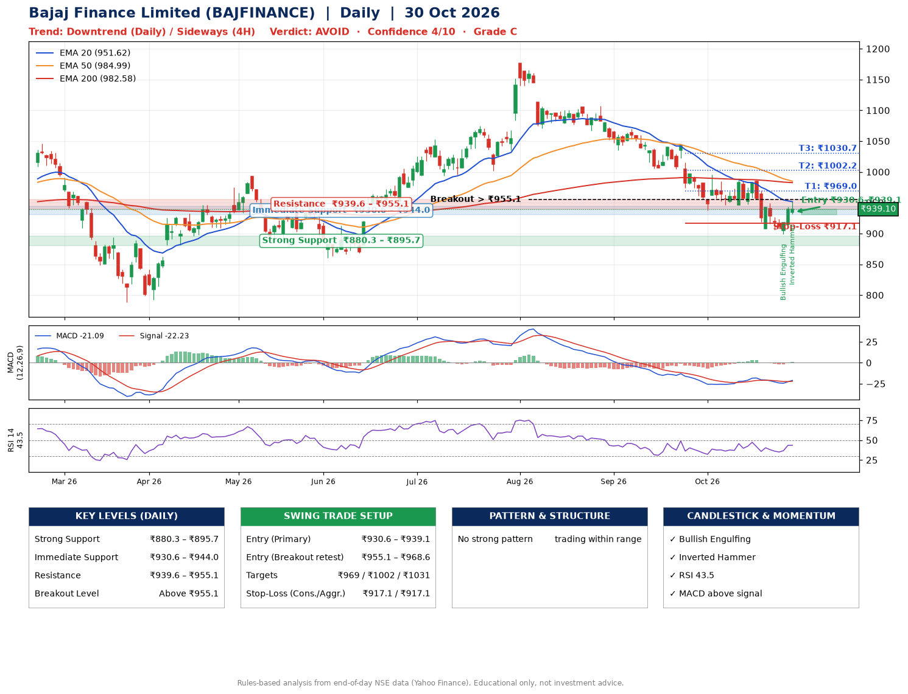

📌 **Bajaj Finance Limited (BAJFINANCE) – Multi-Timeframe Technical Analysis (Daily + 4H Combined)**
_Data up to 30 Oct 2026 · Close ₹939.10_

**📍 Daily Timeframe Trend**
- Trend: **Downtrend** (lower highs and lower lows)
- Recent swing highs: ₹1107.0, ₹1043.2, ₹986.5 · swing lows: ₹1070.8, ₹1034.8, ₹937.3
- EMAs: EMA20 ₹951.6, EMA50 ₹985.0, EMA200 ₹982.6; mixed / crossing; price below all EMAs
- MACD -21.09 above signal -22.23 (below zero), fresh bullish crossover; histogram rising
- RSI(14) 43.5; no divergence on the last two swings

**📍 4-Hour Timeframe Trend**
- Structure: **Sideways** (mixed swing structure)
- Pullback/support area: recent 4H swing lows ₹906.5, ₹900.0; EMA20 ₹940.1
- EMA20/50: bearish stack (EMA20 < EMA50); price above EMA20, EMA50
- MACD -3.38 above signal -9.03 (below zero); histogram rising
- RSI(14) 56.9; Regular bullish divergence

**📍 Pattern Detection (Both Timeframes)**
- No strong pattern detected. Trading within range.

**📍 Candlestick Patterns (last 3 daily candles)**
- **Bullish Engulfing** – 28 Oct: buyers fully reversed the prior red candle
- **Inverted Hammer** – 30 Oct: long upper wick shows selling near ₹952.5

**📍 Price Action Key Levels (Daily Structure)**

| Zone | Price Level (₹) | Context |
|------|-----------------|---------|
| Strong Support | ₹880.3 – ₹895.7 | Cluster of earlier swing lows (demand) |
| Immediate Support | ₹930.6 – ₹944.0 | Nearest swing-low / wick area |
| Resistance | ₹939.6 – ₹955.1 | Nearest swing-high supply |
| Breakout Level | Above ₹955.1 | Swing continuation trigger (52-week high ₹1176.4) |

**📍 Swing Trade Setup**

🟢 **Entry Zone**
- Primary: ₹930.6 – ₹939.1 (daily support / EMA20 area; enter on a bullish 4H candle)
- Alternate: ₹955.1 – ₹968.6 (breakout retest)

🎯 **Profit Targets**
- T1: ₹969.0
- T2: ₹1002.2
- T3: ₹1030.7

🛑 **Stop-Loss**
- Conservative: below daily swing low (₹917.1)
- Aggressive: below 4H structure (₹917.1)
- Risk per share ≈ ₹27.0; reward:risk to T1 ≈ 1.3

**📌 Strategy Notes**
- Higher timeframe: daily trend is downtrend; only take longs while price holds above ₹880.3.
- Entry timing: wait for a bullish 4H candle (engulfing/hammer) inside ₹930.6 – ₹939.1 rather than buying mid-range.
- EMA stacking: mixed / crossing; price below all EMAs.
- Breakout rule: a daily close above ₹955.1 with volume above its 20-day average (≈8,350,531) opens T2/T3.
- Momentum: RSI 43 – room to run; no divergence on the last two swings.
- Exit discipline: move the stop to entry once T1 is hit; book partial profits at each target.

**STEP 2 — Marked Up Chart**

**✅ Trade Validation Checklist**
- Trend + momentum aligned: No · Price at entry zone: Yes
- Stop defined (₹917.1) · Reward:risk ≥ 1.5 to T1: No

## 📌 Final Verdict

Recommendation: **🔴 AVOID**

Confidence: **4/10**

Trade Quality: **C**

Reason:
• Daily downtrend (lower highs and lower lows)

Next Action:
• Avoid until the trend changes (reclaim EMA50 and a higher low)

_Rules-based analysis from end-of-day data. Educational only, not investment advice. Never place orders without your own confirmation._