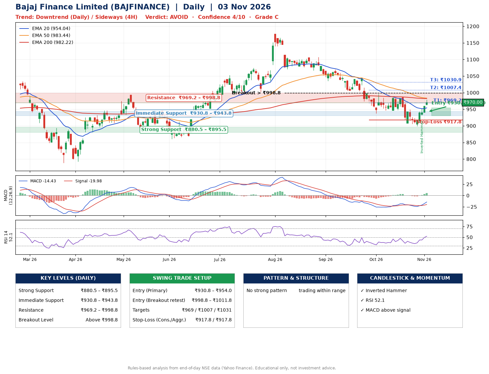

📌 **Bajaj Finance Limited (BAJFINANCE) – Multi-Timeframe Technical Analysis (Daily + 4H Combined)**
_Data up to 03 Nov 2026 · Close ₹970.00_

**📍 Daily Timeframe Trend**
- Trend: **Downtrend** (lower highs and lower lows)
- Recent swing highs: ₹1107.0, ₹1043.2, ₹986.5 · swing lows: ₹1070.8, ₹1034.8, ₹937.3
- EMAs: EMA20 ₹954.0, EMA50 ₹983.4, EMA200 ₹982.2; mixed / crossing; price above EMA20
- MACD -14.43 above signal -19.98 (below zero), fresh bullish crossover; histogram rising
- RSI(14) 52.1; no divergence on the last two swings

**📍 4-Hour Timeframe Trend**
- Structure: **Sideways** (mixed swing structure)
- Pullback/support area: recent 4H swing lows ₹906.5, ₹900.0; EMA20 ₹945.3
- EMA20/50: bearish stack (EMA20 < EMA50); price above EMA20, EMA50
- MACD 1.22 above signal -5.68 (above zero); histogram rising
- RSI(14) 60.6; Regular bullish divergence

**📍 Pattern Detection (Both Timeframes)**
- No strong pattern detected. Trading within range.

**📍 Candlestick Patterns (last 3 daily candles)**
- **Inverted Hammer** – 30 Oct: long upper wick shows selling near ₹952.5

**📍 Price Action Key Levels (Daily Structure)**

| Zone | Price Level (₹) | Context |
|------|-----------------|---------|
| Strong Support | ₹880.5 – ₹895.5 | Cluster of earlier swing lows (demand) |
| Immediate Support | ₹930.8 – ₹943.8 | Nearest swing-low / wick area |
| Resistance | ₹969.2 – ₹998.8 | Nearest swing-high supply |
| Breakout Level | Above ₹998.8 | Swing continuation trigger (52-week high ₹1176.4) |

**📍 Swing Trade Setup**

🟢 **Entry Zone**
- Primary: ₹930.8 – ₹954.0 (daily support / EMA20 area; enter on a bullish 4H candle)
- Alternate: ₹998.8 – ₹1011.8 (breakout retest)

🎯 **Profit Targets**
- T1: ₹969.2
- T2: ₹1007.4
- T3: ₹1030.9

🛑 **Stop-Loss**
- Conservative: below daily swing low (₹917.8)
- Aggressive: below 4H structure (₹917.8)
- Risk per share ≈ ₹26.0; reward:risk to T1 ≈ 1.0

**📌 Strategy Notes**
- Higher timeframe: daily trend is downtrend; only take longs while price holds above ₹880.5.
- Entry timing: wait for a bullish 4H candle (engulfing/hammer) inside ₹930.8 – ₹954.0 rather than buying mid-range.
- EMA stacking: mixed / crossing; price above EMA20.
- Breakout rule: a daily close above ₹998.8 with volume above its 20-day average (≈8,140,257) opens T2/T3.
- Momentum: RSI 52 – room to run; no divergence on the last two swings.
- Exit discipline: move the stop to entry once T1 is hit; book partial profits at each target.

**STEP 2 — Marked Up Chart**

**✅ Trade Validation Checklist**
- Trend + momentum aligned: No · Price at entry zone: No
- Stop defined (₹917.8) · Reward:risk ≥ 1.5 to T1: No

## 📌 Final Verdict

Recommendation: **🔴 AVOID**

Confidence: **4/10**

Trade Quality: **C**

Reason:
• Daily downtrend (lower highs and lower lows)

Next Action:
• Avoid until the trend changes (reclaim EMA50 and a higher low)

_Rules-based analysis from end-of-day data. Educational only, not investment advice. Never place orders without your own confirmation._