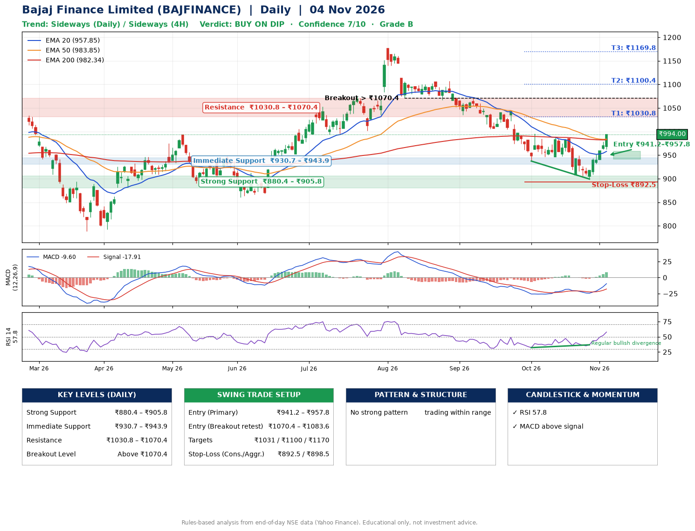

📌 **Bajaj Finance Limited (BAJFINANCE) – Multi-Timeframe Technical Analysis (Daily + 4H Combined)**
_Data up to 04 Nov 2026 · Close ₹994.00_

**📍 Daily Timeframe Trend**
- Trend: **Sideways** (mixed swing structure)
- Recent swing highs: ₹1107.0, ₹1043.2, ₹986.5 · swing lows: ₹1034.8, ₹937.3, ₹899.2
- EMAs: EMA20 ₹957.8, EMA50 ₹983.9, EMA200 ₹982.3; mixed / crossing; price above EMA20, EMA50, EMA200
- MACD -9.60 above signal -17.91 (below zero), fresh bullish crossover; histogram rising
- RSI(14) 57.8; Regular bullish divergence

**📍 4-Hour Timeframe Trend**
- Structure: **Sideways** (mixed swing structure)
- Pullback/support area: recent 4H swing lows ₹906.5, ₹900.0; EMA20 ₹953.5
- EMA20/50: bearish stack (EMA20 < EMA50); price above EMA20, EMA50
- MACD 7.17 above signal -1.51 (above zero); histogram rising
- RSI(14) 67.8; Regular bullish divergence

**📍 Pattern Detection (Both Timeframes)**
- No strong pattern detected. Trading within range.

**📍 Candlestick Patterns (last 3 daily candles)**
- No notable candlestick signal in the last 3 sessions.

**📍 Price Action Key Levels (Daily Structure)**

| Zone | Price Level (₹) | Context |
|------|-----------------|---------|
| Strong Support | ₹880.4 – ₹905.8 | Cluster of earlier swing lows (demand) |
| Immediate Support | ₹930.7 – ₹943.9 | Nearest swing-low / wick area |
| Resistance | ₹1030.8 – ₹1070.4 | Nearest swing-high supply |
| Breakout Level | Above ₹1070.4 | Swing continuation trigger (52-week high ₹1176.4) |

**📍 Swing Trade Setup**

🟢 **Entry Zone**
- Primary: ₹941.2 – ₹957.8 (daily support / EMA20 area; enter on a bullish 4H candle)
- Alternate: ₹1070.4 – ₹1083.6 (breakout retest)

🎯 **Profit Targets**
- T1: ₹1030.8
- T2: ₹1100.4
- T3: ₹1169.8

🛑 **Stop-Loss**
- Conservative: below daily swing low (₹892.5)
- Aggressive: below 4H structure (₹898.5)
- Risk per share ≈ ₹57.0; reward:risk to T1 ≈ 1.4

**📌 Strategy Notes**
- Higher timeframe: daily trend is sideways; only take longs while price holds above ₹880.4.
- Entry timing: wait for a bullish 4H candle (engulfing/hammer) inside ₹941.2 – ₹957.8 rather than buying mid-range.
- EMA stacking: mixed / crossing; price above EMA20, EMA50, EMA200.
- Breakout rule: a daily close above ₹1070.4 with volume above its 20-day average (≈8,641,655) opens T2/T3.
- Momentum: RSI 58 – room to run; Regular bullish divergence.
- Exit discipline: move the stop to entry once T1 is hit; book partial profits at each target.

**STEP 2 — Marked Up Chart**

**✅ Trade Validation Checklist**
- Trend + momentum aligned: No · Price at entry zone: No
- Stop defined (₹892.5) · Reward:risk ≥ 1.5 to T1: No

## 📌 Final Verdict

Recommendation: **🟡 BUY ON DIP**

Confidence: **7/10**

Trade Quality: **B**

Reason:
• No strong edge from trend, momentum or patterns

Next Action:
• Wait for a pullback to ₹941.2–₹957.8

_Rules-based analysis from end-of-day data. Educational only, not investment advice. Never place orders without your own confirmation._