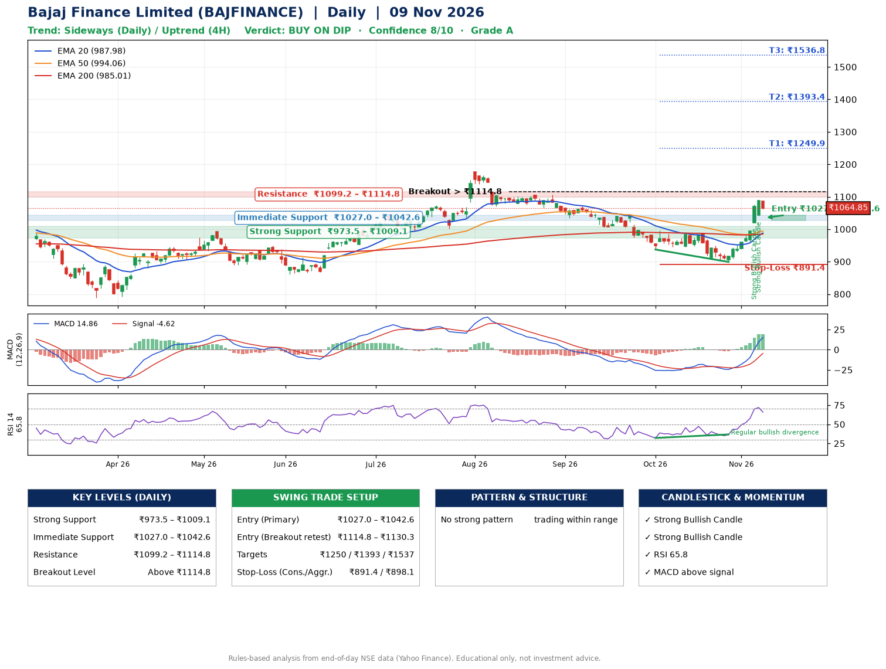

📌 **Bajaj Finance Limited (BAJFINANCE) – Multi-Timeframe Technical Analysis (Daily + 4H Combined)**
_Data up to 09 Nov 2026 · Close ₹1064.85_

**📍 Daily Timeframe Trend**
- Trend: **Sideways** (mixed swing structure)
- Recent swing highs: ₹1107.0, ₹1043.2, ₹986.5 · swing lows: ₹1034.8, ₹937.3, ₹899.2
- EMAs: EMA20 ₹988.0, EMA50 ₹994.1, EMA200 ₹985.0; mixed / crossing; price above EMA20, EMA50, EMA200
- MACD 14.86 above signal -4.62 (above zero); histogram rising
- RSI(14) 65.8; Regular bullish divergence

**📍 4-Hour Timeframe Trend**
- Structure: **Uptrend** (price above rising EMAs)
- Pullback/support area: recent 4H swing lows ₹906.5, ₹900.0; EMA20 ₹1006.0
- EMA20/50: bullish stack (EMA20 > EMA50); price above EMA20, EMA50
- MACD 33.41 above signal 20.73 (above zero); histogram falling
- RSI(14) 70.5; Regular bullish divergence

**📍 Pattern Detection (Both Timeframes)**
- No strong pattern detected. Trading within range.

**📍 Candlestick Patterns (last 3 daily candles)**
- **Strong Bullish Candle** – 05 Nov: wide-range green candle, buyers in control
- **Strong Bullish Candle** – 06 Nov: wide-range green candle, buyers in control

**📍 Price Action Key Levels (Daily Structure)**

| Zone | Price Level (₹) | Context |
|------|-----------------|---------|
| Strong Support | ₹973.5 – ₹1009.1 | Cluster of earlier swing lows (demand) |
| Immediate Support | ₹1027.0 – ₹1042.6 | Nearest swing-low / wick area |
| Resistance | ₹1099.2 – ₹1114.8 | Nearest swing-high supply |
| Breakout Level | Above ₹1114.8 | Swing continuation trigger (52-week high ₹1176.4) |

**📍 Swing Trade Setup**

🟢 **Entry Zone**
- Primary: ₹1027.0 – ₹1042.6 (daily support / EMA20 area; enter on a bullish 4H candle)
- Alternate: ₹1114.8 – ₹1130.3 (breakout retest)

🎯 **Profit Targets**
- T1: ₹1249.9
- T2: ₹1393.4
- T3: ₹1536.8

🛑 **Stop-Loss**
- Conservative: below daily swing low (₹891.4)
- Aggressive: below 4H structure (₹898.1)
- Risk per share ≈ ₹143.4; reward:risk to T1 ≈ 1.5

**📌 Strategy Notes**
- Higher timeframe: daily trend is sideways; only take longs while price holds above ₹973.5.
- Entry timing: wait for a bullish 4H candle (engulfing/hammer) inside ₹1027.0 – ₹1042.6 rather than buying mid-range.
- EMA stacking: mixed / crossing; price above EMA20, EMA50, EMA200.
- Breakout rule: a daily close above ₹1114.8 with volume above its 20-day average (≈9,622,289) opens T2/T3.
- Momentum: RSI 66 – elevated, prefer dips; Regular bullish divergence.
- Exit discipline: move the stop to entry once T1 is hit; book partial profits at each target.

**STEP 2 — Marked Up Chart**

**✅ Trade Validation Checklist**
- Trend + momentum aligned: No · Price at entry zone: No
- Stop defined (₹891.4) · Reward:risk ≥ 1.5 to T1: No

## 📌 Final Verdict

Recommendation: **🟡 BUY ON DIP**

Confidence: **8/10**

Trade Quality: **A**

Reason:
• No strong edge from trend, momentum or patterns

Next Action:
• Wait for a pullback to ₹1027.0–₹1042.6, or a breakout above ₹1114.8

_Rules-based analysis from end-of-day data. Educational only, not investment advice. Never place orders without your own confirmation._