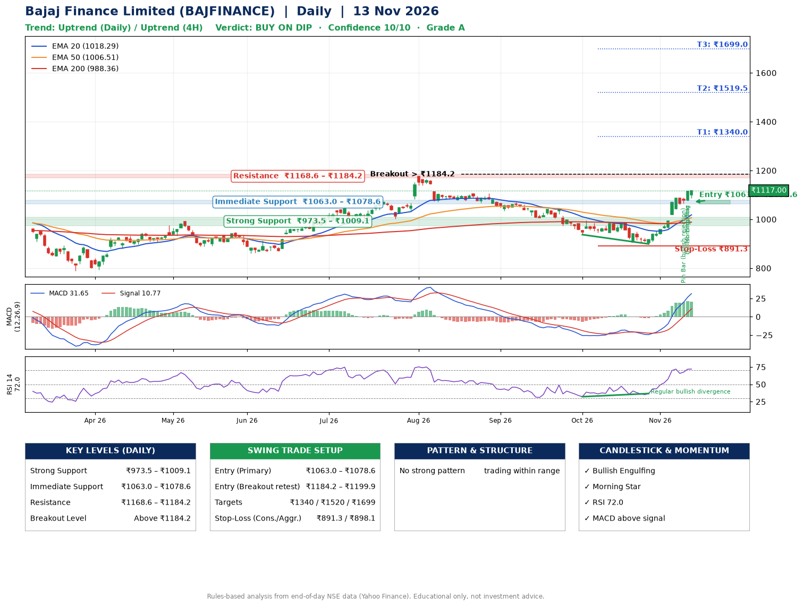

📌 **Bajaj Finance Limited (BAJFINANCE) – Multi-Timeframe Technical Analysis (Daily + 4H Combined)**
_Data up to 13 Nov 2026 · Close ₹1117.00_

**📍 Daily Timeframe Trend**
- Trend: **Uptrend** (price above rising EMAs)
- Recent swing highs: ₹1107.0, ₹1043.2, ₹986.5 · swing lows: ₹1034.8, ₹937.3, ₹899.2
- EMAs: EMA20 ₹1018.3, EMA50 ₹1006.5, EMA200 ₹988.4; bullish stack (EMA20 > EMA50 > EMA200); price above EMA20, EMA50, EMA200
- MACD 31.65 above signal 10.77 (above zero); histogram falling
- RSI(14) 72.0; Regular bullish divergence

**📍 4-Hour Timeframe Trend**
- Structure: **Uptrend** (price above rising EMAs)
- Pullback/support area: recent 4H swing lows ₹906.5, ₹900.0; EMA20 ₹1049.2
- EMA20/50: bullish stack (EMA20 > EMA50); price above EMA20, EMA50
- MACD 41.27 above signal 34.25 (above zero); histogram falling
- RSI(14) 75.5; Regular bullish divergence

**📍 Pattern Detection (Both Timeframes)**
- 4H: **Bull Flag** – 16% pole then a tight 5% flag; trigger above ₹1118.0

**📍 Candlestick Patterns (last 3 daily candles)**
- **Pin Bar (bullish rejection)** – 11 Nov: long lower wick shows dip-buying near ₹1065.0
- **Bullish Engulfing** – 12 Nov: buyers fully reversed the prior red candle
- **Morning Star** – 12 Nov: three-candle bullish reversal

**📍 Price Action Key Levels (Daily Structure)**

| Zone | Price Level (₹) | Context |
|------|-----------------|---------|
| Strong Support | ₹973.5 – ₹1009.1 | Cluster of earlier swing lows (demand) |
| Immediate Support | ₹1063.0 – ₹1078.6 | Nearest swing-low / wick area |
| Resistance | ₹1168.6 – ₹1184.2 | Nearest swing-high supply |
| Breakout Level | Above ₹1184.2 | Swing continuation trigger (52-week high ₹1176.4) |

**📍 Swing Trade Setup**

🟢 **Entry Zone**
- Primary: ₹1063.0 – ₹1078.6 (daily support / EMA20 area; enter on a bullish 4H candle)
- Alternate: ₹1184.2 – ₹1199.9 (breakout retest)

🎯 **Profit Targets**
- T1: ₹1340.0
- T2: ₹1519.5
- T3: ₹1699.0

🛑 **Stop-Loss**
- Conservative: below daily swing low (₹891.3)
- Aggressive: below 4H structure (₹898.1)
- Risk per share ≈ ₹179.5; reward:risk to T1 ≈ 1.5
- Time to T1: about 46 trading days (it rose this much within 60 trading days 19% of the time in the last 2 years)
- Time to T2: it never rose this much within 60 trading days in the price history

**📌 Strategy Notes**
- Higher timeframe: daily trend is uptrend; only take longs while price holds above ₹973.5.
- Entry timing: wait for a bullish 4H candle (engulfing/hammer) inside ₹1063.0 – ₹1078.6 rather than buying mid-range.
- EMA stacking: bullish stack (EMA20 > EMA50 > EMA200); price above EMA20, EMA50, EMA200.
- Breakout rule: a daily close above ₹1184.2 with volume above its 20-day average (≈10,287,647) opens T2/T3.
- Momentum: RSI 72 – elevated, prefer dips; Regular bullish divergence.
- Exit discipline: move the stop to entry once T1 is hit; book partial profits at each target.

**STEP 2 — Marked Up Chart**

**✅ Trade Validation Checklist**
- Trend + momentum aligned: Yes · Price at entry zone: No
- Stop defined (₹891.3) · Reward:risk ≥ 1.5 to T1: No

## 📌 Final Verdict

Recommendation: **🟡 BUY ON DIP**

Confidence: **10/10**

Trade Quality: **A**

Reason:
• Daily uptrend (price above rising EMAs)
• EMAs stacked bullishly

Next Action:
• Wait for a pullback to ₹1063.0–₹1078.6

_Rules-based analysis from end-of-day data. Educational only, not investment advice. Never place orders without your own confirmation._